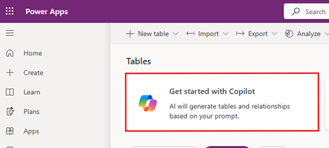
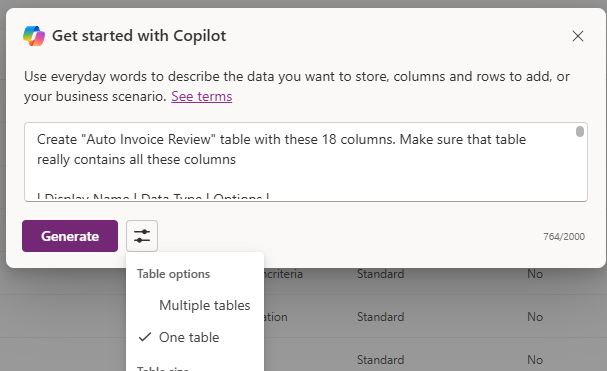
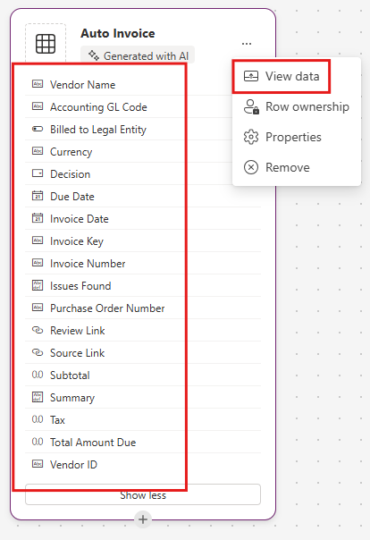
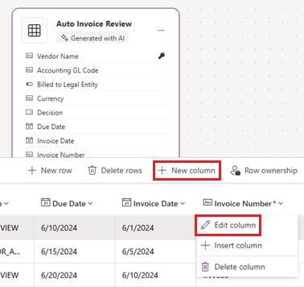
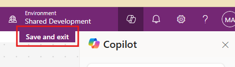

# Build Prompt — Copilot: Dataverse Table

Use **Get started with Copilot** in the **Tables** area of [make.powerapps.com](https://make.powerapps.com/) to create the **Auto Invoice Review** Dataverse table in the **Autonomous Invoice Orchestration** solution. AI builds the table, but it can skip or change columns. This page therefore covers how to remove the sample rows that Copilot adds, what to check afterwards, how to add or change a column by hand. The same solution is later used for the agent and the workflow.

If you prefer to build the table by hand, create the solution first, with your organization's publisher, and set it as your preferred solution (see Step 1-1 of the [Runbook](../../3.Runbook.md#step-1-1-create-the-dataverse-solution-and-table)) and add the table and columns from the [data model](../Capability-matrix.md#dataverse-data-model).

## Copy-ready Copilot prompt

```text
Create "Auto Invoice Review" table with these 18 columns. Make sure that table really contains all these columns

| Display Name | Data Type | Options |
| --- | --- | --- |
| Accounting GL Code | Text | 100 |
| Billed to Legal Entity | Boolean | — |
| Currency | Text | 100 |
| Decision | Choice | NEEDS_REVIEW, READY_FOR_APPROVAL |
| Due Date | Date Only | — |
| Invoice Date | Date Only | — |
| Invoice Key | Text | 850 |
| Invoice Number | Text | 100 |
| Issues Found | Multiline Text | — |
| Purchase Order Number | Text | 100 |
| Review Link | URL | 200 |
| Source Link | URL | 200 |
| Subtotal | Decimal | — |
| Summary | Multiline Text | 2000 |
| Tax | Decimal | — |
| Total Amount Due | Decimal | — |
| Vendor ID | Text | 100 |
| Vendor Name | Text | 100 |
```

The prompt asks for 18 columns. It does not list a GUID column, because Dataverse creates the row ID itself as the table's native primary key. The scenario calls that value the **Auto Invoice Review ID**, and it is checked separately in [Check the table](#check-the-table).

## Create the table with Copilot

### Run the prompt

1. Select **Tables** in the left menu. If the **Get started with Copilot** card is not shown, select **New table** on the command bar and choose the option that starts with Copilot.

   

2. In the **Table options** menu of the prompt box, set the number of tables to **One table** and paste the prompt from [Copy-ready Copilot prompt](#copy-ready-copilot-prompt) and submit it.
   
   

3. Copilot opens the **Create new tables** workspace.
   
4. In the workspace, select **Auto Invoice Review** table and expand it to show all columns. Compare the list with the red box in the screenshot below: one table, 18 columns, and no separate **Name** column. If there is more than one table, select **...** on the extra card and then **Remove**.
   
   

   | # | Display Name | Expected data type | Expected setting |
   |---|---|---|---|
   | 1 | Accounting GL Code | Text | Maximum length 100 |
   | 2 | Billed to Legal Entity | Yes/No | Two options |
   | 3 | Currency | Text | Maximum length 100 |
   | 4 | Decision | Choice | Exactly two options, `NEEDS_REVIEW` and `READY_FOR_APPROVAL`, written with underscores. No default value |
   | 5 | Due Date | Date | Behavior **Date Only**, not Date and Time |
   | 6 | Invoice Date | Date | Behavior **Date Only**, not Date and Time |
   | 7 | Invoice Key | Text | Maximum length 850 |
   | 8 | Invoice Number | Text | Maximum length 100 |
   | 9 | Issues Found | Multiline text | Maximum length at least 4000. Raise it if it is smaller, because a list of issues can be long |
   | 10 | Purchase Order Number | Text | Maximum length 100 |
   | 11 | Review Link | URL | Maximum length 200 |
   | 12 | Source Link | URL | Maximum length 200 |
   | 13 | Subtotal | Decimal number | Precision 2. Not Currency or Floating point |
   | 14 | Summary | Multiline text | Maximum length 2000 |
   | 15 | Tax | Decimal number | Precision 2. Not Currency or Floating point |
   | 16 | Total Amount Due | Decimal number | Precision 2. Not Currency or Floating point |
   | 17 | Vendor ID | Text | Maximum length 100 |
   | 18 | Vendor Name | Text | Maximum length 100 |

   <br>
    5. If a column is missing or wrong, do not send Copilot another prompt, because it can rename or drop other columns. You can add and edit columns before saving. NOTE! You can change column max characters limit here that need to be done after table is saved
   
   

   

### Delete the sample rows

Copilot adds sample rows to the table. Delete all of them before the agent runs. Otherwise they pollute duplicate detection, reports and the first test, which expects an empty table.

1. On the **Auto Invoice** card, select **...** and then **View data**. The first screenshot above shows this menu.
2. The grid lists the sample rows. In the screenshot below, they are five rows with GL codes **GL100** to **GL500**. Write down every column header that shows a red `*`, which means business required. [Check 2](#check-2-no-column-is-required) clears them.
3. Select the circle in the header row to select all rows, then select **Delete rows** and confirm.

   

4. Reopen **View data**. Only the empty line with **Enter text** may remain. Do not type into it.


### Save the table and confirm the solution

1. Select **Save and exit**.
   
   

2. Open **Solutions** > **Autonomous Invoice Orchestration** and confirm that the **Auto Invoice Review** table is listed. If it is not, it was created in a default solution. In **Autonomous Invoice Orchestration** select **Add existing** > **Table**, choose **Auto Invoice** and select **Add**. If the command bar offers **Publish all customizations**, select it.
   
3. Open **Columns** of the table


## Schema handoff for the next steps

After saving, record in the delivery record:

- Environment ID and URL, solution display name and unique name, publisher and prefix.
- The table's logical name, entity set name and each column's logical name (the publisher prefix is added to custom columns).
- The primary key, the primary name column from Check 3, the Date Only behavior, the choice option values and numeric values, and the actual length chosen for **Issues Found**.
- Whether any column still shows a red `*` and why.
- Whether the **Billed to Legal Entity** column can be stored as empty in this environment.

Confirm that the schema matches the [Dataverse data model](../Capability-matrix.md#dataverse-data-model), that the table has no rows, and that no app, flow, site or agent was created in this stage.

## Official guidance

- [Create tables with Copilot (Start with Copilot) and set table properties](https://learn.microsoft.com/en-us/power-apps/maker/data-platform/create-edit-entities-portal).
- [Review the generated tables, view their data and remove rows](https://learn.microsoft.com/en-us/power-apps/maker/canvas-apps/ai-conversations-create-app).
- [Solution display name, unique name and publisher](https://learn.microsoft.com/en-us/power-apps/maker/data-platform/create-solution).
- [Set and verify the maker's preferred solution](https://learn.microsoft.com/en-us/power-apps/maker/data-platform/preferred-solution).
- [Create and edit columns, including the Required setting](https://learn.microsoft.com/en-us/power-apps/maker/data-platform/data-platform-manage-fields).
- [Date and time column behavior](https://learn.microsoft.com/en-us/power-apps/maker/data-platform/behavior-format-date-time-field).
