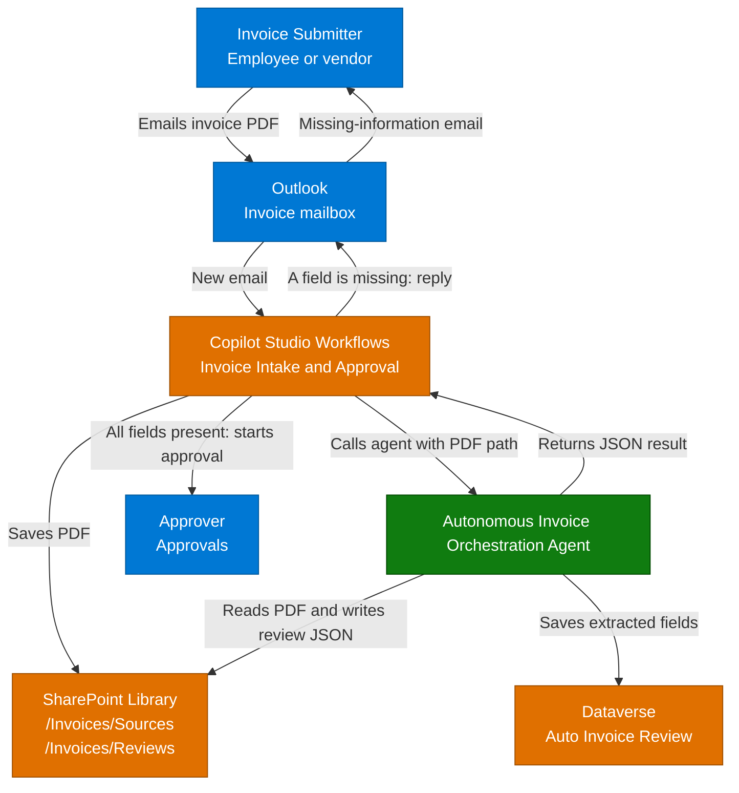

**1. Overview** > [2. Architecture](2.Architecture.md) > [3. Runbook](3.Runbook.md) > [4. Sample Prompts](4.Sample-prompts.md)

# Autonomous Invoice Orchestration Agent — Overview

## Scenario Overview

**Scenario Type**: Invoice Processing and Approval (Accounts Payable)  
**Harness**: GitHub Copilot 
**Agent Type**: Autonomous agent called by one Workflows email trigger, with no end-user chat channel 
**Primary Tools**: Microsoft Copilot Studio, Workflows, Outlook, SharePoint, Microsoft Dataverse, Approvals 
**Complexity**: Advanced 
**Status**: 📝 Draft

This scenario describes an **Autonomous Invoice Orchestration Agent** that turns invoices arriving by email into structured, approvable records. When an email with a PDF invoice arrives in a designated mailbox, one workflow saves the PDF to a SharePoint document library and calls the agent with the PDF's full path. The agent reads the invoice, saves the extracted fields to a Dataverse table and to a JSON review file in the same library, and returns the fields to the workflow. The workflow starts an approval when every field has a value. If even one value is missing, it emails the sender about the missing information.

The standard configuration has one agent and one workflow. The supplied artifacts are documentation, a data model, runtime skill definitions and two synthetic sample invoices, not a deployed agent. During setup, operators build the Dataverse table, the SharePoint folders, the agent and the workflow, and keep the workflow turned off until the pilot is approved. See the [release gates](0.Resources/README.md#release-gates).

---

## Problem Statement

Accounts payable teams receive invoices as PDF attachments in shared mailboxes. Someone opens each email, saves the file, retypes vendor, invoice, amount and accounting details into a system, checks them and forwards the result for approval. Missing details, such as a purchase order number, are found late and chased by hand.

Without a clear process:

- Invoices wait in mailboxes, and retyped data contains mistakes.
- Original files, extracted data and the approval are not linked, so audits are slow.
- The same invoice can be processed twice.
- Incomplete invoices reach approvers, and senders are not told what is missing.
- An automated assistant that reads untrusted PDFs could be misled by text inside them, or act without limits.

---

## Solution Summary

The **Autonomous Invoice Orchestration Agent** reads one saved PDF at a time and records what it finds. Its two skills extract and check the fields, save a row in the **Auto Invoice Review** Dataverse table and write a review JSON file. A single workflow, **Invoice Intake and Approval**, surrounds the agent. It receives the email, saves the PDF to `/Invoices/Sources`, calls the agent, decides from the returned JSON whether every field has a value, and then starts an approval or replies to the sender.

The workflow, not the agent, makes the completeness decision, starts the approval and sends the reply. The agent has no email or approval tool. Every PDF is treated as untrusted data, and the agent writes only to the Dataverse table and to `/Invoices/Reviews`. There is no human approval of the intake itself. A person approves each invoice that is complete.

### Key Capabilities

| Capability | Description |
|---|---|
| Invoice capture | The workflow saves each PDF attachment to `/Invoices/Sources` and passes its full path and link, with the email subject and sender, to the agent |
| Invoice extraction and record | `invoice-extraction-review` reads the invoice from the saved PDF or a SharePoint link, creates the Source Link, extracts 11 fields, works out Issues Found, a Summary and a Decision, and saves one row in the **Auto Invoice Review** table |
| Review JSON file | `save-invoice-json-to-sharepoint` writes the extracted fields and the email details to a JSON file in `/Invoices/Reviews` and stores the file's sharing link in the row's Review Link |
| Completeness check | The workflow checks the returned JSON. The Decision must be `READY_FOR_APPROVAL`, Issues must be empty and every other key must have a value |
| Approval | When every field has a value, the workflow starts an approval with the fields, issues and links |
| Missing-information reply | When a field is missing, the workflow replies to the sender and lists what is missing |

## How It Works

A submitter emails an invoice PDF to the designated mailbox. The workflow saves each PDF and calls the agent, which reads the saved file and writes the Dataverse row and the review JSON. The agent returns the extracted fields as JSON. If all fields have values, the workflow starts an approval for the approver. If one value is missing, the workflow replies to the sender, and the stored row is marked `NEEDS_REVIEW`.

This is the documented flow, not a deployed integration. Identity, delivery and operational limitations are in [Architecture](2.Architecture.md) and the [capability matrix](0.Resources/Capability-matrix.md).

---

## Business Outcomes

| Outcome | Description |
|---|---|
| ⏱️ Faster invoice intake | Measure time from email arrival to a stored, reviewed record against a pre-pilot baseline |
| 🎯 Consistent data capture | Measure extraction accuracy for each field against the PDF, with separate rates for missing and wrong values |
| ✅ Complete invoices at approval | Track the share of approvals that start with every field present, and the share returned to senders |
| 📬 Clear feedback to senders | Measure how often a missing-information reply leads to a corrected invoice, and how long that takes |
| 🔍 Traceable records | Check that the original PDF, the JSON review file, the Dataverse row and the approval can be linked to each other |
| 🔁 Less re-keying | Track how many invoices reach an approval without anyone typing the fields again, and how many extra rows need cleaning up |
| 💳 Controlled adoption | Track Copilot Credits per processed invoice, failed runs and manual follow-up before wider use |

These are target outcomes and measures, not observed improvements or a guarantee of error-free extraction.

---

## Target Users

| Persona | Role in This Scenario |
|---|---|
| **Invoice Submitters (employees and vendors)** | Email invoices to the mailbox and receive a reply if information is missing |
| **Approvers (AP/Finance approvers)** | Review the extracted fields, issues and the source PDF in the approval, then approve or reject |
| **AP/Finance Team** | Owns the mailbox and the follow-up for failed or unclear invoices |
| **Finance Operations / Reporting** | Uses the Dataverse table and the review files for reporting and audit |
| **System Admins / Power Platform Engineers** | Build and test the table, agent, workflow and connections, and monitor failed runs |
| **Solution Owner / Business Stakeholders** | Approve the pilot scope, retention, release evidence, cost and rollback |

---

## In Scope / Out of Scope

### ✅ In Scope

- One workflow that starts when a new email arrives in the designated mailbox and keeps only PDF attachments.
- Saving each PDF to the SharePoint document library folder `/Invoices/Sources`.
- Calling the Autonomous Invoice Orchestration Agent through the Workflows Agent node with the full path and link of the PDF and the email subject and sender.
- Extracting invoice fields from the PDF and saving them to the **Auto Invoice Review** Dataverse table, with Decision `NEEDS_REVIEW` or `READY_FOR_APPROVAL`.
- Saving the extracted fields as a JSON file in `/Invoices/Reviews` and returning the key fields to the workflow as JSON.
- A deterministic completeness check in the workflow. An approval starts when the Decision is `READY_FOR_APPROVAL`, Issues is empty and every other key has a value.
- A reply to the sender that lists the missing information when any value is missing.
- Preview and Evaluate acceptance cases, controlled publishing and rollback.

### ❌ Out of Scope

- Payment, posting to an accounting or ERP system, vendor onboarding and vendor master data changes.
- Outcome emails after an approval, reminders and escalation of approvals.
- Invoices that are not PDFs, such as images, Word files or links to portals.
- Interactive chat with the agent in production, and Teams or Microsoft 365 Copilot channels. The Preview chat is used only for testing.
- Duplicate detection, so a resubmitted invoice creates another row and another review file.
- Checks that the amounts add up or that the bill-to is an approved legal entity, and automatic correction of wrong values that are present.
- Bank account details, sensitive personal data and real invoices before the pilot is approved.
- Guaranteed accuracy on scanned or handwritten invoices.
- A production-ready tenant deployment.

When the agent returns something that is not the expected JSON, or a complete invoice comes back without a source link or a review link, the workflow ends the run as failed so that the run history shows it. The agent does not invent a value, a link or a successful write.

Runtime definitions: [Skill index](0.Resources/Skills/README.md).

---

## Related Resources

| Resource | Link |
|---|---|
| Architecture | [Architecture](2.Architecture.md) |
| Step-by-Step Runbook | [Runbook](3.Runbook.md) |
| Sample Prompts | [Prompts](4.Sample-prompts.md) |
| Capability and Integration Contracts | [Capability matrix](0.Resources/Capability-matrix.md) |
