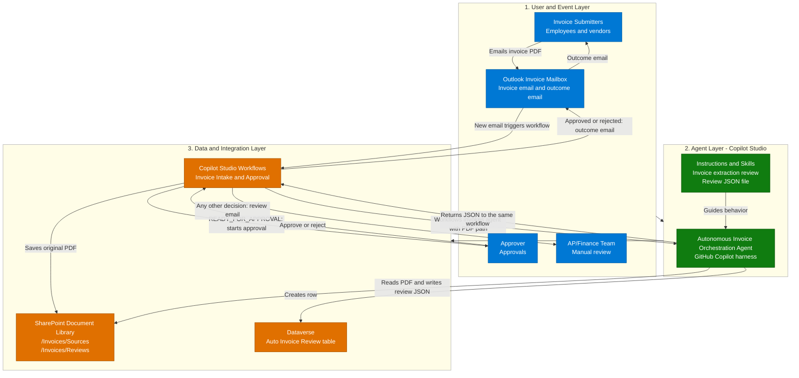
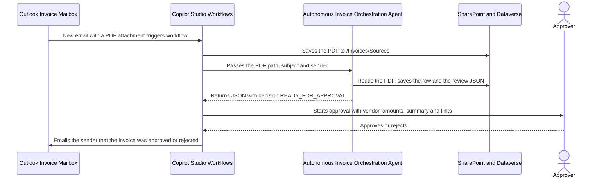
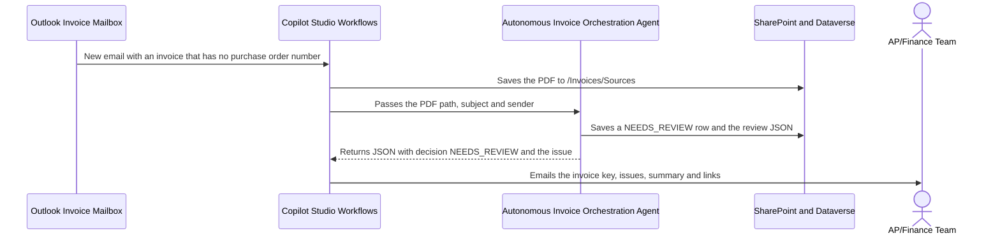

[1. Overview](1.Overview.md) > **2. Architecture** > [3. Runbook](3.Runbook.md) > [4. Sample Prompts](4.Sample-prompts.md)

# Autonomous Invoice Orchestration Agent — Architecture

## 1. Logical Architecture

The three layers are the submitters, mailbox and approver at the edge, the Copilot Studio GitHub Copilot agent, and the workflow, document library and Dataverse table that the agent and the workflow use. The agent is not a chat agent. It has no end-user channel and is called only by one workflow.

One configuration includes the workflow **Invoice Intake and Approval** and the two skills. Operators build the Dataverse table, the SharePoint folders, the agent and the workflow in the tenant. The workflow owns the trigger, the environment variables, the saved original, the decision check, the approval and the emails to Finance and to the sender. The agent owns reading the PDF and writing the Dataverse row and the review JSON file. No custom backend is required or supplied.

### How It Works

The diagram summarizes the layers. The path is **submitter → Outlook invoice mailbox → Workflows → Autonomous Invoice Orchestration Agent → the same Workflows instance → approval, Finance email and outcome email**. One workflow owns the trigger, the agent call, the decision check and every outcome. The agent returns JSON. It does not send email, start an approval or invoke a second workflow. The agent reaches SharePoint and Dataverse through its own tools, and the workflow reaches them through its own connectors. Both write only to the folders and the table named in the [capability matrix](0.Resources/Capability-matrix.md#agent-tool-contracts).

---

## 2. Key Components

| Component | Technology | Role |
|---|---|---|
| Event entry | Office 365 Outlook **When a new email arrives** in Copilot Studio Workflows | Starts the workflow for each email with attachments in the invoice mailbox. The mailbox and the identity are configured during setup |
| Workflow | Copilot Studio Workflows, **Invoice Intake and Approval** | Created by Copilot from the prompt in [Step 2-3 of the Runbook](3.Runbook.md#step-2-3-build-the-workflow-invoice-intake-and-approval). Reads the environment variables, saves each PDF, calls the agent, checks the returned decision, then starts the approval or emails Finance, and emails the sender the approval outcome. It is the only workflow |
| Settings | Power Platform environment variables | `SharePointSiteURL`, `SourceFolderPath`, `Approvers` and `FinanceEmailAddress` are read by the workflow by display name. The agent's review-file skill reads `SharePointSiteURL` and `ReviewsFolderPath` |
| Agent call | Workflows Agent node `InvoiceExtractionAgent`, **An existing agent** | Calls the published Autonomous Invoice Orchestration Agent with the PDF path, the email subject and the sender, and waits for its `result` as custom structured output |
| Agent runtime | Copilot Studio GitHub Copilot harness | Reads and reasons over the invoice and follows the skill procedures. It is not Copilot CLI or a Copilot SDK host |
| Skills | Two standalone definitions | `invoice-extraction-review` (extraction, checks and the Dataverse row) and `save-invoice-json-to-sharepoint` (review JSON and Review Link). Each skill is one capability |
| Agent tools | SharePoint MCP, Dataverse MCP and the `CreateSharingLink` tool in the agent | Read a file from its link, create a view-only sharing link, create and update rows on one table, read the environment variables and create a file in `/Invoices/Reviews` |
| Document library | SharePoint document library | Holds the original PDFs in `/Invoices/Sources` and the review JSON files in `/Invoices/Reviews` |
| Data store | Dataverse table **Auto Invoice Review** | One row per run with the 18 columns and the native row ID defined in the [data model](0.Resources/Capability-matrix.md#dataverse-data-model) |
| Approval | Approvals connector **Start and wait for an approval** in Workflows | Sends the vendor, amounts, summary and links to the approver in the `Approvers` value and records the outcome |
| Emails | Office 365 Outlook **Send an email** in Workflows | Sends the manual review email to the `FinanceEmailAddress` value and, after the approval, the approved or rejected email to the sender, once per PDF |
| Monitoring | Workflow run history, agent run history, approval records and the mailbox | Operators inspect failures and uncertain outcomes. No custom queue or status API exists |

### Capability Design

| Capability | Component | Behavior and controls |
|---|---|---|
| Invoice capture | Workflow trigger, environment variables and SharePoint **Create file** | Keeps PDF attachments only, saves each under its attachment name in `/Invoices/Sources`, and passes the full path, the email subject and the sender to the agent. A missing environment variable fails the run before anything is saved. A message without a PDF ends the run with no email |
| Invoice extraction and record | `invoice-extraction-review` | Reads the invoice from a chat attachment or a SharePoint link, creates a sharing link for the Source Link, extracts 11 fields and leaves a missing field empty. Derives Issues Found, a Summary and a Decision (`READY_FOR_APPROVAL` only when all 11 are found) and creates one row in the Auto Invoice Review table |
| Review JSON file | `save-invoice-json-to-sharepoint` | Runs only when the prompt carries the email subject, sender, PDF path and PDF link. Reads the site and folder from environment variables, writes an 18-key JSON file to the Reviews folder and stores its sharing link in the row's Review Link |
| Decision check | Workflow condition | Applies the [decision rule](0.Resources/Capability-matrix.md#decision-rule) to the returned `decision`. Only `READY_FOR_APPROVAL` continues to the approval. The skill sets it only when all 11 invoice fields were found. The workflow, not the agent, decides who is notified |
| Approval | Workflow Approvals action | Starts only for `READY_FOR_APPROVAL`. The approver sees the vendor, total amount due, dates, summary and links to the source PDF and the review package |
| Manual review email | Workflow Outlook send action | Emails the Finance team the invoice key, vendor, decision, issues, summary and the two links. The sender is not told, and Finance follows up |
| Outcome email | Workflow if/else and Outlook send action | After the approval, a three-branch check (Approved, Rejected, Other) emails the sender that the invoice was approved or rejected, with the links. The Other branch sends nothing |
| Failure follow-up | Workflow owner | A missing environment variable or a failed step ends the run as failed. The owner inspects run history and handles the invoice manually. The workflow does not check the source or review link |

The design uses one agent and one workflow. No connected agent, ERP feed, payment system or general mailbox search is needed.

### Capabilities and Workflow Configuration

The [matrix](0.Resources/Capability-matrix.md) records the agent's tools, the nine workflow steps, the JSON response contract, the decision rule and the data model. The agent's tools are configured in **Build > Tools**. Outlook, SharePoint save and Approvals operations belong to the workflow, not to the agent.

The [Workflows Agent-node guidance](https://learn.microsoft.com/en-us/microsoft-copilot-studio/workflows-experience/agent-node-workflow) documents selecting an existing published agent and using its response in the workflow. Before the workflow is turned on, operators verify the selected agent and version, the output form (custom structured output), the effective identity of the agent's tool connections, and that the harness reads the PDF content returned by the SharePoint tool. [Resources](0.Resources/README.md#release-gates) lists these checks as release gates.

---

## 3. Data Flow

### Scenario A — Ready for Approval and Outcome Email

This is the routine path. The workflow starts the approval only when the agent set Decision to `READY_FOR_APPROVAL`. After the approver answers, the workflow emails the sender the outcome. An outcome other than approve or reject sends no email. The workflow does not pay the invoice.

### Scenario B — Missing Information and Manual Review

This diagram shows the missing-information path. No approval starts and the sender is not emailed. The row stays in Dataverse with Decision `NEEDS_REVIEW`, and Finance follows up with the sender. A corrected invoice is processed as a new email. Nothing looks for the earlier row, so the corrected invoice creates another row and another review file.

Other outcomes are summarized here. An environment variable with no value ends the run as failed before anything is saved. A failed agent step ends the run as failed or takes the manual review path with blank values, which is a release gate, and leaves the saved PDF and any rows or files already written. An email with no PDF attachment ends the run with no saved file and no email. See the [outcome handling](0.Resources/Capability-matrix.md#outcome-handling), the [limitations](0.Resources/Capability-matrix.md#limitations-and-operational-ownership) and the [Runbook](3.Runbook.md).

---

## 4. Security & Governance Considerations

| Area | Consideration |
|---|---|
| Identity | The agent's SharePoint and Dataverse connections use a dedicated service account, not a maker's personal account and not the email sender. Whether workflow-invoked runs use that connection is a release gate. The workflow's Outlook, SharePoint and Approvals connections are owned and reviewed separately |
| Access control | Table scope and connection permissions limit what the agent can write. The agent's account has read rights on the Invoices library, contribute rights on `/Invoices/Reviews` only and create, read and write rights on one table. These limits do not rely on instructions alone, because the skills do not check paths |
| Untrusted input | Email text and PDF content are data. The agent receives only the PDF path that the workflow built, plus the email subject and sender as data. It never receives the email body. Text in a PDF that tries to give instructions is ignored and recorded as an issue. Values extracted from a PDF appear in the approval and in the emails, so Finance and the approver compare them with the source PDF |
| Authorization and writes | The agent has no email, approval or second-workflow tool. The workflow decides the approval and the emails from the returned decision. A person approves each invoice that is ready for approval, and no payment is made |
| Reliability | The attachment keeps its own file name, so a repeated attachment name can collide in the library. There is no duplicate detection, so a repeated invoice or a trigger that fires twice for one email can create a second row and a second review file. A partial failure ends the run as failed and leaves what was already written |
| Data handling | Invoices hold vendor, amount and tax business data. Limit access to the mailbox, the library, the table and the run histories, and set retention for originals, reviews and rows. Keep memory and unrelated personal-context retrieval off |
| Deployment | Use a dedicated mailbox and an optional sender allowlist. Verify the tenant, model, credits and Approvals availability, then pilot with synthetic invoices before real ones |
| Disablement | Turn off the workflow first. Then remove the agent's tool exposure or unpublish the agent. Removing a skill does not revoke tool permissions. Keep written files and rows |

### Identity, Permissions and Data Handling

**Mailbox identity:** the Outlook trigger and the send actions use the connection of the account that owns the invoice mailbox. Verify the monitored folder and the sending rights. Receiving mail does not automatically grant the right to send, and a shared mailbox needs its own address set in the send action.

**Agent identity:** the SharePoint and Dataverse tools run under the connection configured for the agent. Grant that account only the rights listed above. A write by the agent is therefore limited by the account, not by a prompt.

**Workflow identity:** the workflow saves the original PDF, starts the approval and sends the emails under its own connections. The approval and the emails use values extracted from an untrusted PDF, so the approver assignment and the Finance address come from environment variables and are never taken from the PDF, and the approver compares the values with the source PDF.

**Sender identity:** a sender's display name can be forged, and the approved or rejected email goes to the sender of the received message. The approver gets the link to the source PDF. A sender allowlist and the mailbox's own anti-spoofing controls are the first line of defense.

### Reliability and Deployment Boundaries

| Concern | Current limitation / operator action |
|---|---|
| Duplicate triggers | The attachment name is reused, so a second save may fail, overwrite or get a new name, which is a release gate. Nothing prevents a second row. Inspect the run history if an email shows two runs and delete the extra row |
| Loops and bounces | Add a trigger filter that excludes mail sent by the mailbox itself. The workflow sends emails to Finance and to the sender only when a PDF was processed. Review auto-responders, which can start a mail loop |
| Rate limits and concurrency | Check the concurrency setting of the attachment loop. Inspect connector throttling and retries. No custom rate limiter or queue exists |
| Unreadable invoices | The agent saves a `NEEDS_REVIEW` row with issues, and the workflow emails Finance. A failed agent step fails the run or takes the manual review path, which is a release gate. Missing values are never filled in |
| Wrong values that are present | The decision check finds only missing values. The approver compares the extracted fields with the PDF |
| Approval outcome | The result is in the approval record and the run history, and the sender gets an approved or rejected email. It is not written back to Dataverse |
| Maintenance / rollback | Disable the workflow, inspect runs in flight, then remove tool exposure or unpublish the agent |
| Cost and capacity | Workflow runs, agent runs and the approval wait use Copilot Credits and platform limits. Verify environment, model and credits |

The runbook leaves the workflow off until the agent, the non-sending checks and the pilot approval are ready. This documentation claims neither tenant execution nor production readiness.

---

Official guidance and remaining owner checks: [Resources](0.Resources/README.md#official-source-verification).

## Related Resources

| Resource | Link |
| --- | --- |
| Scenario Overview | [Overview](1.Overview.md) |
| Step-by-Step Runbook | [Runbook](3.Runbook.md) |
| Sample Prompts | [Prompts](4.Sample-prompts.md) |
| Capability and Integration Contracts | [Capability matrix](0.Resources/Capability-matrix.md) |
