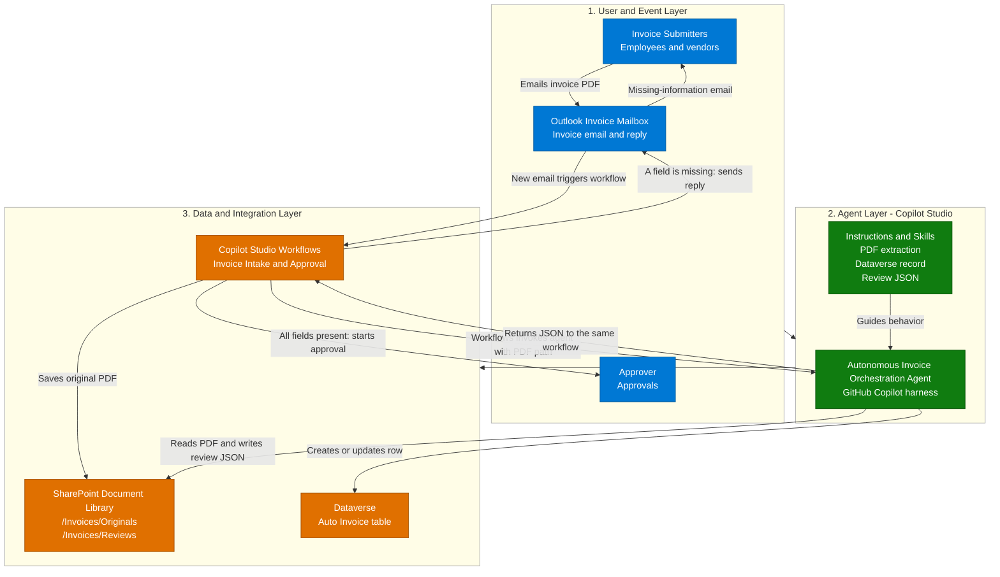
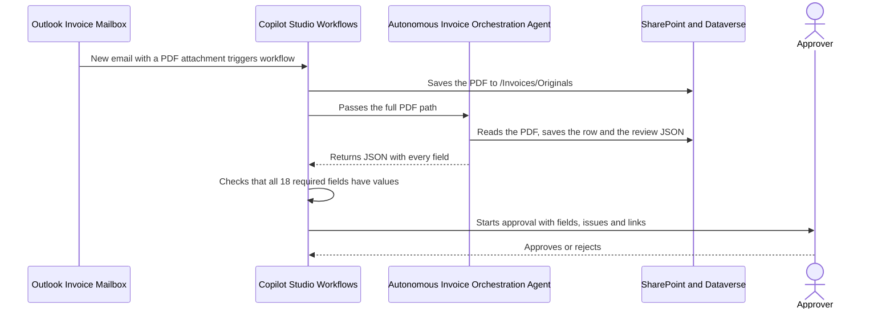
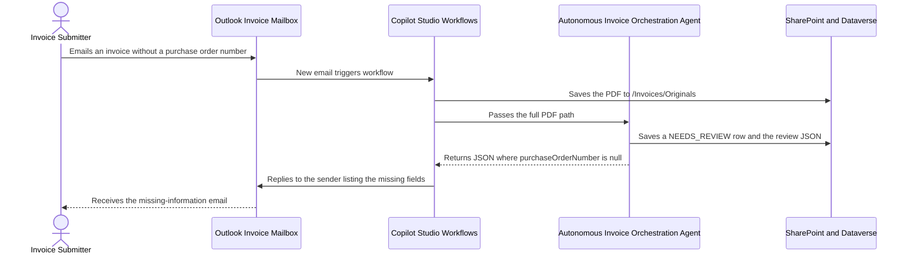

[1. Overview](1.Overview.md) > **2. Architecture** > [3. Runbook](3.Runbook.md) > [4. Sample Prompts](4.Sample-prompts.md)

# Autonomous Invoice Orchestration Agent — Architecture

## 1. Logical Architecture

The three layers are the submitters, mailbox and approver at the edge, the Copilot Studio GitHub Copilot agent, and the workflow, document library and Dataverse table that the agent and the workflow use. The agent is not a chat agent. It has no end-user channel and is called only by one workflow.

One configuration includes the workflow **Invoice Intake and Approval** and the three skills. Operators build the Dataverse table, the SharePoint folders, the agent and the workflow in the tenant. The workflow owns the trigger, the saved original, the completeness check, the approval and the reply to the sender. The agent owns reading the PDF and writing the Dataverse row and the review JSON file. No custom backend is required or supplied.

### How It Works

The diagram summarizes the layers. The path is **submitter → Outlook invoice mailbox → Workflows → Autonomous Invoice Orchestration Agent → the same Workflows instance → approval or sender reply**. One workflow owns the trigger, the agent call, the completeness check and both outcomes. The agent returns JSON. It does not send email, start an approval or invoke a second workflow. The agent reaches SharePoint and Dataverse through its own tools, and the workflow reaches them through its own connectors. Both write only to the folders and the table named in the [capability matrix](0.Resources/Capability-matrix.md#agent-tool-contracts).

---

## 2. Key Components

| Component | Technology | Role |
|---|---|---|
| Event entry | Office 365 Outlook **When a new email arrives (V3)** in Copilot Studio Workflows | Starts the workflow for each email with attachments in the invoice mailbox. The mailbox and the identity are configured during setup |
| Workflow | Copilot Studio Workflows, **Invoice Intake and Approval** | Saves each PDF, calls the agent, checks the returned JSON, starts the approval or replies to the sender. It is the only workflow |
| Agent call | Workflows Agent node, **An existing agent** | Calls the published Autonomous Invoice Orchestration Agent with the PDF path and waits for its JSON response |
| Agent runtime | Copilot Studio GitHub Copilot harness | Reads and reasons over the invoice and follows the skill procedures. It is not Copilot CLI or a Copilot SDK host |
| Skills | Three standalone definitions | PDF extraction and checks, Dataverse record, review JSON and response. Each skill is one capability |
| Agent tools | SharePoint and Microsoft Dataverse connector operations in the agent | File content and metadata by path, file create and update in `/Invoices/Reviews`, row list, create and update on one table |
| Document library | SharePoint document library | Holds the original PDFs in `/Invoices/Originals` and the review JSON files in `/Invoices/Reviews` |
| Data store | Dataverse table **Auto Invoice** | One row per Invoice Key with the 18 columns and the native row ID defined in the [data model](0.Resources/Capability-matrix.md#dataverse-data-model) |
| Approval | Approvals connector **Start and wait for an approval** in Workflows | Sends the fields, issues and links to the approver and records the outcome |
| Sender reply | Office 365 Outlook **Reply to email (V3)** in Workflows | Tells the sender which fields are missing, once per PDF |
| Monitoring | Workflow run history, agent run history, approval records and the mailbox | Operators inspect failures and uncertain outcomes. No custom queue or status API exists |

### Capability Design

| Capability | Component | Behavior and controls |
|---|---|---|
| Invoice capture | Workflow trigger and SharePoint **Create file** | Keeps PDF attachments only, saves each under a stable name in `/Invoices/Originals`, and passes only the full path to the agent. A message without a PDF ends the run without a reply |
| PDF extraction | `invoice-pdf-extraction` | Reads the PDF at an `/Invoices/Originals/` path, normalizes the fields, builds the Invoice Key and derives Decision and Issues Found. It never writes, never guesses a value and treats PDF text as data |
| Dataverse record | `invoice-dataverse-record` | Creates, updates or recognizes a duplicate by Invoice Key. It writes only to the Auto Invoice table |
| Review JSON file | `invoice-review-json` | Writes the review file in `/Invoices/Reviews`, stores its link in the row and returns one JSON object with 23 keys |
| Completeness check | Workflow condition | Checks the 18 required keys in the returned JSON. `null`, absent and blank are missing, `0` and `false` are values. The agent's own view of completeness is not used |
| Approval | Workflow Approvals action | Starts only when all 18 fields have values. The approver sees the fields, Decision and Issues Found, with a prominent warning when Decision is `NEEDS_REVIEW` |
| Missing-information reply | Workflow Outlook reply action | Replies to the sender with the missing field names and the stored PDF name, and asks for a corrected invoice |
| Failure follow-up | Workflow owner | A `failed` result ends the run as failed. The owner inspects run history and handles the invoice manually |

The design uses one agent and one workflow. No connected agent, ERP feed, payment system or general mailbox search is needed.

### Capabilities and Workflow Configuration

The [matrix](0.Resources/Capability-matrix.md) records the tool operation IDs, the eight workflow steps, the JSON response contract, the required-field rule and the data model. The agent's tools are configured in **Build > Tools**. Outlook, SharePoint save and Approvals operations belong to the workflow, not to the agent.

The [Workflows Agent-node guidance](https://learn.microsoft.com/en-us/microsoft-copilot-studio/workflows-experience/agent-node-workflow) documents selecting an existing published agent and using its response in the workflow. Before the workflow is turned on, operators verify the selected agent and version, the output form (custom structured output or Parse JSON), the effective identity of the agent's tool connections, and that the harness reads the PDF content returned by the SharePoint tool. [Resources](0.Resources/README.md#release-gates) lists these checks as release gates.

---

## 3. Data Flow

### Scenario A — Complete Invoice and Approval

This is the routine path. The workflow starts the approval even when the agent set Decision to `NEEDS_REVIEW` for a reason such as a total that does not match, and the approver sees that warning. The approval outcome stays in the approval record and the run history. The workflow does not pay the invoice and does not send an outcome email.

### Scenario B — Missing Information and Reply to the Sender

This diagram shows the missing-field path. No approval starts. The row stays in Dataverse with Decision `NEEDS_REVIEW`, and a corrected invoice from the sender is processed as a new email. If the corrected invoice has the same vendor ID and invoice number, the agent updates the earlier row instead of creating another one.

Other outcomes are summarized here. A `duplicate` status means a finished row already exists, so the workflow stops without a reply. A `failed` status ends the run as failed and leaves the saved PDF and any rows or files already written. An email with no PDF attachment ends the run without a reply. See the [status handling](0.Resources/Capability-matrix.md#status-handling), the [limitations](0.Resources/Capability-matrix.md#limitations-and-operational-ownership) and the [Runbook](3.Runbook.md).

---

## 4. Security & Governance Considerations

| Area | Consideration |
|---|---|
| Identity | The agent's SharePoint and Dataverse connections use a dedicated service account, not a maker's personal account and not the email sender. Whether workflow-invoked runs use that connection is a release gate. The workflow's Outlook, SharePoint and Approvals connections are owned and reviewed separately |
| Access control | Folder prefixes, table scope and connection permissions limit what the agent can write. The agent's account has read rights on `/Invoices/Originals`, contribute rights on `/Invoices/Reviews` and create, read and write rights on one table. These limits do not rely on instructions alone |
| Untrusted input | Email text and PDF content are data. The agent receives only a path that the workflow built, never the email body, subject or sender. Text in a PDF that tries to give instructions is ignored and recorded as an issue |
| Authorization and writes | The agent has no email, approval or second-workflow tool. The workflow decides the approval and the reply from the returned JSON. A person approves each invoice that is complete, and no payment is made |
| Reliability | The saved file name is stable if the trigger fires twice. The skill finds an existing row by Invoice Key before it writes, so a repeated invoice does not get a second row. A duplicate is detected, not re-processed. A partial failure ends the run as failed, and a later run reuses the rows and files already written |
| Data handling | Invoices hold vendor, amount, tax and legal-entity business data. Limit access to the mailbox, the library, the table and the run histories, and set retention for originals, reviews and rows. Keep memory and unrelated personal-context retrieval off |
| Deployment | Use a dedicated mailbox and an optional sender allowlist. Verify the tenant, model, credits and Approvals availability, then pilot with synthetic invoices before real ones |
| Disablement | Turn off the workflow first. Then remove the agent's tool exposure or unpublish the agent. Removing a skill does not revoke tool permissions. Keep written files and rows |

### Identity, Permissions and Data Handling

**Mailbox identity:** the Outlook trigger and the reply use the connection of the account that owns the invoice mailbox. Verify the monitored folder and the sending rights. Receiving mail does not automatically grant the right to reply, and a shared mailbox needs its own address in the reply action.

**Agent identity:** the SharePoint and Dataverse tools run under the connection configured for the agent. Grant that account only the rights listed above. A write by the agent is therefore limited by the account, not by a prompt.

**Workflow identity:** the workflow saves the original PDF and starts the approval under its own connections. The approval title and details use values extracted from an untrusted PDF, so the approver assignment is fixed in the workflow and never taken from the PDF, and the approver compares the values with the source PDF.

**Sender identity:** a sender's display name can be forged, and the reply goes to the sender of the received message. The approver gets the link to the source PDF. A sender allowlist and the mailbox's own anti-spoofing controls are the first line of defense.

### Reliability and Deployment Boundaries

| Concern | Current limitation / operator action |
|---|---|
| Duplicate triggers | The stable file name and the Invoice Key avoid a second original or row. Inspect the run history if an email shows two runs |
| Loops and bounces | The workflow ignores mail from the mailbox itself and replies only when a PDF was processed. Review auto-responders, which can reply to the reply |
| Rate limits and concurrency | The attachment loop runs one file at a time. Inspect connector throttling and retries. No custom rate limiter or queue exists |
| Unreadable invoices | The agent returns `failed` or a `NEEDS_REVIEW` row with issues. Missing values are never filled in |
| Wrong values that are present | The completeness check finds only missing values. The approver compares the extracted fields with the PDF |
| Approval outcome | The result is in the approval record and the run history. It is not written back to Dataverse |
| Maintenance / rollback | Disable the workflow, inspect runs in flight, then remove tool exposure or unpublish the agent |
| Cost and capacity | Workflow runs, agent runs and the approval wait use Copilot Credits and platform limits. Verify environment, model and credits |

The runbook leaves the workflow off until the agent, the non-sending checks and the pilot approval are ready. This documentation claims neither tenant execution nor production readiness.

---

Official guidance and remaining owner checks: [Resources](0.Resources/README.md#official-source-verification).

## Related Resources

| Resource | Link |
| --- | --- |
| Scenario Overview | [Overview](1.Overview.md) |
| Step-by-Step Runbook | [Runbook](3.Runbook.md) |
| Sample Prompts | [Prompts](4.Sample-prompts.md) |
| Capability and Integration Contracts | [Capability matrix](0.Resources/Capability-matrix.md) |
