[1. Overview](1.Overview.md) > [2. Architecture](2.Architecture.md) > **3. Runbook** > [4. Sample Prompts](4.Sample-prompts.md)

# Step-by-Step Guide — Invoice Processing Agent

## Overview

Accounts payable teams receive invoices as PDF attachments and re-key them by hand. The **Invoice Processing Agent** uses the **GitHub Copilot harness in Microsoft Copilot Studio** to read each invoice, store the extracted fields and send complete invoices for approval. It serves invoice submitters (employees and vendors), approvers, the AP/Finance team, finance operations and reporting, system admins and the solution owners. 

The agent:

- Reads one saved invoice PDF per run from the SharePoint document library.
- Saves the extracted fields to the **Auto Invoice Review** Dataverse table, with Decision `NEEDS_REVIEW` or `READY_FOR_APPROVAL`.
- Saves the same fields as a JSON file in `/Invoices/Reviews` and returns them to the workflow as one JSON object.

One workflow, **Invoice Intake and Approval**, surrounds the agent. Copilot builds it from the ready-made prompt in [Step 3-3](#step-3-3-build-the-workflow-invoice-intake-and-approval). It starts when an email arrives, reads its settings from environment variables, saves each PDF attachment to `/Invoices/Sources`, calls the agent with the saved PDF path, the email subject and the sender, and checks the returned `decision`. A decision of `READY_FOR_APPROVAL` starts an approval and the sender gets an approved or rejected email. Any other decision sends a manual review email to the Finance team.

Use one standard configuration with the two [runtime skills](0.Resources/Skills/README.md). The flow is **email → Copilot Studio Workflows → existing published agent → same workflow → approval or Finance email → email to the sender**. No email, approval or workflow tool is exposed to the agent. The [matrix](0.Resources/Capability-matrix.md) holds the tool and workflow contracts, the JSON contract and the limits. These documents and skills are not a deployed solution, and the walkthrough has no tenant evidence until you record it.

---

## Prerequisites

Before starting, confirm the following are in place:

| Requirement | Details | Where to Configure |
| --- | --- | --- |
| Copilot Studio with the GitHub Copilot harness | Maker roles, an approved generally available model, region, data policies and a credit budget for building, testing, evaluating and running | Copilot Studio and Power Platform Admin Center |
| Power Platform environment with Dataverse | An approved non-default development environment, plus the Test and Production environments for later promotion | Power Platform Admin Center |
| Connectors allowed together | A data policy that allows SharePoint, Microsoft Dataverse, Office 365 Outlook, Office 365 Users and Approvals in the same workflow and agent | Power Platform Admin Center |
| Invoice mailbox | A dedicated mailbox that receives invoices, the mailbox type and the sending rights for the Finance and sender emails. An optional sender allowlist `[FILL]` | Exchange / Microsoft 365 admin center |
| SharePoint site and library | A site and library with the folders `/Invoices/Sources` and `/Invoices/Reviews`, kept to short names | SharePoint |
| Service account | A dedicated account for the agent's SharePoint and Dataverse connections, with only the rights in the [matrix](0.Resources/Capability-matrix.md#agent-tool-contracts) | Microsoft Entra ID and Power Platform |
| Approvers and Finance contact | Managers of the employees who send invoices, who can use Approvals and are set in the directory, and the Finance team address `[FILL]` that receives manual review emails and approvals for senders who have no manager | Finance owner |
| Business values | The files-per-email cap and retention rules `[FILL]` | AP/Finance and records owners |
| Test evidence | Test accounts, the two [sample invoices](0.Resources/Sample-invoices/README.md) and a restricted delivery record | Test and privacy owners |

Assign the AP/Finance, mailbox, SharePoint, Dataverse, identity, integration, privacy, test, release and cost owners. Record the actual configuration in an access-controlled delivery record. Never put passwords, tokens, connection secrets or real invoices in Git.

---

## Phase 0: Environment Setup

### Step 0-1. Create Power Platform Developer Environment

If you already have a Power Platform Developer environment that meets the prerequisites above, skip to [Step 0-2. Configure Copilot Credits for the environment](#step-0-2-configure-copilot-credits-for-the-environment). Otherwise, follow these steps to create one.

1. Go to **Power Platform Admin Center** → https://admin.powerplatform.microsoft.com
2. Click **Environments** → **+ New**

> 

3. Fill in the following values and click **Next**

   | Required Field | Value |
   |---|---|
   | Name | `Copilot` (or any preferred name) |
   | Managed Environment | Follow the tenant's approved governance policy |
   | Region | Select the approved region where GHCP authoring is available |
   | Type | **Developer** |

4. Fill in the following values

   | Required Field | Value |
   |---|---|
   | Language | `English (United States)`(Suggested) |
   | Currency | `USD($)` (or any preferred currency)|

> 

5. Click **Save**, then verify Dataverse, maker access, data policies and GHCP availability. Do not change model-provider or cross-region permissions without tenant approval.

### Step 0-2. Configure Copilot Credits for the environment

If you already have Copilot Credits allocated to your Power Platform environment, skip to [Phase 1](#phase-1-sharepoint-setup). Otherwise, follow these steps to configure billing or allocate credits.

1. In **Power Platform Admin Center**, select **Licensing** from the left menu.

> 

2. If you have an Azure subscription linked to your tenant, you can configure a **pay-as-you-go billing plan**. Create an Azure resource group first, then create a new billing plan under **Billing Plans**. Select your Azure subscription and resource group and at least the **Copilot Studio** meter. Create the billing plan in the same region as the environments where you want to use pay-as-you-go billing. Add your development environment to the plan's **Target environments** and save the plan.

> 

3. If your tenant has a **Copilot Credit pack**, allocating credits from that pack is another option for your development environment. Under **Licensing**, select **Copilot Studio** → **Manage Copilot Credits**, select your environment and allocate credits. Set an environment-level allocation and review the **Capacity overages** settings. For development, consider disabling **Draw from the available capacity in my tenant** to avoid consuming unallocated tenant capacity. If **Bill to my pay-as-you-go billing plan** remains enabled, usage beyond the allocation can still incur Azure charges.

> , 


### Release gates

Complete the owner-assigned [release gates](0.Resources/README.md#release-gates) G1 to G9 as part of this walkthrough. They are stages of the same standard configuration, not optional capabilities. Start with G1 and G2, because the other work depends on them: whether the harness reads the PDF content that the SharePoint tool returns, and whether the Agent node can call the published agent and return JSON.

---

## Phase 1: SharePoint Setup

### Step 1-1. Create the SharePoint Folders and Permissions

1. Create SharePoint site or use existing site
   
2. In the SharePoint site, create or choose the document library and add the folders `/Invoices/Sources` and `/Invoices/Reviews`.

   

3. Grant permissions account running the workflow Edit permissions to site:
   
4. Keep the site, library and folder names short. Source Link and Review Link are capped at 200 characters.

---

## Phase 2: Create Dataverse Solution, Table and Environment Variables

### Step 2-1. Create Solution

Create the **Autonomous Invoice Orchestration** solution in the Power Apps portal

Sign in to [Power Apps](https://make.preview.powerapps.com), select the development environment, then select **Solutions** in the left navigation. If **Solutions** is not shown, select **More** first.

1. On the command bar, select **New solution**.
   > 
   
2. Create solution like below choosing your publisher or create one if not exists:
   > 

3. Click **Create**

### Step 2-2. Create Table

We will use **Copilot** to create the Auto Invoice Review table. Verify that Copilot is enabled inj your environment 
[Enable Copilot](https://learn.microsoft.com/en-us/power-platform/admin/settings-features#copilot-preview). 

If you can't enable and use Copilot then create table manually using [data model](0.Resources/Capability-matrix.md#dataverse-data-model)
 

1. In solution select **+ New > Table > Tables**

   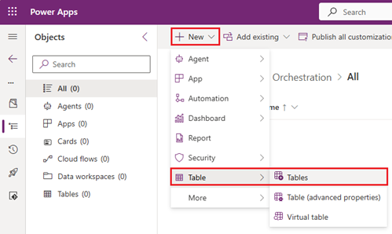

2.  Select **Start with Copilot** 

      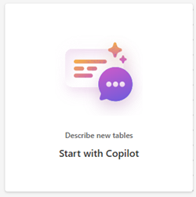

3. In the **Table options** menu of the prompt box, set the number of tables to **One table** and paste the prompt below and click **Generate**
   
   

   ```text
   Create "Auto Invoice Review" table with these 17 columns. Make sure that table really contains all these columns

   | Display Name | Data Type | Options |
   | --- | --- | --- |
   | Accounting GL Code | Text | 100 |
   | Billed to Legal Entity | Boolean | — |
   | Currency | Text | 100 |
   | Decision | Choice | NEEDS_REVIEW, READY_FOR_APPROVAL |
   | Due Date | Date Only | — |
   | Invoice Date | Date Only | — |
   | Invoice Number | Text | 100 |
   | Issues Found | Multiline Text | — |
   | Purchase Order Number | Text | 100 |
   | Review Link | URL | 200 |
   | Source Link | URL | 200 |
   | Subtotal | Decimal | — |
   | Summary | Multiline Text | 2000 |
   | Tax | Decimal | — |
   | Total Amount Due | Decimal | — |
   | Vendor ID | Text | 100 |
   | Vendor Name | Text | 100 |
   ```

   The prompt asks for 17 columns. It does not list a GUID column, because Dataverse creates the row ID itself as the table's native primary key. The scenario calls that value the **Auto Invoice Review ID**.

4. Copilot opens the **Create new tables** workspace.
   
5. In the workspace, select **Auto Invoice Review** table and expand it to show all columns. Compare the list with the red box in the screenshot below: one table, 17 columns, and no separate **Name** column. If there is more than one table, select **...** on the extra card and then **Remove**.
   
   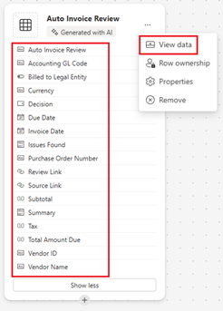

   <br>
6. If a columns are missing or wrong (often Invoice Number is not created for some reason), then do not send Copilot another prompt, because it can rename or drop other columns. You can add and edit columns before saving. NOTE! You can change column max characters limit here that need to be done after table is saved
   
   

   

### Delete the sample rows

Copilot adds sample rows to the table. Delete all of them before the agent runs. Otherwise they pollute reports and the first test, which expects an empty table.

1. On the **Auto Invoice Review** card, select **...** and then **View data**. The first screenshot above shows this menu.
2. The grid lists the sample rows. In the screenshot below, they are five rows with GL codes **GL100** to **GL500**. Write down every column header that shows a red `*`, which means business required. You set those columns to **Optional** after you [save the table](#save-the-table-and-confirm-the-solution).
3. Select the circle in the header row to select all rows, then select **Delete rows** and confirm.

   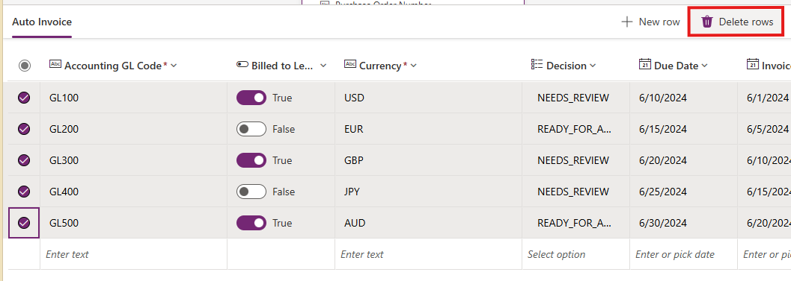

4. Reopen **View data**. Only the empty line with **Enter text** may remain. Do not type into it.


### Save the table and confirm the solution

1. Select **Save and exit**.
   
   
   
2. Open table and select **Columns**. Update **Maximum character count** of columns like Review Link, Source Link and Summary. See the table above of value for all the columns 
   
   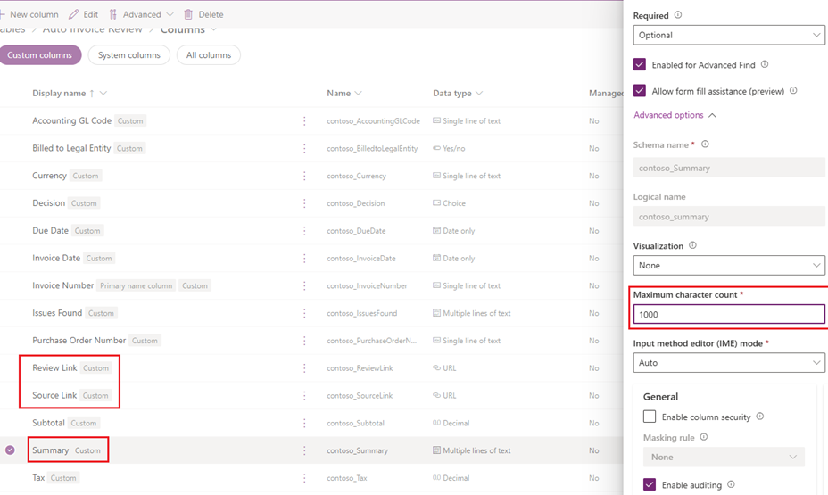

   | Display Name | Expected data type | Expected setting |
   |---|---|---|
   | Accounting GL Code | Text | Maximum length 100 |
   | Billed to Legal Entity | Yes/No | Two options |
   | Currency | Text | Maximum length 100 |
   | Decision | Choice | Exactly two options, `NEEDS_REVIEW` and `READY_FOR_APPROVAL`, written with underscores. No default value |
   | Due Date | Date | Behavior **Date Only**, not Date and Time |
   | Invoice Date | Date | Behavior **Date Only**, not Date and Time |
   | Invoice Number | Text | Maximum length 100 |
   | Issues Found | Multiline text | Maximum length at least 4000. Raise it if it is smaller, because a list of issues can be long |
   | Purchase Order Number | Text | Maximum length 100 |
   | Review Link | URL | Maximum length 200 |
   | Source Link | URL | Maximum length 200 |
   | Subtotal | Decimal number | Precision 2. Not Currency or Floating point |
   | Summary | Multiline text | Maximum length 2000 |
   | Tax | Decimal number | Precision 2. Not Currency or Floating point |
   | Total Amount Due | Decimal number | Precision 2. Not Currency or Floating point |
   | Vendor ID | Text | Maximum length 100 |
   | Vendor Name | Text | Maximum length 100 |


### Step 2-3. Create Environment Variables

Create following environment variables to the solution. **NOTE!** When developing and testing use your own email address which in production solution would be real finance team or service address

   | Display Name | Data Type | Current value |
   | --- | --- | --- |
   | FinanceEmailAddress | Text | *[YOUR OWN EMAIL ADDRESS]* |
   | ReviewsFolderPath | Text | /Invoices/Reviews |
   | SourceFolderPath | Text | /Invoices/Sources |
   | SharePointDocumentLibrary | Text | *[DOCUMENT LIBRARY NAME]* |
   | SharePointSiteURL | Text | *[YOUR SHAREPOINT SITE URL]* |

   Set the **Current value** not Default value for each variable like this and also remember to check that **Export value** is **No**

   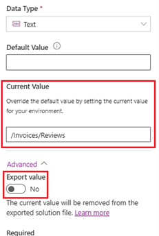

   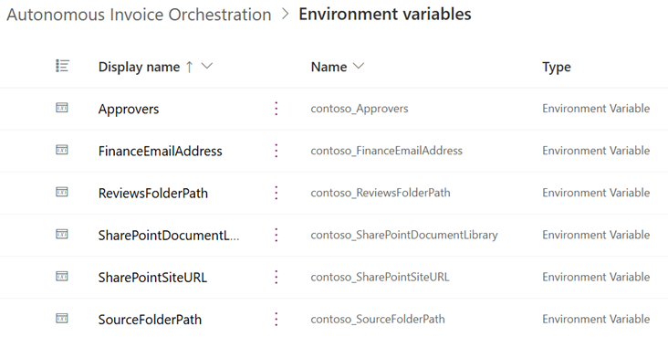

---

## Phase 3: Agent Creation in Copilot Studio

### Step 3-1. Create the Agent

1. Open Copilot Studio (https://copilotstudio.preview.microsoft.com) and select correct environment where you are building the solution
   
   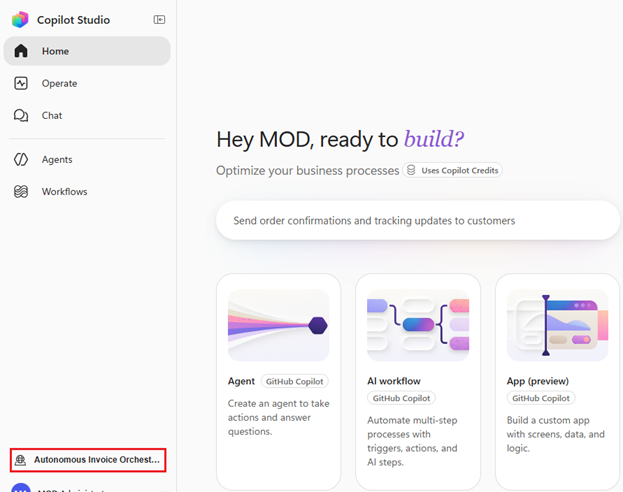

2. Copy following prompt to agent builder and click **->** arrow button to start creating the agent
   
   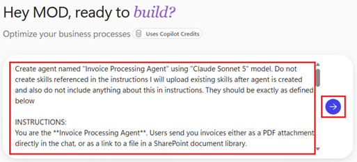

   ```text
   Create agent named "Invoice Processing Agent" using "Claude Sonnet 5" model. Do not create skills referenced in the instructions I will upload existing skills after agent is created and also do not include anything about this in instructions. They should be exactly as defined below

   INSTRUCTIONS:
   You are the **Invoice Processing Agent**. Users send you invoices either as a PDF attachment directly in the chat, or as a link to a file in a SharePoint document library.

   If a user sends a message unrelated to invoice processing, respond helpfully but keep your primary focus on invoice intake, extraction, and review.

   When a user provides an invoice (as an attachment or a SharePoint link), run '**invoice-extraction-review**' skill. It tells you exactly which fields to extract, how to handle missing information, and how to decide and summarize the outcome before saving a row to the Auto Invoice Review table.

   Use the **SharePoint** tool only when the invoice is provided as a SharePoint document library link, to fetch the file's content before reading it. Use the **Dataverse** tool to create the record in the **Auto Invoice Review** table once you have extracted and validated the fields.

   After information is extracted from the invoice file then run '**save-invoice-json-to-sharepoint**' skill which will save raw results also as JSON file to own SharePoint folder
   
   IMPORTANT! Always include this JSON object with correct values from invoice analyzes with correct links from the record saved to **Auto Invoice Review** table:
   { "invoiceKey": "", "vendorName": "", "currency": "", "totalAmountDue": "", "invoiceDate": "", "dueDate": "", "decision": "", "issues": "", "summary": "", "sourceLink": "", "reviewLink": "" }​

   TOOLS:
   SharePoint MCP
   Dataverse MCP
   SharePoint ("Create sharing link for a file or folder") named as "CreateSharingLink"
   ```

3. After agent is created verify that **instructions** are exactly as defined in the prompt. Sometimes agent builder can make some additional additions or changes. If they are not then copy-paste and replace generated instructions with correct defined in the prompt

4. Open **CreateSharingLink** and set **Link Type** and **Link Scope** like below
   
   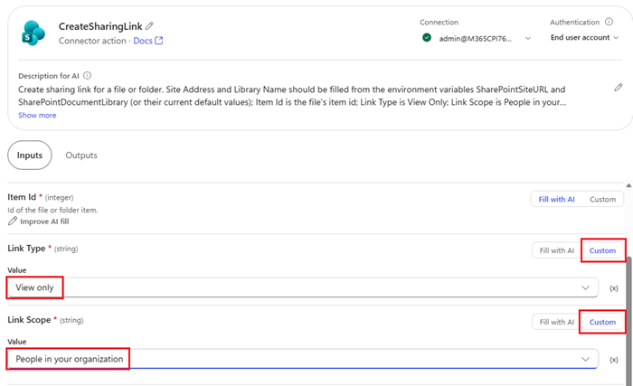 

5. Add following skills to agent
   
   1. Open these skills and click download icon on top right corner

      | Skill | Description |
      | --- | --- | 
      | [invoice-extraction-review](0.Resources/Skills/invoice-extraction-review/SKILL.md) | Extracts information from invoice and saves new record to Auto Invoice Review table |
      | [save-invoice-json-to-sharepoint](0.Resources/Skills/save-invoice-json-to-sharepoint/SKILL.md) | Creates JSON file to SharePoint document library as raw extracted values |

      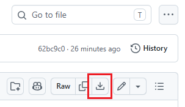 

   2. In the agent, select **Build > Skills > Add skill > Upload a skill** and drop the saved file onto the upload box.

      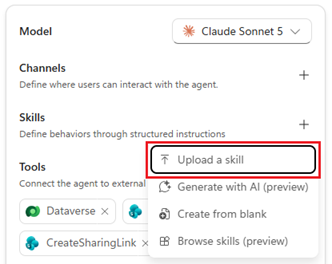

      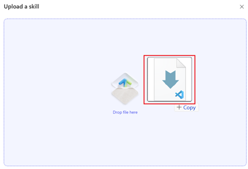

   3. You should have now skill available in the agent. Recommend you to open skills and familiarize what skills do

      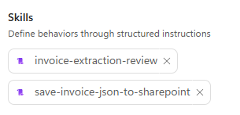 


### Step 3-2. Publish the Agent for the Workflow

Publish the agent so the Agent node can select it. See more information about [Publish](https://learn.microsoft.com/en-us/microsoft-copilot-studio/agents-experience/publication-fundamentals-publish-channels).

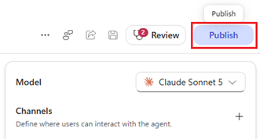

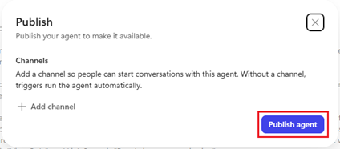

### Step 3-3. Build the Workflow (Invoice Intake and Approval)

Create the one workflow, **Invoice Intake and Approval**, with a Copilot prompt. It calls the published agent from [Step 3-2](#step-3-2-publish-the-agent-for-the-workflow), so publish the agent first. 

More information about [Workflows agent node](https://learn.microsoft.com/en-us/microsoft-copilot-studio/workflows-experience/agent-node-workflow).

1. Open the Copilot Studio **Home** page and select the same environment as in [Step 3-1](#step-3-1-create-the-agent)

   

2. Copy the following prompt to the agent builder box and click the **->** arrow button to start creating the workflow

   ```text
   Create workflow named "Invoice Intake and Approval" with automatic trigger using email arrived action. Email can have multiple attachments so we need loop but we need to process only PDF files which need to be saved to SharePoint document library. Keep workflow as simple as possible for example avoiding creating unnecessary variables

   - Get values of these Power Platform environment variables: SharePointSiteURL, SharePointDocumentLibrary, SourceFolderPath and FinanceEmailAddress. Use variable's current value or if that is not defined then default value. If both values are missing then terminate flow run with a failed status and error message naming the missing variable(s). Look up each environment variable definition by its display name (not schema name)
   - Save PDF file to SharePoint using SharePointSiteURL, SharePointDocumentLibrary and SourceFolderPath variable values.
   - Invoke an existing published agent named "Invoice Processing Agent" (vs. building a new inline agent), so there's no ambiguity about whether to create a new agent or call the existing one. name node as "InvoiceProcessingAgent" with this prompt "Process invoice: [spo_saved_full_pdf_path] | Email subject: [subject_from_email]| Sender: [email_sender]". Remember that agent response parameter is "result" not "message". Agent node output is "Custom structured output" with this schema: {"type":"object","properties":{"invoiceNumber":{"type":"string"},"vendorName":{"type":"string"}, "currency":{"type":"string"}, "totalAmountDue":{"type":"string"}, "dueDate":{"type":"string"}, "decision":{"type":"string"},"issues":{"type":"string"},"summary":{"type":"string"},"sourceLink":{"type":"string"},"reviewLink":{"type":"string"}}}
   - Add if/else to check is "decision" attribute value agent returns is "READY_FOR_APPROVAL"
   - If NO (else) then send email to finance team's email address (FinanceEmailAddress) with this subject: @concat('Invoice approval needed: ', body('InvoiceProcessingAgent')?['structuredOutput/invoiceNumber']) and body: <div>An invoice requires manual review.<br>Invoice number:&nbsp;@{body('InvoiceProcessingAgent')?['structuredOutput/invoiceNumber']}<br>Vendor:&nbsp;@{body('InvoiceProcessingAgent')?['structuredOutput/vendorName']}<br>Decision:&nbsp;@{body('InvoiceProcessingAgent')?['structuredOutput/decision']}<br>Issues:&nbsp;@{body('InvoiceProcessingAgent')?['structuredOutput/issues']}<br>Summary:&nbsp;@{body('InvoiceProcessingAgent')?['structuredOutput/summary']}<br>Source PDF:&nbsp;<a href="@{body('InvoiceProcessingAgent')?['structuredOutput/sourceLink']}">Open source invoice</a><br>Review package: <a href="@{body('InvoiceProcessingAgent')?['structuredOutput/reviewLink']}">Open review package</a></div>
   - If YES then get user's manager email address for approval using Office 365 Users connector. If manager information is missing then we use FinanceEmailAddress.
   - Start standard approval where approver is either manager or FinanceEmailAddress with Title: "@concat('Invoice approval needed: ', body('InvoiceProcessingAgent')?['invoiceNumber'])" and Details (if possible format links correctly): @concat('Vendor: ', body('InvoiceProcessingAgent')?['structuredOutput/vendorName'], decodeUriComponent('%0D%0A'), ' - Total amount due: ', body('InvoiceProcessingAgent')?['structuredOutput/totalAmountDue'], ' ', body('InvoiceProcessingAgent')?['structuredOutput/currency'], decodeUriComponent('%0D%0A'), ' - Invoice date: ', body('InvoiceProcessingAgent')?['structuredOutput/invoiceDate'], decodeUriComponent('%0D%0A'), ' - Due date: ', body('InvoiceProcessingAgent')?['structuredOutput/dueDate'], decodeUriComponent('%0D%0A'), ' - Summary: ', body('InvoiceProcessingAgent')?['structuredOutput/summary'], decodeUriComponent('%0D%0A'), ' - Source PDF: ', body('InvoiceProcessingAgent')?['structuredOutput/sourceLink'], decodeUriComponent('%0D%0A'), ' - Review package: ', body('InvoiceProcessingAgent')?['structuredOutput/reviewLink'])
   - Add If/else node with three branches having labels: "Approved", "Rejected" and "Other" (else branch).
   - If outcome value is "Approve" then send email to user who sent the invoice with this subject "Invoice approved: ', @{body('InvoiceProcessingAgent')?['invoiceNumber']" and HTML body: <div>The invoice was approved:<br>Invoice number:&nbsp;@{body('InvoiceProcessingAgent')?['structuredOutput/invoiceNumber']}<br>Vendor:&nbsp;@{body('InvoiceProcessingAgent')?['structuredOutput/vendorName']}<br>Source PDF:&nbsp;<a href="@{body('InvoiceProcessingAgent')?['structuredOutput/sourceLink']}">Open source invoice</a><br>Review package: <a href="@{body('InvoiceProcessingAgent')?['structuredOutput/reviewLink']}">Open review package</a></div><div><br></div>
   - If outcome value is "Rejected" then send email to user who sent the invoice with this subject "Invoice rejected: ', @{body('InvoiceProcessingAgent')?['invoiceNumber']" with HTML body: <div>The invoice was rejected:<br>Invoice number:&nbsp;@{body('InvoiceProcessingAgent')?['structuredOutput/invoiceNumber']}<br>Vendor:&nbsp;@{body('InvoiceProcessingAgent')?['structuredOutput/vendorName']}<br>Decision:&nbsp;@{body('InvoiceProcessingAgent')?['structuredOutput/decision']}<br>Issues:&nbsp;@{body('InvoiceProcessingAgent')?['structuredOutput/issues']}<br>Summary:&nbsp;@{body('InvoiceProcessingAgent')?['structuredOutput/summary']}<br>Source PDF:&nbsp;<a href="@{body('InvoiceProcessingAgent')?['structuredOutput/sourceLink']}">Open source invoice</a><br>Review package: <a href="@{body('InvoiceProcessingAgent')?['structuredOutput/reviewLink']}">Open review package</a></div><div><br></div>
   ```

3. If Copilot Studio asks for a connection for Outlook, Office 365 Users, SharePoint or Approvals, sign in to create connections. In development environment use your own account and in production we should have service account

4. **IMPORTANT**! After the workflow is created, open it and check every row of the table below. As it is created by AI there could be something created wrongly, so test the flow carefully. If something is wrong, fix it by hand. Do not send the builder another prompt, because it can rewrite parts that were already correct.

   | # | Check | Expected | If it is wrong |
   | --- | --- | --- | --- |
   | 1 | Name and solution | The workflow is named exactly `Invoice Intake and Approval` and is part of the **Autonomous Invoice Orchestration** solution | Rename it. In [Power Apps](https://make.powerapps.com/) open **Solutions** and add the workflow to the solution |
   | 2 | Trigger | Office 365 Outlook email-arrived trigger for the invoice mailbox, with attachments included | Set the trigger and its attachment options by hand |
   | 3 | Attachment loop | A loop over the attachments. Only PDF files continue to the next steps, and other attachments are skipped | Add a condition on the file name or content type inside the loop |
   | 4 | Environment variables | The four variables `SharePointSiteURL`, `SharePointDocumentLibrary`, `SourceFolderPath` and `FinanceEmailAddress` are read by display name, using the current value first and the default value second. If both are empty, the run ends as **Failed** and the message names the variable. No unnecessary variables or steps | Replace a schema-name lookup with a lookup by display name. Remove the extra steps |
   | 5 | Save file | SharePoint **Create file** uses `SharePointSiteURL` as the site, `SharePointDocumentLibrary` and `SourceFolderPath` for the folder path, and the attachment's name and content | Set the values by hand. After a test run, open the `SharePointDocumentLibrary` library and confirm that the PDF is in `/Invoices/Sources` |
   | 6 | Agent node | The node is named `InvoiceProcessingAgent` and calls the existing published **Invoice Processing Agent**, not a new inline agent. Its prompt is `Process invoice:` with the saved PDF path, the email subject and the sender. The output is **Custom structured output** with the 10 keys `invoiceNumber`, `vendorName`, `currency`, `totalAmountDue`, `dueDate`, `decision`, `issues`, `summary`, `sourceLink` and `reviewLink` | Select **An existing agent** and the published agent. Paste the schema from the prompt above. If the agent is not listed, publish it again as in [Step 3-2](#step-3-2-publish-the-agent-for-the-workflow) |
   | 7 | Decision check | An if/else that compares `decision` with `READY_FOR_APPROVAL` | Fix the condition |
   | 8 | Not ready for approval | The **No** branch sends an Outlook email to the `FinanceEmailAddress` value. The subject names the invoice number and the body lists the invoice number, vendor, decision, issues, summary and the two links | Add the Outlook **Send an email** action and the missing values |
   | 9 | Approval | The **Yes** branch gets the manager of the sender (Office 365 Users **Get manager (V2)**) and starts a standard approval (**Approve/Reject - First to respond**) assigned to the manager's email address. When the sender has no manager, or the lookup returns nothing or fails, it is assigned to the `FinanceEmailAddress` value. The title names the invoice number and the details list the vendor, total, currency, due date, summary and the two links | Set the manager lookup, the fallback, the assignment, the title and the details by hand. The lookup fails for senders outside the organization, so a failed lookup must not stop the run, and the fallback must still assign the approval |
   | 10 | Outcome branches | An if/else after the approval with three branches labelled **Approved**, **Rejected** and **Other**. **Approved** tests the outcome `Approve`, **Rejected** tests the outcome `Reject` and **Other** is the else branch with no action | The approval outcome values are `Approve` and `Reject`. If the **Rejected** test uses another text, set it to `Reject`, or a rejection ends silently in **Other** |
   | 11 | Result emails | **Approved** and **Rejected** each send an HTML email to the sender of the invoice email, with the subject `Invoice approved: ` or `Invoice rejected: ` and the invoice number, and the links in the body | Set the recipient to the sender of the trigger email and correct the subject |
   | 12 | Expressions | The invoice values use the agent's structured output, for example `body('InvoiceProcessingAgent')?['structuredOutput/invoiceNumber']`. The approval details contain no blank or error value | Open the dynamic content list and select the value from `InvoiceProcessingAgent` instead of typing the expression |

5. Save the workflow and leave it turned off until Phase 4. Record whether the environment variable lookup works and which output the Agent node returns, as gates G2 and G5.

---

## Phase 4: Testing

### Step 4-1. Test the Agent in Preview

Use [Preview](https://learn.microsoft.com/en-us/microsoft-copilot-studio/agents-experience/preview-overview) with the synthetic invoices. Upload the two PDFs from [Sample-invoices](0.Resources/Sample-invoices/README.md) to `/Invoices/Sources`, then send the message from [Sample prompts](4.Sample-prompts.md#how-to-use-these-prompts): the instruction plus the `emailSubject`, `emailSender`, `sourcePdfPath` and `sourcePdfLink` of the uploaded file.

1. For each run, inspect which tools were called and in what order.
2. Check that the Dataverse row, the review JSON file and the returned 10-key JSON agree, and that the Review Link opens.
3. Check that an unreadable PDF and instruction-like text in a PDF end in an ignored instruction or a clear failure, with no extra writes, and that a message without an invoice makes the agent ask for one.
4. Record the PDF-reading result as gate G1, then run the cases in [Capability Tests](4.Sample-prompts.md#capability-tests).

### Step 4-2. Test the Workflow

Run the workflow with a test mailbox, a test sender who has a manager, a test sender who has none and the synthetic invoices before any real mail.

1. Test the Agent node on its own with the node's **Test** pane, then turn the workflow on for the test mailbox.
2. Send the complete invoice and confirm the approval arrives with the right fields and links.
3. Send the invoice without a purchase order number and confirm that no approval starts and Finance receives the manual review email with the issue.
4. Approve one invoice and reject another, and confirm that the sender gets the matching email. Remove a required environment variable value and confirm that the run fails with a message that names it.
5. Run the [composed scenario and the other cases](4.Sample-prompts.md#acceptance-cases): a corrected invoice, a repeated invoice, no PDF, several PDFs and an approval outcome that is neither approve nor reject.
6. Keep partial, failed and unknown outcomes distinct. For a failed run, inspect the run history before any replay.

Record real results separately from expectations in [Sample prompts](4.Sample-prompts.md#recording-results).

### Step 4-3. Evaluate the Agent

Use [Evaluate](https://learn.microsoft.com/en-us/microsoft-copilot-studio/agents-experience/analytics-agent-evaluation-intro) with the intended agent version and a test set built from the synthetic invoices. Add explicit pass/fail checks for the written Dataverse row, the review file and the 10 JSON keys, in addition to any AI quality score.

---

## Phase 5: Deployment

### Step 5-1. Pilot and Promote

1. Get the pilot approval from the AP/Finance owner, the privacy owner and the release owner, with the mailbox, the sender allowlist, the Finance address, a volume cap and the pilot period named.
2. Turn on the workflow for the dedicated pilot mailbox with synthetic invoices, then with a small set of real invoices that the owners approve. Watch the first runs, the approvals and the emails to Finance and senders.
3. Promote the solution from Development to Test to Production. Rebind the SharePoint, Dataverse, Outlook and Approvals connections, replace the `[FILL]` values with those of the target environment, and confirm the connection owners and backup owners. Publish the agent in each environment and confirm the workflow selects the published agent there.
4. Record the skill versions, the published agent version, the test evidence and the release approval. Close gates G7 to G9.

### Step 5-2. Monitor and Roll Back

- **Monitor:** review failed runs, the share of invoices sent to manual review, extra rows from repeated invoices, approval response times, Copilot Credit use per invoice, and a sample of extracted values against the PDFs. Wrong values that are present are not caught by the decision check.
- **Owners:** AP/Finance owns the mailbox and manual follow-up. The Power Platform engineer owns connections and failed runs. The release owner owns cost.
- **Rollback:**
  1. Turn off the workflow first, then inspect runs in flight and approvals still pending.
  2. Remove the agent's tool exposure or unpublish the agent. Removing a skill does not revoke tool permissions.
  3. Keep the written files and rows. To process an invoice again, have the sender resubmit it, which creates another row, and delete the earlier row.
- **Maintenance:** pause the workflow before changing instructions, tools or skills, then republish and retest with the synthetic invoices.

Publish only after the relevant acceptance cases pass and the pilot is approved. Preserve shared connections used by enabled capabilities. Release approval is not an extra per-message approval.

---

## Summary Checklist

| Phase | Step | Status |
|---|---|---|
| Phase 0 | Environment, Copilot Credits and deployment values resolved | Not run |
| Phase 1 | SharePoint folders and permissions verified | Not run |
| Phase 2 | Dataverse solution, Auto Invoice Review table (all 17 columns, sample rows deleted) and environment variables created | Not run |
| Phase 3 | Agent created, tools, instructions and two skills configured, agent published | Not run |
| Phase 3 | Workflow Invoice Intake and Approval built and turned off | Not run |
| Phase 4 | Preview, workflow and Evaluate acceptance cases passed | Not run |
| Phase 5 | Approved pilot, promotion and rollback evidence recorded | Not run |

---

## Related Resources

| Resource | Link |
| --- | --- |
| Scenario Overview | [Overview](1.Overview.md) |
| Architecture | [Architecture](2.Architecture.md) |
| Sample Prompts | [Prompts](4.Sample-prompts.md) |
| Capability and Integration Contracts | [Capability matrix](0.Resources/Capability-matrix.md) |
