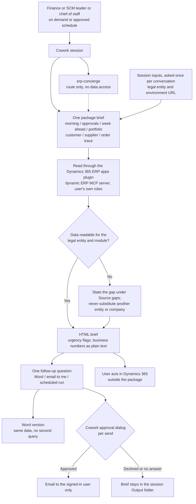

# Chief of Staff D365 ERP Cowork Agent - Architecture

## Request Flow

These are eleven configured skills that run inside the user's Cowork session and are packaged by
one plugin manifest; they are not separately hosted services. The scenario adds no backend, data
store, index or model. Finance and operations security roles, legal-entity assignments,
record-level security and workflow, the tenant Dataverse setting, the environment's Allowed MCP
clients list and the Cowork approval dialog remain authoritative.

## Components

| Component | Responsibility | Important boundary |
|---|---|---|
| Cowork session | Discover skills, plan the request, run one package skill and keep outputs in the session | Start a new session after package changes |
| `erp-concierge` | Name one brief for a goal; send reports, KPIs and trends to `insights-analyst-concierge` | Never queries Dynamics 365, drafts, schedules or sends |
| Morning and decision-queue briefs (`finance-morning-brief`, `scm-morning-brief`, `finance-approvals-brief`, `procurement-decisions-brief`) | Daily attention lists and the items waiting on a decision | Read-only; list and explain, never approve, reject, award or disposition |
| Week-ahead and portfolio briefs (`finance-week-ahead-brief`, `operations-week-ahead-brief`, `project-portfolio-brief`) | Dated calendars and an exposure-ordered project watch-list | Read-only; carry-over items listed first and flagged red |
| Record briefs (`customer-account-brief`, `supplier-brief`, `order-trace-brief`) | List mode without an identifier, then a drill-down on one record | Read-only; ambiguous matches are listed, never guessed |
| Dynamics 365 ERP apps plugin | Finance & Operations connector to the dynamic Dynamics 365 ERP MCP server: data, form and action tools | Environment version and type, the Dataverse setting, Allowed MCP clients and user roles are qualification gates |
| `reference.md` per skill | Definitions, thresholds, data read, record identifiers, session inputs, output delivery rule and hand-off table | Customer thresholds and an optional preset URL are set once by the package owner |
| Cowork Word and Outlook capabilities | Word version of the brief and the email to self | Word is built from the same data; every email is previewed and approved |

## Identity, Environment and Permissions

- Interactive runs execute as the signed-in user through that user's own connection to the
  Finance & Operations connector. A scheduled run executes as its owner, with the owner's roles,
  legal entities and connection; schedule each leader's brief under one owner.
- Each user needs a qualifying finance and operations licence (Dynamics 365 Finance and/or Supply
  Chain Management; Project Operations or project management and accounting access where
  `project-portfolio-brief` is piloted) and roles that can view the records each brief reads. The
  package is read-only, so no posting, approval, release or maintain privilege is needed, and none
  should be granted for the pilot.
- The user configures the connector once and selects the approved environment. Each brief asks for
  the legal entity and environment URL once per conversation and states both in its header band.
  The URL is recorded, not used to redirect the plugin: the plugin reads the environment it is
  connected to, and a mismatch visible in its response is reported under Source gaps.
- Users see only the legal entities their role assignments cover. Test with one deliberately
  low-privilege user and one user assigned only to an out-of-scope legal entity (CoS-V-14), and
  confirm that permission gaps are stated, not worked around.

## Data and Evidence Contract

| Claim | Required backing |
|---|---|
| Record facts: status, amount, dates, account, hold, workflow state | Plugin data, shown with the record's business number as plain text |
| Urgency flag and inclusion in a list | A definition or threshold in the skill's `reference.md` |
| Blocking step in an order trace | The order's lifecycle status and its related records |
| Submitter, approver, requester or buyer names | Record facts only; never ranked, rated, compared or analysed |
| Anything without backing | Omitted, or stated under Source gaps |

The definitions live in each skill's `reference.md`. The configurable defaults are:

| Term | Package default |
|---|---|
| Invoice due soon | Open vendor invoice due within the next 3 calendar days (`finance-morning-brief`) |
| Cash discount expiring | Cash discount date within the next 3 days |
| Newly on hold | Vendor or customer hold state changed within the last 7 days |
| Near budget | Actual plus committed cost above 90% of the approved budget (`project-portfolio-brief`) |
| Compliance exception | Project expense or timesheet not approved for more than 7 days |
| Exposure | Amount over budget plus unbilled WIP older than 30 days; orders the watch-list only |
| Stock-out risk | On-hand plus on-order below reorder point or safety stock, with a default buffer of 20% (`scm-morning-brief`) |
| Overdue and trailing windows | Overdue more than 30 days; trailing 90 days for quality, returns and payments (`customer-account-brief`, `supplier-brief`) |
| Stuck order | The expected date of the current lifecycle step has passed and the next step has not started (`order-trace-brief`) |

Every other definition is a status or date rule and ships unchanged unless the customer's process
differs.

## Approval Boundaries

| Action | Behaviour | Pilot rule |
|---|---|---|
| Read Dynamics 365 through the plugin | Automatic, under the user's roles and legal entities | Not applicable |
| Create, update, approve, reject, post, release, adjust or delete any record | Not performed by any skill; answered with the record's number | The user acts in Dynamics 365 directly |
| Email the brief to the user's own address | Recipient, subject, summary and attachments previewed; Cowork approval dialog per send | Per send; never **Always allow** |
| Email anyone else, post to Teams or share a file | Not performed by any skill | Share manually after review |
| Create or change a schedule | Set up only after the user approves; managed from **Automations** | Approval to schedule does not approve any send |
| Change the environment or legal entity | Never performed by a skill; a different value named in a prompt is used and confirmed back | User action only |

## Operations

Keep the package version, `reference.md` thresholds, any preset environment URL, scheduled-prompt
texts, schedule owners and the plugin manifest version under change control. Purview captures
Cowork activity under Copilot activities, and finance and operations attributes every MCP action to
the signed-in user.

To roll back, block the plugin in the Microsoft 365 admin center (Agents > Tools > plugin > Users >
Block; new conversations only), then pause or delete schedules from **Automations**; blocking the
plugin does not stop an existing schedule from attempting to run. To stop Cowork reaching an
environment altogether, remove the Cowork client from **Allowed MCP clients** in that environment,
which affects every Cowork user and package there. See the [delivery runbook](3.Runbook.md) for
acceptance and handover.
