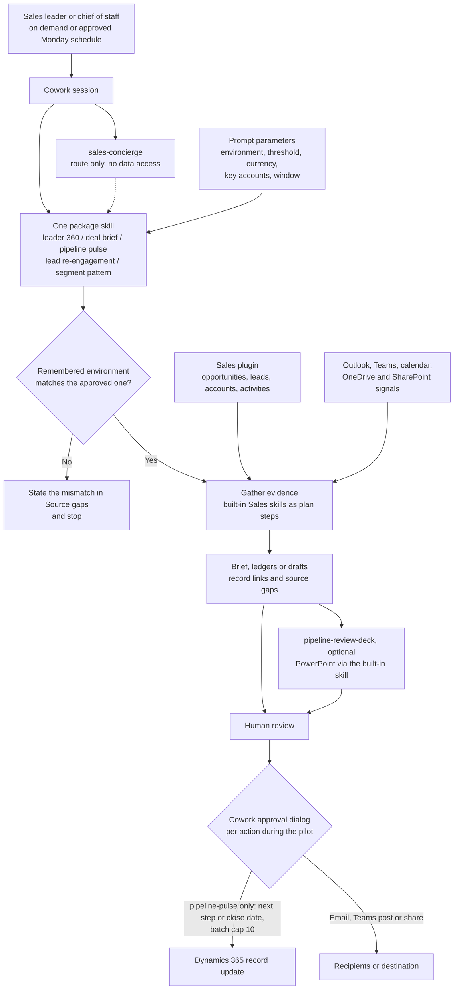

# Chief of Staff D365 Sales Cowork Agent - Architecture

## Request Flow

These are seven configured skills that run inside the user's Cowork session and are packaged by
one plugin manifest; they are not separately hosted services. The scenario adds no backend, data
store, index or model. Dynamics 365 security roles, the tenant Dataverse setting, the environment's
Dataverse MCP server and the Cowork approval dialog remain authoritative.

## Components

| Component | Responsibility | Important boundary |
|---|---|---|
| Cowork session | Discover skills, plan the request, run one package skill and keep outputs in the session | Start a new session after package changes |
| `sales-concierge` | Name one skill for a goal; send plain asks to the built-in Sales skills | Never queries Dynamics 365, drafts, schedules or changes the environment |
| `sales-leader-360`, `deal-brief`, `segment-pattern` | Weekly leadership brief, one-deal brief and segment pattern | Read-only; record link on every deal claim; deals, never sellers |
| `pipeline-pulse` | Four hygiene ledgers and drafted fixes | The only write path: next step and close date, batch cap, per-item approval |
| `lead-reengagement` | Quiet-lead ledger, angles and outreach drafts | No lead field updates; every send approved |
| `pipeline-review-deck` | Deck from the latest sibling brief | No new data; no deck from a brief that shows an environment mismatch |
| Sales plugin (Dynamics 365 Sales) | Built-in skills and record access through the Dataverse MCP server | Sales app, plugin availability, MCP component and user licences are qualification gates |
| `references/reference.md` per skill | Parameters, definitions, RAG model, layouts, deck maps and gates | Customer defaults are set once by the package owner |
| Microsoft 365 sources | Calendar, mail, Teams and file signals | Only content the signed-in user can open; private detail stays out of outbound drafts |
| Built-in PowerPoint, Word and Email skills | Deck, document and message creation | Sharing and sending stay behind the approval dialog |

## Identity, Environment and Permissions

- Interactive runs execute as the signed-in user. The Monday schedule runs as its owner, with the
  owner's permissions and remembered environment; schedule each leader's brief under one owner.
- Users need Dynamics 365 Sales Enterprise or Premium licences and sales security roles. Test with
  one deliberately low-privilege user (S-06) and confirm that permission gaps are stated, not worked
  around.
- The environment is chosen on the first sales prompt and remembered. Users list environments with
  `list environments` and change the selection with `Set environment to [environment name]`. Every
  output names the environment, a mismatch with the approved environment stops the run, and the
  schedule owner confirms the environment before activating the Monday run.

## Data and Evidence Contract

| Claim | Required backing |
|---|---|
| Deal facts: stage, value, dates, owner | Dynamics 365 record link |
| Interaction claims | Named email, meeting or Teams source with its date |
| Competitive, pricing and risk signals | Quoted or referenced evidence, marked inferred when indirect |
| Missing stakeholder | Role expected for the stage with no contact or touch recorded |
| Anything without backing | Omitted, or stated as an open question |

The hygiene and pattern definitions live in each skill's `references/reference.md`:

| Term | Package definition |
|---|---|
| Slipped | Estimated close date moved later during the reporting week, with the evidence for why |
| Stalled | No email, meeting, task or note for 14 days or more |
| Missing or aging next step | Next-step field empty, or unchanged for 21 days or more |
| Closing soon, untouched | Close date within 14 days and no activity for 7 days or more |
| Quiet lead | At least one outbound touch and no inbound reply for 14 days or more |
| Underperforming segment | At least two metrics below both its prior period and the median of the other segments |
| Small sample | Fewer than five closed opportunities in the period; reported as an observation only |

The reporting window defaults to the previous Monday through Sunday. Deals below the value
threshold are summarised, not itemised.

## Approval Boundaries

| Action | Behaviour | Pilot rule |
|---|---|---|
| Read Dynamics 365 and Microsoft 365 sources | Automatic, under the user's permissions | Not applicable |
| Update next step or estimated close date (`pipeline-pulse`) | Record, field, old and new value previewed; Cowork approval dialog per write; committed list reported | One by one, within the batch cap; never "Approve & don't ask again" |
| Any other record create or update, including lead status | Not performed by any skill | Make the change in Dynamics 365 directly |
| Send outreach or nudges, post to Teams, share a brief or deck | Exact recipients and content previewed; Cowork approval dialog | Per action; never "Always allow" |
| Create or change the Monday schedule | Done by the schedule owner after acceptance | Approval to schedule does not approve distribution |
| Change the Dynamics 365 environment | Never performed by a skill | User action only |

## Operations

Keep the package version, reference defaults, Monday prompt text, schedule owner, permitted fields,
batch cap and plugin manifest version under change control. Purview captures Cowork activity under
Copilot activities.

To roll back, block the plugin in the Microsoft 365 admin center (Agents > Tools > plugin > Users >
Block; new conversations only), then pause or delete the schedule from Automations; blocking the
plugin does not stop an existing schedule from attempting to run. To stop the Sales integration,
remove the pilot group from the tenant Dataverse setting or disable the Dataverse MCP server on the
environment, which stops every MCP-dependent tool there. See the [delivery runbook](3.Runbook.md)
for acceptance and handover.
