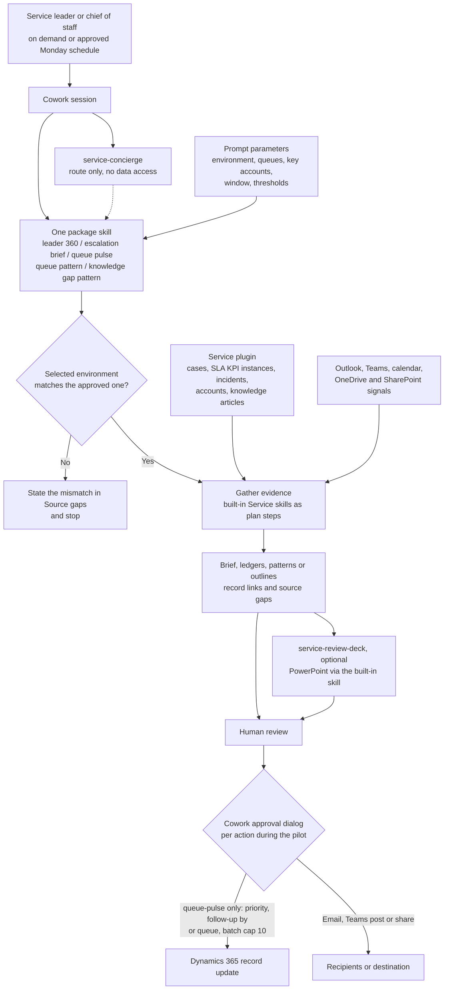

# Chief of Staff D365 Service Cowork Agent - Architecture

## Request Flow

These are seven configured skills that run inside the user's Cowork session and are packaged by
one plugin manifest; they are not separately hosted services. The scenario adds no backend, data
store, index or model. Dynamics 365 security roles, the tenant Dataverse setting, the environment's
MCP configuration and the Cowork approval dialog remain authoritative.

## Components

| Component | Responsibility | Important boundary |
|---|---|---|
| Cowork session | Discover skills, plan the request, run one package skill and keep outputs in the session | Start a new session after package changes |
| `service-concierge` | Name one skill for a goal; send one-case asks to the built-in Service skills | Never queries Dynamics 365, drafts, schedules or changes the environment |
| `service-leader-360`, `escalation-brief` | Weekly leadership brief and one-escalation or one-account brief | Read-only; record link on every case claim; cases and accounts, never agents |
| `queue-pulse` | Five hygiene ledgers and drafted fixes | The only write path: priority, follow-up by and queue; never close, resolve or reassign; batch cap; per-item approval |
| `queue-pattern` | Pattern by queue, product, channel, region or category | Read-only; person dimensions declined |
| `knowledge-gap-pattern` | Uncovered or stale themes and draft article outlines | Never creates, edits or publishes articles; no customer identifiers in outlines |
| `service-review-deck` | Deck from the latest sibling brief | No new data; no deck from a brief that shows an environment mismatch |
| Service plugin (Dynamics 365 Customer Service) | Built-in skills and record access through the product's MCP integration | Service app assignment, MCP configuration and user licences are qualification gates |
| `references/reference.md` per skill | Parameters, definitions, RAG model, layouts, deck maps and gates | Customer defaults are set once by the package owner |
| Microsoft 365 sources | Calendar, mail, Teams and file signals | Only content the signed-in user can open; private detail stays out of outbound drafts |
| Built-in PowerPoint and Word skills | Deck and document creation | Sharing stays behind the approval dialog |

## Identity, Environment and Permissions

- Interactive runs execute as the signed-in user. The Monday schedule runs as its owner, with the
  owner's permissions and selected environment; schedule each leader's brief under one owner.
- Users need Dynamics 365 Customer Service licences and service security roles scoped to the
  queues in scope. Test with one deliberately low-privilege user (CS-06) and confirm that
  permission gaps are stated, not worked around.
- Every output names the environment, and a mismatch with the approved environment stops the run.
  The package tells users to use `list environments` and `Set environment to [environment name]`;
  current Microsoft Learn guidance selects the environment in the Service plugin's Settings, and an
  administrator may configure a default. The schedule owner confirms the environment before
  activating the Monday run.

## Data and Evidence Contract

| Claim | Required backing |
|---|---|
| Case facts: status, priority, SLA, owner, queue | Dynamics 365 record link |
| Interaction claims | Named email, meeting or Teams source with its date |
| Exposure claims: entitlement, linked cases, commercial or regulatory context | Record evidence, marked inferred when indirect |
| Missing stakeholder | Role expected for the stage with no contact or touch recorded |
| Anything without backing | Omitted, or stated as an open question |

The hygiene and pattern definitions live in each skill's `references/reference.md`:

| Term | Package definition |
|---|---|
| SLA breached | Active case with any SLA KPI instance past its target |
| SLA at risk | Active case within 20% of an SLA KPI target with no resolution |
| Aging | Active case older than 10 days |
| Waiting on customer | Status reason "waiting on customer" for 48 hours or more |
| Unowned or no next action | No owner, or follow-up by empty or more than 2 days in the past |
| Reopened | Case reactivated in the last 7 days |
| Knowledge gap | Theme of 5 or more cases with no current article, a stale article (180 days, draft or expired) or an article linked to fewer than 25% of its cases |
| Small sample | Fewer than 20 cases for a queue-pattern value; reported as an observation only |

Cases linked to an open incident are reported but never nudged, and incident-driven themes are
listed separately from knowledge gaps. The reporting window defaults to the previous Monday
through Sunday.

## Approval Boundaries

| Action | Behaviour | Pilot rule |
|---|---|---|
| Read Dynamics 365 and Microsoft 365 sources | Automatic, under the user's permissions | Not applicable |
| Update priority, follow-up by or queue (`queue-pulse`) | Record, field, old and new value previewed; Cowork approval dialog per write; committed list reported | One by one, within the batch cap; never "Approve & don't ask again" |
| Close, resolve or reassign a case; any other record write | Not performed by any skill | Make the change in Dynamics 365 directly |
| Create, edit or publish a knowledge article | Not performed; outlines stay drafts for review | Knowledge owner action only |
| Send customer messages, post to Teams, share a brief or deck | Exact recipients and content previewed; Cowork approval dialog; customer replies are handed to the built-in drafting skill | Per action; never "Always allow" |
| Create or change the Monday schedule | Done by the schedule owner after acceptance | Approval to schedule does not approve distribution |
| Change the Dynamics 365 environment | Never performed by a skill | User or administrator action only |

## Operations

Keep the package version, reference defaults, SLA definitions, Monday prompt text, schedule owner,
permitted fields, batch cap and plugin manifest version under change control. Purview captures
Cowork activity under Copilot activities.

To roll back, block the plugin in the Microsoft 365 admin center (Agents > Tools > plugin > Users >
Block; new conversations only), then pause or delete the schedule from Automations; blocking the
plugin does not stop an existing schedule from attempting to run. To stop the Service integration,
remove the pilot group from the tenant Dataverse setting, or disable the MCP access the Service
plugin uses on that environment (the author's runbook names the Dataverse MCP server); this stops
every MCP-dependent tool there. See the [delivery runbook](3.Runbook.md) for acceptance and
handover.
