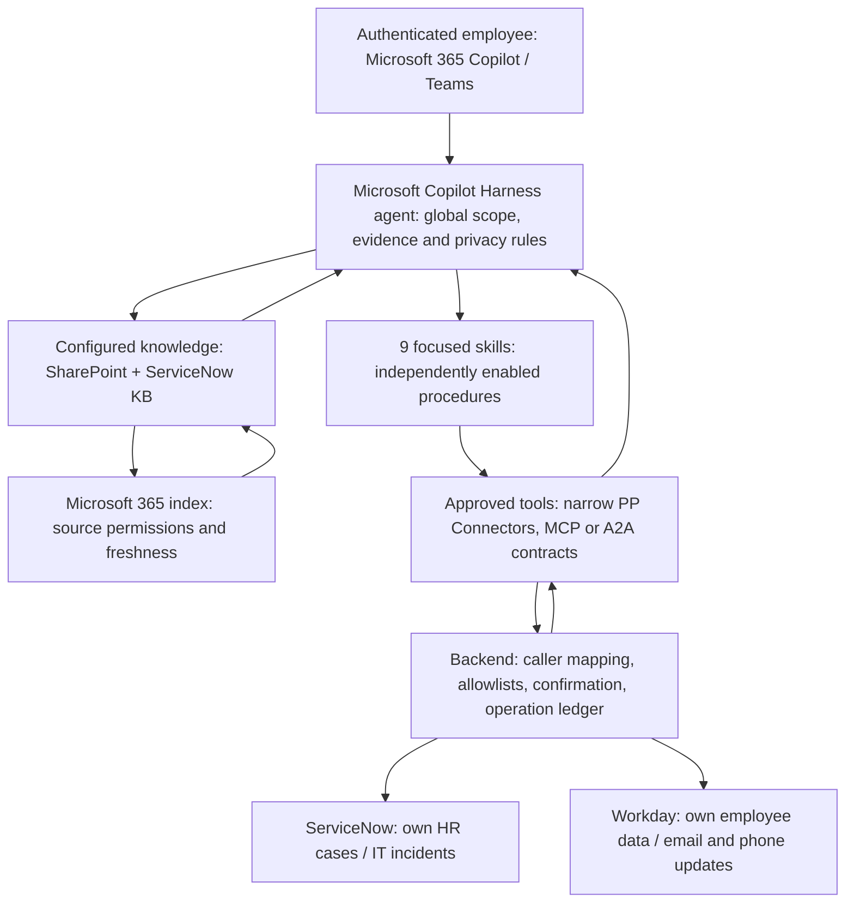

[1. Overview](1.Overview.md) > **2. Architecture** > [3. Scope and Readiness](3.Scope-and-readiness.md) > [4. Runbook](4.Runbook.md) > [5. Sample Prompts](5.Sample-prompts.md)

# Employee Self-Service Agent with Microsoft Copilot Harness - Architecture

> **Host**: Microsoft Copilot Studio, Microsoft Copilot Harness.
> **Authored**: 2026-10-28. Design and contracts only; no live integration.

## Architecture and data flow

Channels are proposed pilot surfaces supported at the host level; tenant availability, authentication, sensitive output rendering and end-user tool sign-in must still pass the runbook gates.

| Layer | Responsibility / boundary |
|---|---|
| Global instructions | HR/IT scope, grounding, privacy, no implicit writes, failure handling even when no skill loads |
| Skills | Select and execute a task-specific procedure; not a tool, identity assertion, scheduler or access-control mechanism |
| Knowledge | Retrieve approved policy/KB text and links; **no external operation tool** for the two knowledge capabilities |
| Live tools | Read source-system records or initiate one named action; absent until implemented and configured |
| Backend/workflow | Enforce actual caller, own-record scope, field/action allowlists, validation, exact-payload confirmation, concurrency and operation reconciliation |

A policy question follows employee -> agent -> configured knowledge -> cited answer. A personal-record question follows employee -> enabled skill -> delegated backend tool -> authorized live record -> minimal answer with source ID and retrieval time. Indexed KB content and pasted record text never establish live status or ownership.

A mutation follows authoritative metadata and current-record reads -> prepare immutable target/payload -> trusted confirmation -> authorized commit with concurrency and idempotency checks -> operation-status/read-back verification. A separate attachment action follows a completed create/update if requested and enabled. A failed attachment does not undo a successful case creation or cause it to be repeated.

## Source-to-Microsoft-Copilot-Harness mapping

The local source has **no topic exports, runtime skills or delivered solution**. Its four Markdown documents cover alternative build options; its resources README proposes future assets only. Topic mapping is not applicable to that source. The mapping below distinguishes retained source behaviors from new capabilities specified for this standalone agent.

| Source asset / behavior | Target component | Disposition / preserved guarantee |
|---|---|---|
| Overview: HR/IT front door, personas, readiness | Overview and staged runbook | Retained without unverified licensing/seat claims |
| Architecture: content topology, authoritative policy per domain | Knowledge source inventory plus `ess-knowledge-answer` | Retained; ACLs are enforcement, geography is relevance |
| Architecture: HRIS and ServiceNow indexed content | KB index separated from live Workday/ServiceNow tools | Changed; knowledge ingestion is not record access |
| Runbook: global instructions, human routes and pilot | Global instruction block and acceptance gates | Re-expressed for Microsoft Copilot Harness |
| Prompts: how-to, links, missing answers and country cases | Knowledge/navigation skills and tests | Retained |
| Prompts: own-case and compensation exclusions | Optional narrowly scoped skills | Expanded by the requested employee self-service scope; default OFF |
| Resources README: suggested screenshots/audits/evaluation | New resources, matrix, skills and evidence register | Re-expressed; no screenshots or personal data copied |
| New ServiceNow HR case operations | `list-hr-cases` and `submit-new-hr-case` | List and create are separately enabled for one's own cases; details, updates and attachments remain excluded |
| New ServiceNow IT incident operations | Six `sn-it-*` skills | Create/list/details/updates/update/attachments separately gated |
| New caller checks, metadata validation and execution controls | Integration configuration and deterministic backend | Reauthorization on every operation; cache never authorizes |
| New Workday employee-information reads and contact updates | Fourteen `wd-*` skills | Twelve reads and two updates; each integration requires independent implementation and validation |

## Capabilities and integration setup

Use the [capability matrix](0.Resources/Capability-matrix.md) as the manifest and the [runbook](4.Runbook.md#phase-2-implement-optional-live-integrations) for integration setup and validation. Tool names are **binding requirements to verify**, not verified vendor operation IDs. A deployment must bind exact real operations and keep every unbound capability OFF.

No connected second agent is required. The agent calls its configured tools directly; backend services enforce identity, authorization and transaction controls.

The [connector employee-information skill](0.Resources/Skills/get-workday-employee-information/SKILL.md) uses `WD-REST-API` with `GET staffing/v7/{tenant}/workers/me` for seven approved core fields. Configure one primary connector/MCP route for overlapping core-profile questions; explicit MCP-only reads remain separately governed. Do not duplicate the core lookup or switch routes after an OFF, denied or failed result.

## Identity, permissions and data handling

| Identity | Required treatment |
|---|---|
| Knowledge ingestion | Admin-managed connector identity reads only approved KB scope and correct user criteria; never used for employee mutations |
| Knowledge retrieval | Signed-in employee's source permissions; test restricted KB and SharePoint items, revoked access, country scoping and index latency |
| ServiceNow actions | Delegated Microsoft Entra user context with validated claim-to-user mapping; no Basic or app-token fallback for employee operations |
| Workday actions | Validated delegated employee identity, Entra SSO and vendor domain security; no shared integration-user or maker-context substitute |
| Workflow owner | Owns configuration and deployment, not permission to impersonate every employee; effective downstream caller must be observable |

Use immutable caller mapping from the authenticated session; never trust a name, UPN or worker ID supplied by the user/model. Own-record scope is narrower than whatever an HR administrator might technically read. Restrict results to employee-visible fields/comments, not internal work notes or sensitive HR narrative. Minimize emergency-contact third-party details; mask national IDs and document numbers in the backend. Do not index personal HR records as knowledge.

Sensitive responses remain within the current authenticated conversation. Do not put personal records, contact values or credentials into persistent memory, public test reports, screenshots or broad telemetry. Choose and validate the memory policy and transcript access/retention with the privacy owner; the baseline does not rely on memory. Use synthetic data for authoring/evaluation. A chat confirmation is not itself a durable backend authorization grant.

Disabling a capability means updating tool exposure, backend permissions and the deployed capability manifest; also cover alternate tools, active sessions, workflows and pending operations. Removing a skill alone is insufficient. Preserve shared connections still needed by other enabled skills or the original agent.

## Reliability and deployment boundaries

Knowledge answers show source versions/effective dates when available and disclose conflicting or stale evidence. Live reads report `observedAt`, coverage and pagination; an empty page is not proof of no records. No population analytics are inferred from one employee's results.

Writes require a durable operation ID and deduplication key tied to caller, operation and immutable payload. An uncertain result is reconciled, never blindly retried. Workday business-process acceptance can be pending rather than effective; polling is bounded and source state wins. Backend state/version changes invalidate confirmation and require a new preview and confirmation. No general exactly-once claim is made for underlying vendors.

The ServiceNow connector's Create Record action can ignore the full description. Integration acceptance must verify description fidelity; do not silently create and then patch through an unrelated operation. Unsupported domains, policy blocks, absent delegated sign-in or unresolved OIDC coexistence are release blockers, not reasons to use elevated credentials.

Microsoft Copilot Harness supports connectors, MCP and Workflows, but each selected integration still requires compatibility validation. Tenant cloud, model, channels, DLP, billing and supported Workday/ServiceNow execution paths remain explicit gates. There is no Microsoft Copilot Harness general-knowledge on/off switch; grounding is instructed and evaluated.

## References and navigation

See [references and validation checks](0.Resources/Official-sources.md) for support boundaries, design decisions and remaining tenant checks.

[Overview](1.Overview.md) | [Scope and Readiness](3.Scope-and-readiness.md) | [Runbook](4.Runbook.md) | [Prompts](5.Sample-prompts.md)
