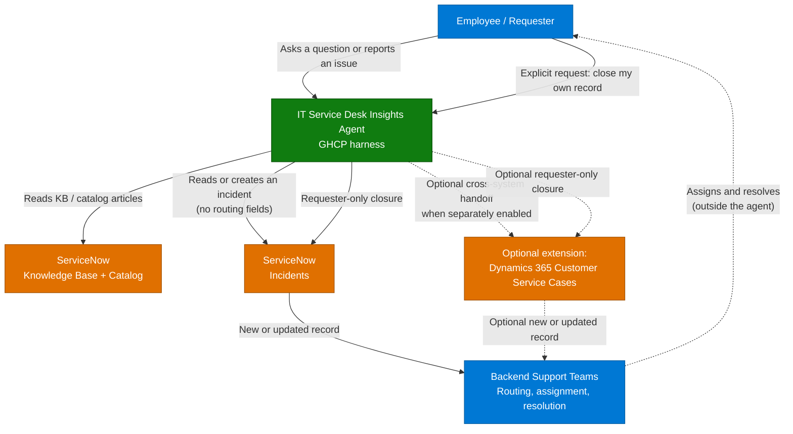

**1. Overview** > [2. Architecture](2.Architecture.md) > [3. Runbook](3.Runbook.md) > [4. Sample Prompts](4.Sample-prompts.md) > [5. Packaging Guide](5.Working-solution.md) > [Release Readiness](0.Resources/Release-readiness.md)

# IT Service Desk Insights Agent with GHCP Harness — Overview

## Scenario Overview

**Scenario Type**: IT Service Management (ITSM) / Employee Support  
**Harness**: GitHub Copilot  
**Agent Type**: Copilot Studio agent  
**Primary Tools**: ServiceNow and Office 365 Users; optional Microsoft Dataverse tools for Dynamics 365 Customer Service handoff  
**Complexity**: Advanced for investigation and controlled actions  
**Status**: Blueprint, not tenant-tested. Includes 8 core ServiceNow and 4 optional Dynamics instruction-only skill definitions, but no agent project or deployable solution. See [included resources](0.Resources/README.md) and [release readiness](0.Resources/Release-readiness.md).

**GHCP means GitHub Copilot harness inside Microsoft Copilot Studio**, not standalone
Copilot CLI or a GitHub engineering integration. This scenario covers investigation and
controlled resolution through one agent with capabilities attached only to that agent,
not an organization-wide skill deployment.

For read-only knowledge and catalog answers in Microsoft 365 Copilot, use the separate
[Agent Builder scenario](../IT-Service-Desk-Insights-Agent/1.Overview.md). Neither scenario
requires deploying the other.

The agent can answer a knowledge question, inspect authorized ServiceNow incident evidence,
guide troubleshooting, and create an incident if the issue remains unresolved. An optional
Dynamics 365 Customer Service extension can add case handoff when another support organization
uses Dynamics as its system of record.
Each action is independently enabled. Allowing ticket creation does not imply permission to
update, annotate, attach files to, or close an existing ticket.

Investigation is based on knowledge, support records, and user-reported symptoms. No device
telemetry, remote diagnostic collection, or endpoint remediation tools are included.

**Routing is backend-owned.** Creating a ServiceNow incident, or an optional Dynamics case,
hands the record to existing backend processes; the agent does not choose an assignee,
owner, or queue.
**Closure is requester-only:** the user must explicitly ask to close their
own record, and the backend must authorize the supported requester-side transition.

---

## Problem Statement

Employees often restart the support process because approved guidance, catalog information,
and the incidents available through their ServiceNow connection are handled separately:

- **Answers depend on which source is reached.** The same question can return knowledge
  guidance in one conversation and miss relevant live incident context in another.
- **Investigations restart at every handoff.** Employees repeat symptoms and attempted fixes
  when support moves between knowledge, incident-management, and case-management systems.
- **Knowledge and ticket context are disconnected.** A support handoff needs the applicable
  guidance, reported symptoms, and attempted fixes together, not just an article link.
- **Knowledge is siloed.** Employees search ServiceNow separately from SharePoint, and neither
  search understands the other's content.
- **Access control gets in the way.** ITSM knowledge bases are heavily segmented (HR-scoped
  articles, region-scoped articles, restricted runbooks). Any Copilot experience over that
  content has to honour those rules exactly, or the project stops.

This agent can perform qualitative analysis over the records it actually retrieves, but it
is not a population analytics or reporting solution. Full-ticket counts, MTTR, SLA
compliance, and trend reporting still belong in ServiceNow reporting, a warehouse, or
Power BI.

---

## Solution Summary

The harness orchestrates knowledge, agent-scoped skills, and narrowly exposed tools.
Skills describe procedures; connectors provide connectivity; workflows/API policies authorize
and execute operations. The [capability matrix](0.Resources/Capability-matrix.md) defines the
required skill, tool, connector action, prerequisites, and dependencies for each operation.
The [Skills folder](0.Resources/Skills/README.md) contains one standalone instruction
definition per capability. The skills assume configured tools and focus on execution;
deployment prerequisites remain in the matrix and runbook.

Knowledge and catalog content do not provide incident records or user feedback. Ticket
analysis requires an enabled, authorized incident read tool; feedback analysis requires
an explicitly connected feedback source. Never infer either from knowledge articles.

Office 365 Users **Get my profile (V2)** supplies the shared `GetMyProfile` tool for
current-user details and an optional language fallback. Its result is reused across skills
in the same conversation; it does not replace backend requester or record-access checks.

The expected benefit is less repeated diagnosis and a more complete handoff, not guaranteed
resolution or inherently better search. Multilingual answers and ticket creation are not
exclusive to the new harness. Live data and write-back depend on the tools that are enabled.

### Key Capabilities

| Capability | Description |
|---|---|
| Grounded knowledge | KB and catalog answers with source references through the configured knowledge/read tools |
| Knowledge-guided investigation | Reviews knowledge and authorized support records, clarifies reported symptoms, and selects a bounded next step |
| Capability-level controls | Separate creation, descriptive updates, internal notes, attachments, and requester closure |
| Evidence-rich handoff | Native ServiceNow creation persists a concise summary and returns detailed manual handoff text; a validated custom create-only operation is required to persist complete evidence. Optional Dynamics handoff applies only to organizations using Customer Service downstream |
| Requester-only closure | ServiceNow closure is independent; optional Dynamics closure applies only when the extension is enabled |
| Permission enforcement | Connector ACLs for indexed knowledge; record authorization and action policies for live tools |
| Multilingual support | User-language conversation while preserving exact errors, identifiers, and the backend's agreed handoff language |

---

### How It Works

An employee asks the agent a question or describes a problem in an ordinary conversation.
The agent answers from approved ServiceNow knowledge and catalog content when that is enough,
citing its source. When the question needs live evidence, enabled read tools pull the
signed-in person's own incidents through an invoker-authenticated ServiceNow connection,
using a focused and bounded query. ServiceNow impersonates the current user and enforces the
own-record boundary through server-side incident ACLs; `GetMyProfile` is not used to decide
record ownership.
If knowledge and existing records do not resolve it, the agent gathers the reported symptoms
and attempted fixes. The proposed native ServiceNow profile creates an incident with a
`short_description` and return the detailed evidence as a manual handoff summary; a validated
custom create-only operation is required when the complete description must be persisted at
creation. When the optional Dynamics extension is enabled, a separately approved handoff can
create a Customer Service case for a downstream team that does not work in ServiceNow. The
agent never decides who picks up either record next; each backend routes and assigns its own
records. The agent closes a record only when that
record's own requester explicitly asks, and only after the backend confirms they are
actually eligible to close it; a report that "it's fixed" is not by itself a closure instruction.

**Step sequence:**

1. Reuse or retrieve the current user's profile when needed, then establish the affected
   service, reported symptoms, and relevant time window without repeating known intake questions.
2. Retrieve permitted knowledge and live evidence using enabled capabilities.
3. Review the evidence, provide source-grounded guidance, and ask for the user's observed
   outcome. Do not present reported findings as independently verified device telemetry.
4. Verify support-record action results. Pending, failed, and unknown outcomes are not success.
5. If unresolved, create a ServiceNow incident or provide a manual handoff. Create a
   Dynamics case only when the optional extension is separately enabled.
6. Close a record only following an explicit request from its verified requester and a
   successful backend-authorized closure. A reported fix never closes it automatically.

---

## Business Outcomes

| Outcome | Description |
|---|---|
| 📉 Deflect tier-1 tickets | Employees self-serve knowledge and catalog answers from the Copilot they already use |
| Reduce repeated intake | Carry source evidence, reported symptoms, and attempted fixes into the support record |
| Reduce handoff effort | Supply backend teams with evidence without taking over their assignment and routing decisions |
| 🧭 Keep knowledge honest | Use source evidence to identify stale or contradictory guidance |
| 🔐 Preserve source access | Validate KB permissions, record authorization, and operation-level controls |

---

## In Scope / Out of Scope

### ✅ In Scope

- Copilot Studio agent-scoped skills with independent tool/action enablement
- ServiceNow KB/catalog reads, incident reads/creation, and optional constrained mutations
- Optional Dynamics 365 **Customer Service** case reads/creation and descriptive updates,
  only for cross-system handoff to a team that uses Dynamics as its system of record
- Requester-initiated closure of the requester's own ServiceNow incident; optional Dynamics
  case closure is a separate extension capability
- Multilingual support, bounded investigation, permission tests, and capability ON/OFF tests

### ❌ Out of Scope

- **Agent-driven routing or assignment**, during creation or later: no routing skill/tool,
  queue selection, ownership change, or assignment-group override. Backend teams own this.
- **Administrative closure, closure on behalf of another requester, or autonomous closure.**
  Read/update access is not requester identity. Closing one record never implicitly closes
  a linked record.
- ERP integrations, Finance/Supply Chain operations, and GitHub engineering support
- Device telemetry retrieval, remote diagnostic collection, and endpoint remediation
- Record deletion, catalog ordering, arbitrary remote scripts, or unrestricted CRUD tools
- Writing through an alternative tool when the corresponding capability is disabled
- Numeric ticket analytics (counts, MTTR, SLA breach rates). Use Power BI over the ServiceNow
  data warehouse. Retrieved samples are not the full ticket population.
- Live ticket status without an enabled, authorized incident read tool
- Replacing the ServiceNow Virtual Agent for customer-facing support.

---

## Target Users

| Persona | Role in This Scenario |
|---|---|
| **Employee / Requester** | Asks for help, approves permitted actions, explicitly requests closure of their own record |
| **Backend Support Team** | Owns assignment, queues, routing, resolution policy, and exceptional lifecycle transitions |
| **ServiceNow Admin** | Provisions the impersonated end-user connection, own-incident ACLs, caller defaults, approved APIs/actions, and lifecycle policy |
| **Dynamics Admin (optional extension)** | Provisions Dataverse case permissions and mappings only when Dynamics handoff is enabled |
| **Microsoft 365 / Power Platform Admin** | Owns environment access, connectors, DLP, publishing, and capacity |
| **Delivery Engineer** | Applies the capability profile, builds tool/workflow contracts, and records acceptance evidence |

---

## Knowledge Sources Used

Configure the knowledge and live-tool connections for this agent independently. An existing
Agent Builder or Graph connection is not automatically migrated.

| Source | Content | Connector |
|---|---|---|
| ServiceNow Knowledge Base(s) | How-to articles, policies, runbooks, FAQ | `sn-knowledge-read` through scoped ServiceNow tools |
| ServiceNow Service Catalog | Requestable items and their descriptions | `sn-catalog-read`; no ordering |
| SharePoint IT site (optional) | Policy documents not maintained in ServiceNow | Validated Copilot Studio knowledge connection |
| ServiceNow incidents | Authorized live incident evidence | `sn-incident-read` |
| Dynamics 365 Customer Service (optional) | Authorized case evidence | `d365-case-read` through Dataverse |

If reusing Graph-indexed content, validate an authorized retrieval path separately. Indexed
KB ACLs do not grant live record access or write permission.

---

## What Actually Goes Wrong

Validate knowledge retrieval and operation boundaries independently:

| Symptom | Root cause | Where it is handled |
|---|---|---|
| Same question answers correctly, then fails minutes later | Inspect retrieval, permissions, and citations; do not assume a single cause | [3.Runbook.md](3.Runbook.md) — Step 7 |
| Agent replies in the wrong language | Profile fallback overrides a clear user preference or message language | Runbook — Steps 1a and 5 |
| Agent cites an article the user cannot open | Knowledge/tool permissions were not validated for the end user | Runbook — Steps 1, 2, and 7 |
| Incident time window is wrong | Date or timezone was inferred from language instead of trusted context | Runbook — Step 1a + [4.Sample-prompts.md](4.Sample-prompts.md) |
| A disabled update still executes | Skill removed but generic action or alternate workflow remains exposed | [Capability matrix](0.Resources/Capability-matrix.md) — execution controls |
| Ticket creation loses investigation detail | Native Create Record description limitation; a hidden update is not a create-only solution | Runbook — Step 2 |
| A case is created with an agent-selected owner | Creation tool accepts backend-owned routing fields | Architecture — routing boundary |
| A colleague can close someone else's case | Closure checks write access or owner instead of verified requester identity | Runbook — Step 4 |
| Agent claims a device is repaired after providing an article | Guidance or user-reported findings were treated as verified device evidence | Runbook — Steps 5 and 7 |

---

## Related Patterns

- [Copilot Connector Knowledge Onboarding](../../02-patterns/Copilot-Connector-Knowledge-Onboarding/Copilot-Connector-Knowledge-Onboarding.md) — how the connectors are deployed and validated
- [Grounding & Response Quality Remediation](../../02-patterns/Grounding-and-Response-Quality-Remediation/Grounding-and-Response-Quality-Remediation.md) — diagnosing inconsistent answers
- [Agent Governance & Rollout Control Plane](../../02-patterns/Agent-Governance-and-Rollout-Control-Plane/Agent-Governance-and-Rollout-Control-Plane.md) — publishing and controlling the agent at scale

---

## Next

→ [2.Architecture.md](2.Architecture.md) — architecture, build-tool decision, and integration points
