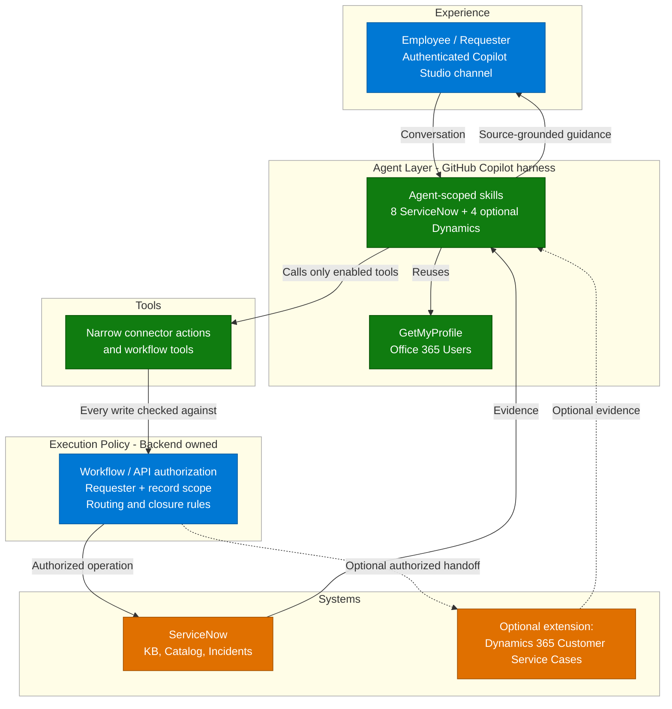

# Architecture — IT Service Desk Insights Agent (GHCP)

[Overview](1.Overview.md) | [Architecture](2.Architecture.md) |
[Runbook](3.Runbook.md) | [Sample prompts](4.Sample-prompts.md) |
[Working solution](5.Working-solution.md) |
[Release readiness](0.Resources/Release-readiness.md)

> **Platform**: GitHub Copilot harness inside Microsoft Copilot Studio
> **Last Updated**: October 2026

---

## Harness Decision and Migration Trade-Offs

The read-only implementation lives in the separate
[Agent Builder scenario](../IT-Service-Desk-Insights-Agent/1.Overview.md). This folder
contains only the GHCP implementation; the comparison below helps choose between them.

| Consideration | Separate Agent Builder scenario | This GHCP scenario |
|---|---|---|
| Best fit | Lightweight knowledge and catalog Q&A | Bounded, multi-step investigation across tools |
| Procedure design | Agent instructions over configured knowledge | Agent-scoped skills plus constrained tools and workflows |
| Live tickets and actions | Not configured in the read-only scenario | Available only through enabled, authorized tools |
| Adaptation | Primarily retrieval and response | Can inspect record evidence and choose the next permitted support step |
| Delivery effort | Connector onboarding and answer-quality work | Also requires capability contracts, backend controls, impersonated-user ACL validation, and operational support |
| Cost | Depends on Microsoft 365 licensing and consumption rules | Usage-based Copilot Credits, including building and previewing |
| Main risk | Retrieval coverage, source freshness, and permissions | Those risks plus consequential actions, retries, and identity propagation |

Use this GHCP scenario for investigation. This is a new agent configuration, not a
harness toggle on the existing declarative agent. Microsoft also documents that standard and
GitHub Copilot harness agents cannot be transferred between harnesses.

Do not justify migration solely by ticket creation, multilingual support, or MCP availability:
the standard harness supports tools, and declarative agents can have action plugins. The
benefit here is the combination of adaptive investigation and reusable, agent-scoped procedures.
No standalone GitHub CLI deployment, ERP connector, or GitHub engineering integration is needed.

## One Agent, Independently Enabled Capabilities

An authenticated employee talks to one Copilot Studio agent running the GitHub Copilot
harness. The baseline profile exposes ServiceNow knowledge and incident capabilities.
Dynamics case tools are a separately enabled extension for cross-system handoff to a support
organization that uses Customer Service as its system of record. Every tool call is checked
against backend-owned execution policy before it runs, so the agent itself never decides
routing, assignment, or who may close a record.

The diagram is the target architecture, not evidence that every layer exists in the local
MVP. The ServiceNow connector uses invoker authentication so the source executes as the
signed-in, impersonated ServiceNow user. Server-side incident ACLs must restrict that user to
records where they are the caller/requester. The local project uses native `CreateRecord`,
where only `short_description` is treated as reliably persisted. Own-record ACL validation,
complete description persistence, and write authorization remain release gates. See
[Release readiness](0.Resources/Release-readiness.md).

| Layer | Component | Responsibility |
|---|---|---|
| Experience | Published, authenticated Copilot Studio agent | Requester conversation and explicit action confirmations |
| Harness | GitHub Copilot harness | Bounded selection of knowledge, skills, and tools |
| Skills | Skills attached only to this agent | Operation-specific procedures; not security boundaries or organization-wide deployments |
| Tools | Narrow connector actions, workflow tools, or MCP tools | Typed inputs/outputs for one permitted operation |
| User context | Office 365 Users `GetMyProfile` | Current-user details and optional language default; scoped to this user's conversation |
| Execution policy | Backend/workflow authorization | Capability checks, requester/record scope, field allowlists, approvals, and deduplication |
| Systems | ServiceNow, optional Dynamics 365 Customer Service | Authoritative knowledge, support records, and business lifecycle |
| State and audit | Approved workflow store and source-system records | Operation IDs, evidence, approvals, partial outcomes, and recovery |

See the [capability matrix](0.Resources/Capability-matrix.md) for the complete mapping from
skill to tool, connector action, prerequisites, and dependencies. Tool names in that matrix
are implementation contracts, not a claim that deployable workflows are included.

### Why Dynamics Is Optional

ServiceNow is sufficient for the core employee-support flow: knowledge retrieval, incident
investigation, incident creation, permitted follow-up actions, and requester-side closure.
Add Dynamics Customer Service only when a separate backend team manages escalated work there
and needs a structured case containing the ServiceNow investigation context. Do not add it
merely to duplicate ServiceNow records: the extension introduces another connection, requester
mapping, permission model, lifecycle, deduplication contract, and partial-failure path.

There is no device telemetry or remote diagnostic/remediation integration. Investigation
combines knowledge, authorized support records, and user-reported findings. An article or
a reported fix is not independently verified evidence of current device health.

**Investigation sequence:** intake, retrieve authorized evidence, evaluate, select another
permitted step, verify the result, then finish or hand off. Configure finite step/time budgets.
Do not repeat an accepted asynchronous action or a write whose outcome is unknown.

Store observed facts, source IDs, timestamps, and action results, not unrestricted raw logs.
Personal agent memory is optional and is not the authoritative incident record or audit log.

### Shared User Profile and Language

Expose Office 365 Users **Get my profile (V2)** (`MyProfile_V2`) as `GetMyProfile`.
The connection must belong to the end user, because "my" refers to the connection's user,
not automatically the person chatting when a workflow uses a maker-owned connection.
Select only `id,displayName,mail,userPrincipalName,preferredLanguage`.

Load these fields when needed and reuse them across skill activations in the current
conversation. Invalidate the cached result on user/connection changes and refresh on
request. Do not share it across users or treat it as cached permission evidence.

The returned profile supports intake and language selection; it is not proof of ServiceNow
requester status or a Dynamics contact/requester relationship. ServiceNow ownership comes
from the impersonated connector identity and source ACLs. Dynamics identity remains a
separate backend mapping. No directory search or profile-update capability is exposed.

Response language follows explicit user preference, then current-message language, then
the profile's nonempty `preferredLanguage`. Ask if none resolves it. Keep the agreed backend
handoff language and exact technical identifiers. This profile tool does not provide timezone.
If profile retrieval fails, stop work needing missing details but allow source-authorized
knowledge reads that do not depend on them; never substitute another identity.

### Capability Execution Controls

Enabling an operation requires its skill, exposed tool, healthy connection, backend
authorization, and any required approval. Disabling a skill alone does not disable a tool.
Remove the corresponding connector action or disable the MCP tool and enforce the restriction
on every backend path, including workflows and alternate APIs.

Keep a shared connector enabled when other capabilities still need it. Do not expose generic
table updates, arbitrary HTTP calls, generic business actions, or Dataverse upsert as
ways to bypass disabled operations. Validate the active profile at execution time; stale
conversations must not retain a revoked write permission.

Creation and every existing-record mutation are separate capabilities. A strict create-only
profile also disables notes, attachments, and requester closure. A profile may instead allow
requester closure while leaving general descriptive updates disabled.

### Routing Boundary - Backend-Owned

**No agent routing or assignment capability is included.** The agent cannot choose a queue,
assignee, assignment group, or case owner, either on creation or through an update. Creation
and update tool schemas must not accept these fields from the model; reject injected fields
rather than silently forwarding them.

The ServiceNow backend team and, when the extension is enabled, the Dynamics backend team
own defaults, assignment rules, queues, and subsequent routing. Their existing automation
may assign a newly created record; that is not an agent routing decision. A Dynamics
escalation means creating a case with approved context, not
invoking `ApplyRoutingRule`, assigning `ownerid`, or adding it to an agent-selected queue.

### Closure Boundary - Requester Side Only

Expose only `CloseOwnIncident` and `CloseOwnCase` through dedicated requester-close workflows:

1. Require an explicit request/confirmation naming the record. A successful fix or "it works"
   is not permission to close anything.
2. Derive identity from authenticated context, never a requester ID supplied by the model.
   For ServiceNow, execute as the impersonated current user and re-read the record through
   the same own-record ACL immediately before the transition.
3. ServiceNow must verify that the current impersonated user is the incident caller/requester.
   In Dynamics, a support owner or a shared customer account is not proof of the individual
   requester; use a verified contact/requester relationship.
4. Enforce eligible states and the backend's requester-side lifecycle. The workflow may invoke
   a supported backend transition, including Dynamics `CloseIncident`, but cannot expose
   generic administrative resolution to the agent.
5. Return confirmed closed, already closed, pending backend processing, or blocked explicitly.
   If requester-side closure is unsupported for that record/state, do not force it using a
   privileged service account. Keep the capability OFF until an authorized path exists.

Requester-only restrictions apply even if a technician or administrator has read/write access.
Record both initiator and execution identity when a controlled backend uses service credentials.
Closing a ServiceNow incident does not close a linked Dynamics case, or vice versa; each needs
its own requester confirmation and authorization. Ownership/status changes invalidate a stale
approval and require reevaluation.

---

## Investigation Data Flow

1. The user describes the issue through the authenticated agent channel.
2. The agent reuses or retrieves that user's minimal profile when needed and establishes
   the affected service, reported symptoms, and explicit time window when relevant.
3. Enabled read tools retrieve authorized knowledge, incidents, and cases. Keep source
   evidence distinct from user-reported symptoms and attempted fixes.
4. The agent selects a permitted next step within the investigation budget. Backend policy
   checks the capability, caller, target, fields, and required confirmation at execution.
5. Execution results are verified using the original operation IDs. Pending or unknown
   outcomes are not reported as completed actions.
6. If unresolved, an enabled create capability records the approved evidence for backend
   support. Routing remains backend-owned; closure requires a separate requester request.

---

## Integration Points

| Integration | Direction | Auth | Notes |
|---|---|---|---|
| Agent → Office 365 Users | Current-user profile read | End-user connection | `GetMyProfile` / `MyProfile_V2`; minimal fields; no target-user input |
| Agent → ServiceNow | Live knowledge/incident operations | Invoker-authenticated connection impersonating the signed-in ServiceNow user | Incident ACLs restrict reads to the current caller/requester; create sets caller server-side; indexed KB ACLs do not authorize live actions |
| Agent → Dynamics Customer Service (optional extension) | Cross-system case handoff through Dataverse | End-user connection or explicitly authorized backend identity | Enable only for a downstream team using Dynamics; fix environment/table and requester mapping |
| Agent → SharePoint (optional) | Knowledge retrieval | Validated end-user access | Only if IT policy docs live outside ServiceNow |
| Agent → Graph-indexed content (optional) | Authorized retrieval adapter | Delegated user permissions | Validate the retrieval path and source ACLs independently |

Choose and validate this agent's knowledge connection separately. If existing Graph-indexed
content must be retained, an authorized retrieval adapter is an option; the Microsoft 365
Copilot Retrieval API supports connector content with delegated user permissions. Do not
assume existing connection configuration or permission evidence automatically transfers.

---

## Write-Back and Handoff Contracts

- Use separate operation schemas for creation, descriptive updates, internal notes,
  attachments, and requester closure. Never accept arbitrary field bags.
- Native ServiceNow `CreateRecord` documents that the full `description` value is ignored.
  The native MVP submits `short_description` only and returns the detailed investigation as
  a manual handoff summary. Use a validated custom create-only operation when complete
  evidence must be persisted; do not add a hidden update to a create-only profile.
- Use Dataverse `UpdateOnlyRecord` for permitted updates, not `UpdateRecord` (upsert).
- Check for an existing relevant ticket/case and use a correlation/idempotency key. Reconcile
  an unknown write outcome before retrying; duplicate records are not a fallback for disabled updates.
- A cross-system handoff is not atomic. If Dynamics creation succeeds but a separately enabled
  ServiceNow note fails, retain the Dynamics ID and report the partial outcome. Do not recreate it.
- Only transfer evidence authorized for the destination. Redact sensitive logs; do not reveal
  internal work notes to a requester who cannot read them.
- Test the actual end-user sign-in experience, including federated identity and connection
  consent. A maker-owned connection is not automatically an end-user connection.

---

## Non-Functional Considerations

| Concern | Guidance |
|---|---|
| Freshness | Report live-tool observation timestamps and asynchronous execution state; indexed knowledge follows its own crawl schedule |
| Scope | No device telemetry, remote diagnostics/remediation, ERP, GitHub engineering support, agent routing, record deletion, or catalog ordering |
| Latency and cost | Bound investigation steps and polling; measure handling time and consumption rather than assuming savings |
| Availability | Confirm tenant/cloud support and entitlements; GitHub-harness MCP integration and memory are documented as preview |
| Auditability | Correlate requester, execution identity, capability/profile version, approval, record ID, and actual outcome |
| Failure handling | Distinguish disabled, denied, unavailable, pending, failed, and unknown; never return success-shaped fallbacks |

## Product References

- [Harnesses in Copilot Studio](https://learn.microsoft.com/en-us/microsoft-copilot-studio/harnesses-overview)
- [GitHub Copilot harness agents and migration constraints](https://learn.microsoft.com/en-us/microsoft-copilot-studio/agents-experience/overview)
- [Skills](https://learn.microsoft.com/en-us/microsoft-copilot-studio/agents-experience/skills-overview) and [tool management](https://learn.microsoft.com/en-us/microsoft-copilot-studio/agents-experience/tools-manage)
- [Usage-based billing](https://learn.microsoft.com/en-us/microsoft-copilot-studio/agents-experience/billing-credit-overview)
- [Microsoft 365 Copilot Retrieval API](https://learn.microsoft.com/en-us/microsoft-365/copilot/extensibility/api/ai-services/retrieval/copilotroot-retrieval)
- [Declarative-agent action plugins](https://learn.microsoft.com/en-us/microsoft-365/copilot/extensibility/overview-plugins)

---

## Next

→ [3.Runbook.md](3.Runbook.md) — step-by-step implementation
