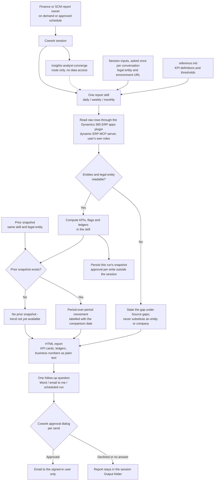

# Insights Analyst D365 ERP Cowork Agent - Architecture

## Request Flow

These are eleven configured skills that run inside the user's Cowork session and are packaged by
one plugin manifest; they are not separately hosted services. The scenario adds no backend,
semantic model, index or model. Finance and operations security roles, legal-entity assignments,
record-level security, the tenant Dataverse setting, the environment's Allowed MCP clients list and
the Cowork approval dialog remain authoritative.

## Components

| Component | Responsibility | Important boundary |
|---|---|---|
| Cowork session | Discover skills, plan the request, run one report and keep outputs in the session | Start a new session after package changes |
| `insights-analyst-concierge` | Name one report and cadence for a goal; send briefs to `erp-concierge` | Never queries Dynamics 365, computes, schedules or sends |
| Daily reports (`cash-liquidity-pulse`, `warehouse-fulfillment-pulse`) | Same-day position and exceptions | Read-only; shortest cadence builds snapshot history fastest |
| Weekly reports (`ar-aging-collections-pulse`, `ap-payment-readiness-pulse`, `inventory-health-pulse`, `procurement-po-health-pulse`, `production-planning-pulse`) | Ageing, readiness and operational health | Read-only; row-level ledgers carry business numbers |
| Monthly reports (`pl-budget-variance-report`, `close-readiness-analytics`, `supplier-performance-report`) | Variance, close readiness and vendor metrics | Read-only; MoM, YoY and days-to-close trends need prior snapshots; no composite vendor score |
| Dynamics 365 ERP apps plugin | Finance & Operations connector to the dynamic Dynamics 365 ERP MCP server; returns rows, not KPIs | Environment version and type, the Dataverse setting, Allowed MCP clients and user roles are qualification gates |
| `reference.md` per skill | KPI definitions, illustrative entities read, snapshot and trend rule, session inputs, record identifiers, output delivery rule and hand-off table | Definition changes need a package version bump |
| Snapshot store | Each run's values with as-of date and legal entity | Location and owner recorded in the pilot boundary; a write outside the session Output folder is approved per write |
| Cowork Word and Outlook capabilities | Word version of the report and the email to self | Word is built from the same data; every email is previewed and approved |

## Identity, Environment and Permissions

- Interactive runs execute as the signed-in user through that user's own connection to the
  Finance & Operations connector. A scheduled run executes as its owner, with the owner's roles,
  legal entities, connection and snapshot history; keep one owner per report and legal entity.
- Each user needs a qualifying finance and operations licence (Dynamics 365 Finance and/or Supply
  Chain Management) and roles that can view the entities each report reads. No posting, approval,
  release or maintain privilege is needed, and none should be granted for the pilot.
- The user configures the connector once and selects the approved environment. Each report asks
  for the legal entity and environment URL once per conversation and states both in its header
  band; the plugin reads the environment it is connected to, and a mismatch visible in its
  response is reported under Source gaps.
- Users see only legal entities their role assignments cover. Test with one deliberately
  low-privilege user and one user assigned only to an out-of-scope legal entity (IA-V-12).

## Data and Evidence Contract

| Claim | Required backing |
|---|---|
| KPI value | Computed from raw plugin rows using the definition in `reference.md` |
| Row-level exception: invoice, order, item, vendor or customer | Plugin data with the record's business number as plain text |
| Period-over-period movement | A persisted prior snapshot for the same skill and legal entity, with its date |
| Flag colour | Thresholds in `reference.md` |
| Anything without backing | Omitted, or stated under Source gaps |

Representative definitions from the shipped `reference.md` files:

| KPI | Package definition |
|---|---|
| Net cash movement | Today's closing balance minus the prior snapshot's closing balance, per bank account |
| AR ageing buckets | 0-30, 31-60, 61-90 and 90+ days past the invoice due date |
| DSO | Total open AR divided by posted customer invoice sales over the trailing period, multiplied by the days in that period |
| Below safety stock | On-hand plus on-order below the item's minimum coverage setting |
| Slow-moving | No outbound inventory transaction in the trailing 180 days or more |
| Material variance | Budget variance above 10% of budget or a configured absolute amount, whichever is lower |
| OTIF % | PO lines received on or before the confirmed delivery date with the ordered quantity, within tolerance |

## Approval Boundaries

| Action | Behaviour | Pilot rule |
|---|---|---|
| Read Dynamics 365 through the plugin | Automatic, under the user's roles and legal entities | Not applicable |
| Post, approve, release, adjust or update any record | Not performed by any skill | The user acts in Dynamics 365 directly |
| Persist the run's snapshot | Kept in the session; a write outside the session Output folder shows the path and file name and requests approval for that write only | Per write; never **Always allow**; a declined write leaves no prior snapshot for the next run |
| Email the report to the user's own address | Recipient, subject, summary and attachments previewed; Cowork approval dialog per send | Per send; never **Always allow** |
| Email anyone else, post to Teams or share a file | Not performed by any skill | Share manually after review |
| Create or change a schedule | Set up only after the user approves; managed from **Automations** | Approval to schedule does not approve any send |
| Change a KPI definition | Package owner edits `reference.md` and bumps the version | Note the change in the next report header |

## Operations

Keep the package version, KPI definitions and thresholds, any preset environment URL, the snapshot
location, scheduled-prompt texts and owners and the plugin manifest version under change control. A
definition change requires a version bump, a note in the next report header and an archived copy of
the previous `reference.md` with the reports it governed. Purview captures Cowork activity under
Copilot activities.

To roll back, block the plugin in the Microsoft 365 admin center (Agents > Tools > plugin > Users >
Block; new conversations only), then pause or delete schedules from **Automations**; blocking the
plugin does not stop an existing schedule from attempting to run. Keep or archive the snapshot
history according to the customer's retention decision. See the [delivery runbook](3.Runbook.md)
for acceptance and handover.
