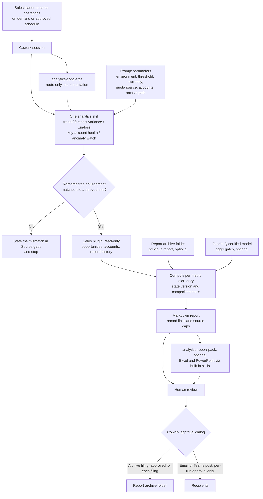

# Insights Analyst D365 Sales Cowork Agent - Architecture

## Report Flow

These are seven configured skills that run inside the user's Cowork session and are packaged by
one plugin manifest; they are not separately hosted services. The scenario adds no backend, data
store, index or model. Dynamics 365 security roles, audit settings and the Cowork approval policy
remain authoritative.

## Components

| Component | Responsibility | Important boundary |
|---|---|---|
| Cowork session | Discover skills, route intent, run the selected skill and keep outputs in the session Output folder | Start a new session after package changes |
| `analytics-concierge` | Name one skill and cadence; quote definitions verbatim | Never queries Dynamics 365 or computes a metric |
| Five analytics skills | Compute one report for one period from the dictionary | Read-only; no per-seller metrics; snapshot when no history or archive |
| `analytics-report-pack` | Turn the latest report into a workbook and deck with a fixed layout | Computes nothing; files to the archive only through the approval dialog |
| Sales plugin (Dynamics 365 Sales) | Opportunity, account and history records through the Dataverse MCP server | Product prerequisites and user licences are tenant qualification gates |
| Opportunity audit or change tracking | Stage, value, close date, forecast category and owner history | Without it, comparisons fall back to the archive or a snapshot |
| `metric-dictionary.md` (v1.0.0) | Definitions, alert bands, anomaly thresholds and health weights | Identical copy in every skill; changes need a package version bump |
| `references/reference.md` per skill | Parameter defaults, alert bands and scheduled-prompt template | Customer defaults are set once by the package owner |
| Report archive folder (optional) | Previous reports for period-over-period comparison | OneDrive or SharePoint path given in the prompt; access follows that folder's permissions |
| Fabric IQ plugin (optional) | Aggregates from a certified semantic model named in the prompt | Not bundled or enabled by the package; the report labels the source |
| Built-in Sales, Excel and PowerPoint skills | Record sets, activity recency, workbook and deck creation | Plain deal prioritisation stays with the built-in Sales skills |

## Identity, Environment and Permissions

- Interactive runs execute as the signed-in user and scheduled runs as the schedule owner.
  Reports contain only records that identity can already open. Schedule each leader's reports
  under one owner so every run sees the same records.
- Users need Dynamics 365 Sales licences and roles that can read opportunity history. Test with a
  low-privilege user and confirm that permission gaps are stated rather than hidden.
- The environment is chosen on the first sales prompt and remembered. Users list environments
  with `list environments` and change the selection with `Set environment to [environment name]`.
  Every report names the environment; a mismatch with the approved environment stops the run.

## Data and Comparison Contract

Each report header records the environment, dictionary version, sources (Sales plugin, Fabric IQ
model name, archive report date), comparison basis and the parameter values used (period,
horizon, value threshold, currency, quota source, key accounts). Unavailable metadata is stated
rather than guessed.

1. Resolve parameters from the prompt, one interactive ask, or the reference defaults.
2. Confirm the remembered environment against the approved one.
3. Read in-scope records and history through the Sales plugin.
4. Compute current values strictly from the dictionary.
5. Compute prior values from record history, else from the archived report, else label a snapshot.
6. Explain deltas with driving deals and record links; apply the small-sample and alert-band rules.

Below-threshold opportunities are summarised as one line. Reports use the environment base
currency unless the prompt names another, and state any conversion. Coverage is not computed
when no quota source exists.

## Approval Boundaries

| Action | Behaviour | Pre-approval |
|---|---|---|
| Read Dynamics 365 records | Automatic, under the user's permissions | Not applicable |
| Create or update Dynamics 365 records | Never performed by any skill | Not applicable |
| Save reports and files in the session Output folder | Automatic | Not applicable |
| File a copy to the report archive folder | Cowork approval dialog | Never; approved for each filing |
| Email or post to Teams | Cowork approval dialog | Never; approved per run |
| Change the Dynamics 365 environment | Never performed by a skill | Not applicable |

Cowork cannot restrict a pre-approval to the archive folder, so each filing is approved when it
happens. See [Archive filing approval](3.Runbook.md#archive-filing-approval) for the pilot
owner's instructions.

## Operations

Keep the package version, metric dictionary version, scheduled-prompt text, schedule owners and
archive path under change control. A dictionary change requires a version bump, a note in the
next report header and an archived copy of the previous dictionary with the reports it governed.
Purview captures Cowork activity under Copilot activities.

To roll back, block the plugin in the Microsoft 365 admin center (Agents > Tools > plugin > Users >
Block), then pause or delete schedules from Automations; blocking the plugin does not stop existing
schedules from attempting to run. See the [delivery runbook](3.Runbook.md) for acceptance and
handover.
