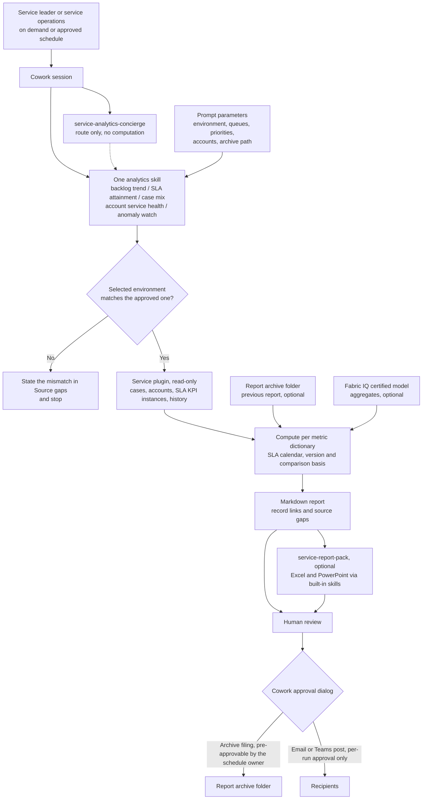

# Insights Analyst D365 Service Cowork Agent - Architecture

## Report Flow

These are seven configured skills that run inside the user's Cowork session and are packaged by
one plugin manifest; they are not separately hosted services. The scenario adds no backend, data
store, index or model. Dynamics 365 security roles, SLA configuration, audit settings and the
Cowork approval policy remain authoritative.

## Components

| Component | Responsibility | Important boundary |
|---|---|---|
| Cowork session | Discover skills, route intent, run the selected skill and keep outputs in the session Output folder | Start a new session after package changes |
| `service-analytics-concierge` | Name one skill and cadence; quote definitions verbatim | Never queries Dynamics 365 or computes a metric |
| Five analytics skills | Compute one report for one period from the dictionary | Read-only; no per-agent metrics; snapshot when no history or archive |
| `service-report-pack` | Turn the latest report into a workbook and deck with a fixed layout | Computes nothing; files to the archive only through the approval dialog |
| Service plugin (Dynamics 365 Customer Service) | Case, account, SLA KPI and history records | Service app assignment, MCP configuration and user licences are tenant qualification gates |
| Case audit or change tracking | Status, priority, queue, owner and SLA KPI history | Without it, comparisons fall back to the archive or a snapshot |
| SLA calendar | Business hours for SLA, resolution and first-response times | Configured on the environment; not changed by the package |
| `metric-dictionary.md` (v1.0.0) | Definitions, alert bands, anomaly thresholds and health weights | Identical copy in every skill; changes need a package version bump |
| `references/reference.md` per skill | Parameter defaults, alert bands and scheduled-prompt template | Customer defaults are set once by the package owner |
| Report archive folder (optional) | Previous reports for period-over-period comparison | OneDrive or SharePoint path given in the prompt; access follows that folder's permissions |
| Fabric IQ plugin (optional) | Aggregates from a certified semantic model named in the prompt | Not bundled or enabled by the package; the report labels the source |
| Built-in Customer Service, Excel and PowerPoint skills | Case enrichment, incident linkage, workbook and deck creation | One-case briefs and "my cases" requests stay with the built-in Customer Service skills |

## Identity, Environment and Permissions

- Interactive runs execute as the signed-in user and scheduled runs as the schedule owner.
  Reports contain only records that identity can already open. Schedule each leader's reports
  under one owner so every run sees the same queues and records.
- Users need Dynamics 365 Customer Service licences and roles that can read case history. Test
  with a low-privilege user and confirm that permission gaps are stated rather than hidden.
- The environment is selected or confirmed through the Service plugin's Settings in Cowork
  (Customize > Service); a selection made in another Copilot experience might not apply to Cowork,
  and an administrator may configure a default. The skills' own text tells users to change it
  with `Set environment to [environment name]`; where that phrase is not honoured, use the plugin
  Settings. Every report names the environment; a mismatch with the approved environment stops
  the run.

## Data and Comparison Contract

Each report header records the environment, dictionary version, sources (Service plugin, Fabric
IQ model name, archive report date), comparison basis and the parameter values used (period,
queues, priorities, KPIs, cuts, key accounts). Unavailable metadata is stated rather than
guessed.

1. Resolve parameters from the prompt, one interactive ask, or the reference defaults.
2. Confirm the selected environment against the approved one.
3. Read in-scope cases, SLA KPI instances and history through the Service plugin.
4. Compute current values strictly from the dictionary, using the environment's SLA calendar.
5. Compute prior values from record history, else from the archived report, else label a snapshot.
6. Explain deltas with driving queues and cases and record links; apply the small-sample and
   alert-band rules; separate incident-driven volume.

CSAT is reported only where a survey record is linked and is otherwise "not available". Unowned
cases are counted, never named.

## Approval Boundaries

| Action | Behaviour | Pre-approval |
|---|---|---|
| Read Dynamics 365 records | Automatic, under the user's permissions | Not applicable |
| Create or update Dynamics 365 records | Never performed by any skill | Not applicable |
| Save reports and files in the session Output folder | Automatic | Not applicable |
| File a copy to the report archive folder | Cowork approval dialog | The schedule owner may pre-approve this one action |
| Email or post to Teams | Cowork approval dialog | Never; approved per run |
| Change the Dynamics 365 environment | Never performed by a skill | Not applicable |

## Operations

Keep the package version, metric dictionary version, scheduled-prompt text, schedule owners and
archive path under change control. A dictionary change requires a version bump, a note in the
next report header and an archived copy of the previous dictionary with the reports it governed.
Purview captures Cowork activity under Copilot activities.

To roll back, block the plugin in the Microsoft 365 admin center (Agents > Tools > plugin > Users >
Block), then pause or delete schedules from Automations; blocking the plugin does not stop existing
schedules from attempting to run. See the [delivery runbook](3.Runbook.md) for acceptance and
handover.
