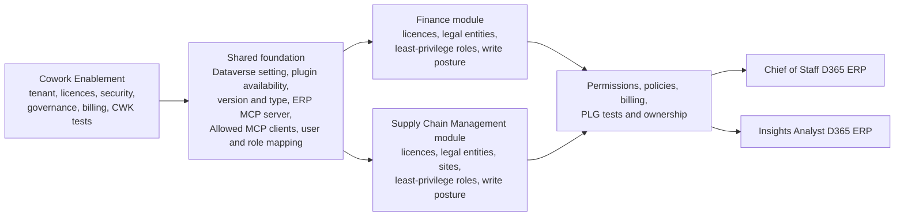
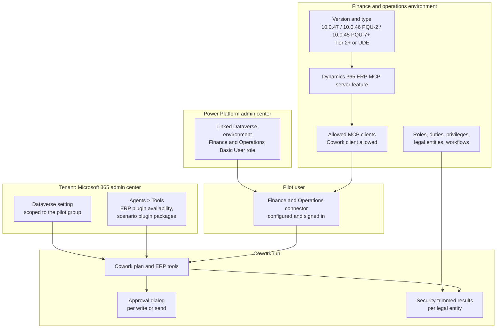

# Cowork D365 Finance and SCM Plugin Enablement

## Purpose

Enable the Dynamics 365 ERP apps plugin for Microsoft 365 Copilot Cowork against Dynamics 365
Finance and Dynamics 365 Supply Chain Management, connect it to an approved finance and operations
environment, and prove permission and legal-entity trimming before any Dynamics 365 ERP scenario
package is installed. This is a **platform enablement pattern**, not a business scenario or a
custom agent build.

It is the finance and operations companion to [Cowork Enablement](../Cowork-Enablement/Cowork-Enablement.md)
and starts only when that pattern's exit criteria are signed off. It covers the plugin layer only:
the tenant Dataverse setting, plugin availability, environment version and type, the Dynamics 365
ERP MCP server and Allowed MCP clients, user and role mapping, legal-entity scope, record-write
policy, billing considerations and run-state ownership. It does not replace a scenario's
business-specific tests. No ZIP, skill or plugin package is supplied by this pattern.

Finance and Supply Chain Management are served by **one plugin connected to one environment**, so
the shared foundation is completed once. The two modules are otherwise independent: they differ in
licences, security roles, legal entities, sites and warehouses, approved scenarios and record-write
posture. Enable Finance only, Supply Chain Management only, or both.

## How the Plugin Reaches Finance and Operations Data

Finance and operations apps are not Dataverse-native. Business data lives in the finance and
operations environment and is reached through the application's server APIs, so this plugin has
more layers than a Dataverse-based plugin, and each is configured explicitly.

| Layer | What it does | Where it is configured |
|---|---|---|
| Cowork plugin (Dynamics 365 ERP apps) | Surfaces the ERP tools in Cowork; each user configures the Finance & Operations connector, selects the environment and signs in once | Microsoft 365 admin center (Agents > Tools); Cowork Sources & Skills panel |
| Tenant Dataverse setting | Gate for the Dynamics 365 plugins in Cowork; if disabled, users see the plugin as disabled by the administrator; changes take up to one hour | Microsoft 365 admin center > Copilot > Settings |
| Linked Power Platform environment | The finance and operations environment is linked to a Dataverse environment; plugin users hold the Finance and Operations Basic User role there | Power Platform admin center |
| Dynamics 365 ERP MCP server (dynamic) | Runs inside the finance and operations environment as a pass-through layer; exposes data, form and action tools discovered at runtime | Feature management; System administration > Setup > Allowed MCP clients |
| Finance and operations security | Every request runs as the signed-in user; roles, duties, privileges, legal entities, record-level security, validations and workflows apply unchanged | System administration > Security |

## Where It Sits

| Scenario | Modules | Needs from this pattern | Extra prerequisites |
|---|---|---|---|
| [Chief of Staff D365 ERP](../../01-scenarios/Chief-of-Staff-D365-ERP-Cowork-Agent/1.Overview.md) | Finance and/or SCM | Step 4, Step 5 and/or Step 6, Steps 7 to 13; PLG-001, PLG-002, PLG-005, PLG-006 and PLG-009 | Workflow work items readable; project access where the project brief is piloted; no write posture |
| [Insights Analyst D365 ERP](../../01-scenarios/Insights-Analyst-D365-ERP-Cowork-Agent/1.Overview.md) | Finance and/or SCM | Step 4, Step 5 and/or Step 6, Steps 7 to 13; PLG-003, PLG-004, PLG-007, PLG-008 and PLG-009 | Snapshot location and owner; material-variance threshold; no write posture |

Both scenarios install their skills through a plugin package targeted at a security group, which
reuses the **Agents > Tools** governance set up in Step 4. Run this pattern once per tenant and
environment. A second scenario on the same environment reuses the evidence and adds only its extra
prerequisites and its own acceptance tests.

## When to Use / Avoid

| Use when | Avoid or separately scope when |
|---|---|
| A Cowork scenario reads Dynamics 365 Finance or Supply Chain Management data through the Dynamics 365 ERP apps plugin | Core Cowork enablement is not signed off |
| Several ERP scenario packages will share one environment, legal-entity scope and write posture | The environment is cloud-hosted or on-premises, or below the minimum version |
| The plugin layer exists but lacks evidence: version, Allowed MCP clients, roles or legal-entity trimming | Works Council or data protection approval for the Dataverse integration is outstanding |
| An accepted pilot moves to new users, legal entities, environments or record writes | The integration needs a custom MCP server, connector or agent; see [MCP Server Integration](../MCP-Server-Integration/MCP-Server-Integration.md) |

Use accepted evidence where it is still current. Revalidate a changed cohort, environment, role
model, legal-entity scope or write posture rather than repeating unrelated setup.

## Control-Plane Architecture

Check each layer separately. A plugin that is visible in Cowork does not prove that the version,
Allowed MCP clients, the Dataverse role, the user's licence or the legal-entity assignment is
correct. The tenant setting and plugin availability decide who can use the plugin; finance and
operations security decides what each user can read or change. Instructions in a scenario skill
are not an authorization boundary.

## Owners and Evidence

| Owner | Responsibility and evidence |
|---|---|
| Delivery engineer | Executes the runbook end to end and records evidence |
| Microsoft 365 / Copilot administrator | Dataverse setting, plugin availability under Agents > Tools and scenario plugin uploads |
| Power Platform administrator | Linked Dataverse environment and the Finance and Operations Basic User role |
| Finance and operations system administrator | Version and type, the ERP MCP server feature, Allowed MCP clients, users, roles and legal entities |
| Finance and supply chain business owners | Scenarios, pilot users, legal entities, sites and warehouses and the record-write posture for their module |
| Security / compliance owner | Data scope, write posture, segregation of duties and Works Council or data protection items |

Keep customer configuration, environment names and test evidence in the customer's governed
workspace. The [runbook evidence list](Cowork-D365-Finance-SCM-Plugin-Enablement-Runbook.md#evidence-artifacts)
identifies what to produce.

## How to Apply

1. **Confirm the gate and scope:** core enablement signed off; module scope (Finance, SCM or both);
   the scenarios that follow; the approved environment, its URL, type, version and linked Dataverse
   environment; in-scope and excluded legal entities; the pilot security group. Stop if any of
   these is unknown.
2. **Validate requirements and risks:** licences, Dataverse integration approval, version and type,
   Power Platform link; log data-quality, broad-role, write, wrong-environment, servicing-window,
   Works Council and segregation-of-duties risks.
3. **Complete the shared foundation:** Dataverse setting, Agents > Tools scope, environment
   readiness, the ERP MCP server feature, Allowed MCP clients and user and role mapping.
4. **Enable each module:** licences, scenario list, least-privilege roles restricted to the
   in-scope legal entities, the record-write posture and approved test records, then a read-only
   validation prompt per module.
5. **Prove permissions and policies:** least privilege, one low-privilege user per module, one
   user assigned only to an out-of-scope legal entity, administrative pages refused, segregation
   of duties unchanged.
6. **Account for billing:** usage-based billing and Copilot Credits for plugin users; page-driven
   and multi-document scenarios run at higher intensity than single lookups.
7. **Verify, test and hand over:** verification checklist, PLG-001 to PLG-009 as applicable,
   success criteria and run-state owners.

Follow the [13-step runbook](Cowork-D365-Finance-SCM-Plugin-Enablement-Runbook.md), including the
[functional tests](Cowork-D365-Finance-SCM-Plugin-Enablement-Runbook.md#functional-tests-and-prompts).

## Boundaries That Must Hold

- Least-privilege finance and operations roles, restricted to the in-scope legal entities, are the
  primary control. The plugin can create, update and delete records and invoke page actions under
  the user's identity, so the Cowork approval dialog is a second control, not the only one.
- Posting, settlement, payment generation, period close, purchase order confirmation, inventory
  adjustments, warehouse work and production posting stay out of the pilot write posture unless
  explicitly approved. Workflows, validations and segregation-of-duties rules remain in force.
- Pilot users never select **Always allow** for record writes or sends; it applies to similar
  actions for the rest of the conversation, not to one recipient or folder. The two scenario
  packages are read-only; their scheduled emails to the user are approved per send, and Insights
  Analyst snapshot writes outside the session are approved per write.
- Scenario outputs report records and conditions, never rankings or ratings of individual
  employees, approvers, buyers, planners or warehouse staff.
- Use security groups for segmentation. Blocking a plugin applies to new conversations only; pause
  schedules separately. Custom skills and plugins are not available on Cowork mobile, and
  Information Barriers block skill and plugin uploads.
- The ERP MCP server is unavailable during servicing windows, returns guidance in US English and
  uses ISO date and number formats regardless of the user's locale.

## Related Patterns

| Pattern | Responsibility |
|---|---|
| [Cowork Enablement](../Cowork-Enablement/Cowork-Enablement.md) | Gating prerequisite: tenant, licences, security, governance, billing and CWK tests |
| [Cowork Skill Delivery and Scheduled Reviews](../Cowork-Skill-Delivery-and-Scheduled-Reviews/Cowork-Skill-Delivery-and-Scheduled-Reviews.md) | Scenario package inspection, distribution and schedules |
| [Cowork Spending Policies and Cost Governance](../Cowork-Spending-Policies-and-Cost-Governance/Cowork-Spending-Policies-and-Cost-Governance.md) | Policies and limits that also meter plugin tool calls |
| [Agent Governance and Rollout Control Plane](../Agent-Governance-and-Rollout-Control-Plane/Agent-Governance-and-Rollout-Control-Plane.md) | Agents > Tools availability, sharing and blocking |
| [Human-in-the-Loop Review and Approval](../Human-in-the-Loop-Review-and-Approval/Human-in-the-Loop-Review-and-Approval.md) | Exact preview and per-action approval for record writes and sends |
| [MCP Server Integration](../MCP-Server-Integration/MCP-Server-Integration.md) | Custom MCP servers and action tools beyond the product plugin |
| [Pilot-to-Scale Validation Gates](../Pilot-to-Scale-Validation-Gates/Pilot-to-Scale-Validation-Gates.md) | Evidence gates before widening plugin scope |

## Scenario Applications

- [Chief of Staff D365 ERP](../../01-scenarios/Chief-of-Staff-D365-ERP-Cowork-Agent/1.Overview.md):
  daily attention lists, decision queues, week-ahead calendars, call briefs and order traces; reads
  workflow work items and, where piloted, project data; read-only.
- [Insights Analyst D365 ERP](../../01-scenarios/Insights-Analyst-D365-ERP-Cowork-Agent/1.Overview.md):
  daily, weekly and monthly KPI reports computed from raw rows, with snapshot-based trends;
  read-only.
- Other Cowork scenarios that read Dynamics 365 finance and operations through the same plugin can
  reuse this evidence and add their own acceptance tests.

## Source Basis and References

Adapted from the user-provided *Dynamics 365 Finance & Supply Chain Management Plugin Enablement
Runbook - Microsoft 365 Copilot Cowork* (version 1.0), written as a companion to a core *Cowork
Enablement Runbook*; in this repository, the [Cowork Enablement](../Cowork-Enablement/Cowork-Enablement.md)
pattern fills that role. Microsoft Learn pages for the Dynamics 365 ERP apps plugin were reviewed on
November 25, 2026. No live-tenant validation is implied. See the
[source interpretation notes](Cowork-D365-Finance-SCM-Plugin-Enablement-Runbook.md#source-basis-and-interpretation).

- [Use Copilot Cowork with Dynamics 365 ERP](https://learn.microsoft.com/en-us/dynamics365/fin-ops-core/fin-ops/copilot/use-copilot-cowork-erp)
- [Enable the Dynamics 365 ERP apps plugin for Copilot Cowork](https://learn.microsoft.com/en-us/dynamics365/fin-ops-core/dev-itpro/copilot/enable-copilot-cowork-erp)
- [Use Model Context Protocol for finance and operations apps](https://learn.microsoft.com/en-us/dynamics365/fin-ops-core/dev-itpro/copilot/copilot-mcp)
- [Manage plugins for Copilot Cowork](https://learn.microsoft.com/en-us/copilot/cowork/cowork-manage-plugins)
- [Available plugins for Copilot Cowork](https://learn.microsoft.com/en-us/microsoft-365/copilot/cowork/cowork-available-plugins)
