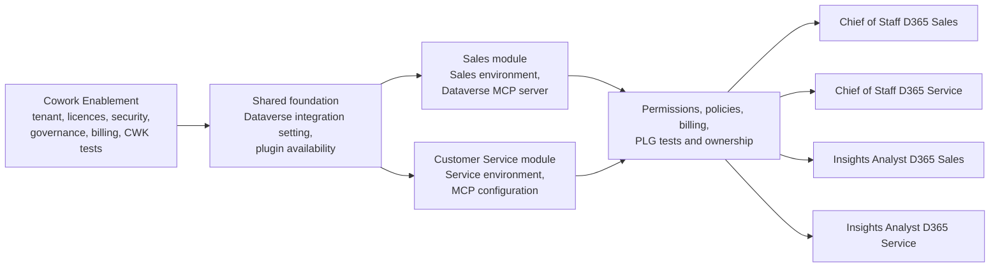
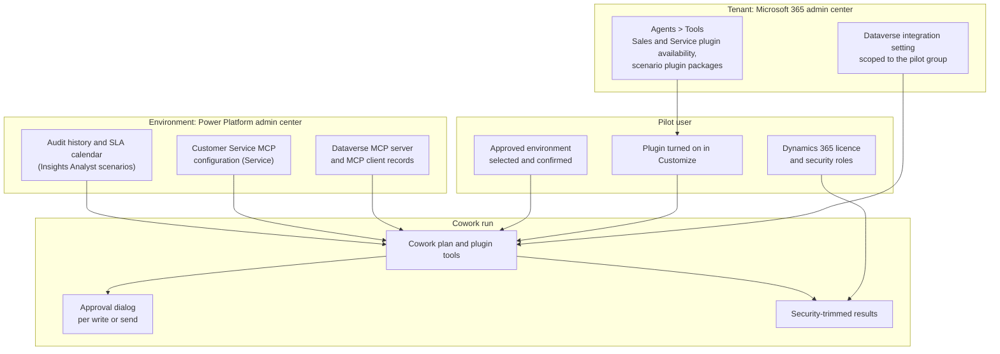

# Cowork D365 Plugin Enablement

## Purpose

Enable the Dynamics 365 Sales and Dynamics 365 Customer Service plugins for Microsoft 365 Copilot
Cowork, connect each plugin to an approved environment, and prove permission trimming and
approval-gated record writes before any Dynamics 365 scenario package is installed. This is a
**platform enablement pattern**, not a business scenario or a custom agent build.

It is the Dynamics 365 companion to [Cowork Enablement](../Cowork-Enablement/Cowork-Enablement.md)
and starts only when that pattern's exit criteria are signed off. It covers the plugin layer only:
the tenant Dataverse integration setting, plugin availability, environment-level MCP settings,
environment selection, security trimming, write posture, record history for analytics, billing
considerations and run-state ownership. It does not replace a scenario's business-specific tests.
No ZIP, skill or plugin package is supplied by this pattern.

The two plugin modules are independent: enable Sales only, Customer Service only, or both. The
shared foundation is completed once when at least one plugin is in scope.

## Where It Sits

| Scenario | Plugin | Needs from this pattern | Extra prerequisites |
|---|---|---|---|
| [Chief of Staff D365 Sales](../../01-scenarios/Chief-of-Staff-D365-Sales-Cowork-Agent/1.Overview.md) | Sales | Steps 4 and 5; PLG-001 to PLG-003, PLG-006 and PLG-007 | Write posture for next step and close date |
| [Chief of Staff D365 Service](../../01-scenarios/Chief-of-Staff-D365-Service-Cowork-Agent/1.Overview.md) | Service | Steps 4 and 6; PLG-004 to PLG-007 | Write posture for priority, follow-up by and queue |
| [Insights Analyst D365 Sales](../../01-scenarios/Insights-Analyst-D365-Sales-Cowork-Agent/1.Overview.md) | Sales | Steps 4 and 5; PLG-001 and PLG-006 to PLG-008 | Audit on opportunity stage, value, close date, forecast category and owner; report archive folder |
| [Insights Analyst D365 Service](../../01-scenarios/Insights-Analyst-D365-Service-Cowork-Agent/1.Overview.md) | Service | Steps 4 and 6; PLG-004 and PLG-006 to PLG-008 | Audit on case status, priority, queue, owner and SLA KPI instances; SLA calendar; report archive folder |

All four scenarios install their skills through a plugin package targeted at a security group,
which reuses the **Agents > Tools** governance set up in Step 4. Run this pattern once per tenant
and plugin. A second scenario on the same plugin reuses the evidence and adds only its extra
prerequisites and its own acceptance tests.

## When to Use / Avoid

| Use when | Avoid or separately scope when |
|---|---|
| A Cowork scenario reads Dynamics 365 Sales or Customer Service data through the built-in plugins | Core Cowork enablement is not signed off |
| Several Dynamics 365 scenario packages will share one plugin, environment and write posture | The integration needs a custom MCP server, connector or agent; see [MCP Server Integration](../MCP-Server-Integration/MCP-Server-Integration.md) |
| The plugin layer exists but lacks evidence: environment names, trimming or approval-gated writes | Works Council or data protection approval for the Dataverse integration is outstanding |
| An accepted plugin pilot moves to new users, environments or record writes | Tenant-wide security-role or data-quality remediation in Dynamics 365 is required |

Use accepted evidence where it is still current. Revalidate a changed cohort, environment, role
model or write posture rather than repeating unrelated setup.

## Control-Plane Architecture

Check each layer separately. A plugin that is visible under Customize does not prove that the
environment's MCP settings, the user's licence or the selected environment are correct. The tenant
setting and plugin availability decide who can use the plugins; Dynamics 365 security roles decide
what each user can read or change. Instructions in a scenario skill are not an authorization
boundary.

## Owners and Evidence

| Owner | Responsibility and evidence |
|---|---|
| Delivery engineer | Executes the runbook end to end and records evidence |
| Microsoft 365 / Copilot administrator | Dataverse integration setting, plugin availability under Agents > Tools and scenario plugin uploads |
| Power Platform administrator | Dataverse MCP server and MCP client records per environment; audit settings |
| Dynamics 365 administrator / business-apps owner | Target environments, security roles, record-write posture and audit history |
| Business sponsor (Sales and/or Service) | Scenarios, pilot users and the record-write posture for their domain |
| Security / compliance owner | Data scope, write posture and Works Council or data protection items where applicable |

Keep customer configuration, environment names and test evidence in the customer's governed
workspace. The [runbook evidence list](Cowork-D365-Plugin-Enablement-Runbook.md#evidence-artifacts)
identifies what to produce.

## How to Apply

1. **Confirm the gate and scope:** core enablement signed off; plugin scope (Sales, Customer
   Service or both); the scenarios that follow; approved environments by exact display name; the
   pilot security group. Stop if any of these is unknown.
2. **Validate requirements and risks:** licences, Dataverse integration approval, and audit
   history and SLA calendar where an Insights Analyst scenario follows; log data-quality, broad-role,
   wrong-environment and Works Council risks.
3. **Complete the shared foundation:** scope the Dataverse integration setting to the pilot group,
   record whether the plugins are preinstalled or deployed, and scope their availability under
   Agents > Tools to the pilot security group.
4. **Enable each plugin module:** environment MCP settings, licences and the approved environment
   name, then a read-only validation prompt per plugin.
5. **Prove permissions and policies:** least-privilege roles, one low-privilege test user per
   plugin, permitted record writes, the approval posture and the people-safety rule.
6. **Account for billing:** plugin tool calls meter Copilot Credits under the core policies; add
   the Dynamics 365 scenarios to the core credit estimation worksheet.
7. **Verify, test and hand over:** verification checklist, PLG-001 to PLG-008 as applicable,
   success criteria and run-state owners.

Follow the [13-step runbook](Cowork-D365-Plugin-Enablement-Runbook.md), including the
[functional tests](Cowork-D365-Plugin-Enablement-Runbook.md#functional-tests-and-prompts).

## Boundaries That Must Hold

- Record writes stay approval-gated. Every proposed update or send appears in Cowork's approval
  dialog, and pilot users never select **Always allow** or **Approve & don't ask again** for
  Dataverse updates or sends. Only report-archive filing in the Insights Analyst scenarios may be
  pre-approved.
- Scenario outputs report records (deals, cases, queues, accounts), never rankings or ratings of
  individual sellers or agents.
- Each user selects and keeps an environment; scenario skills report it and stop on a mismatch.
  Approved environment names are run-state data with an owner.
- Use security groups for segmentation; country or region scoping is not supported for plugin
  availability. Blocking a plugin applies to new conversations only; pause schedules separately.
- Custom skills and plugins are not available on Cowork mobile, and Information Barriers block
  skill and plugin uploads.
- Period-over-period analytics need audit or change tracking on the relevant fields; without it,
  scenario reports are single-period snapshots.

## Related Patterns

| Pattern | Responsibility |
|---|---|
| [Cowork Enablement](../Cowork-Enablement/Cowork-Enablement.md) | Gating prerequisite: tenant, licences, security, governance, billing and CWK tests |
| [Cowork Skill Delivery and Scheduled Reviews](../Cowork-Skill-Delivery-and-Scheduled-Reviews/Cowork-Skill-Delivery-and-Scheduled-Reviews.md) | Scenario package inspection, distribution and schedules |
| [Cowork Spending Policies and Cost Governance](../Cowork-Spending-Policies-and-Cost-Governance/Cowork-Spending-Policies-and-Cost-Governance.md) | Policies and limits that also meter plugin tool calls |
| [Agent Governance and Rollout Control Plane](../Agent-Governance-and-Rollout-Control-Plane/Agent-Governance-and-Rollout-Control-Plane.md) | Agents > Tools availability, sharing and blocking |
| [Human-in-the-Loop Review and Approval](../Human-in-the-Loop-Review-and-Approval/Human-in-the-Loop-Review-and-Approval.md) | Exact preview and per-action approval for record writes |
| [Persona Skill Routing and Scope Isolation](../Persona-Skill-Routing-and-Scope-Isolation/Persona-Skill-Routing-and-Scope-Isolation.md) | Overlap between built-in plugin skills and scenario packages |
| [Pilot-to-Scale Validation Gates](../Pilot-to-Scale-Validation-Gates/Pilot-to-Scale-Validation-Gates.md) | Evidence gates before widening plugin scope |

## Scenario Applications

- [Chief of Staff D365 Sales](../../01-scenarios/Chief-of-Staff-D365-Sales-Cowork-Agent/1.Overview.md):
  Sales module, then the next step and close date write posture proved through PLG-003 before
  `pipeline-pulse` drafts fixes.
- [Chief of Staff D365 Service](../../01-scenarios/Chief-of-Staff-D365-Service-Cowork-Agent/1.Overview.md):
  Customer Service module, then the priority, follow-up by and queue write posture; cases are never
  closed, resolved or reassigned by the package.
- [Insights Analyst D365 Sales](../../01-scenarios/Insights-Analyst-D365-Sales-Cowork-Agent/1.Overview.md)
  and [Insights Analyst D365 Service](../../01-scenarios/Insights-Analyst-D365-Service-Cowork-Agent/1.Overview.md):
  the same modules plus readable record history (PLG-008) and, for Service, a confirmed SLA
  calendar; the packages are read-only.
- Other Cowork scenarios that read Dynamics 365 through the same built-in plugins can reuse this
  evidence and add their own acceptance tests.

## Source Basis and References

Adapted from the user-provided *Dynamics 365 Plugin Enablement Runbook* for Copilot Cowork
(version 1.1, October 2026), which was written as a companion to a core *Cowork Enablement
Runbook*; in this repository, the [Cowork Enablement](../Cowork-Enablement/Cowork-Enablement.md)
pattern fills that role. Microsoft Learn pages for the Sales and Customer Service plugins and the
Dataverse MCP server were reviewed on November 20, 2026. No live-tenant validation is implied. See
the [source interpretation notes](Cowork-D365-Plugin-Enablement-Runbook.md#source-basis-and-interpretation).

- [Manage plugins for Copilot Cowork](https://learn.microsoft.com/en-us/copilot/cowork/cowork-manage-plugins)
- [Available plugins for Copilot Cowork](https://learn.microsoft.com/en-us/microsoft-365/copilot/cowork/cowork-available-plugins)
- [Use sales skills in Copilot Cowork](https://learn.microsoft.com/en-us/dynamics365/sales/use-copilot-cowork-sales-skills)
- [Use Customer Service skills in Copilot Cowork](https://learn.microsoft.com/en-us/dynamics365/customer-service/use/use-copilot-cowork-service-skills)
- [Dataverse data in Microsoft 365 Copilot (tenant setting)](https://learn.microsoft.com/en-us/power-apps/maker/data-platform/data-platform-intelligence)
- [Configure the Dataverse MCP server](https://learn.microsoft.com/en-us/power-apps/maker/data-platform/data-platform-mcp-disable)
