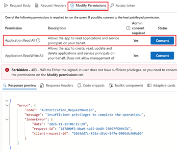
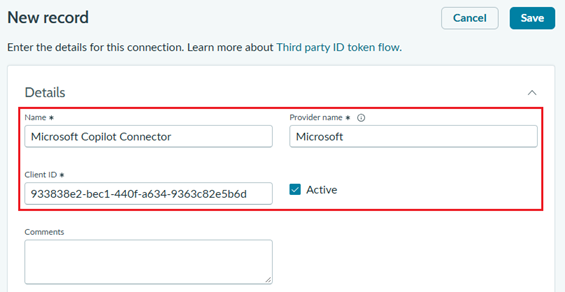
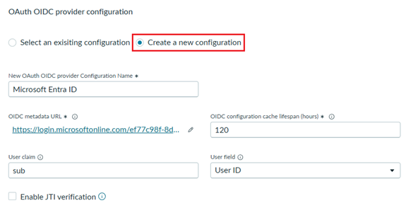
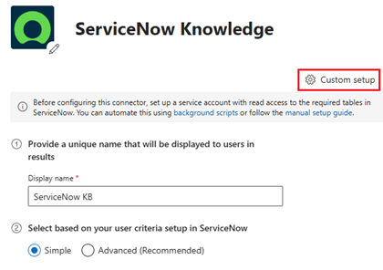
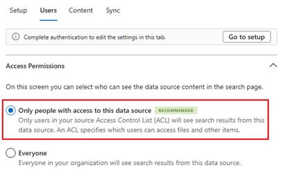

# Runbook - Configure the ServiceNow Knowledge Copilot Connector

## Overview

Configure Federated Auth for the ServiceNow Knowledge Copilot Connector, create its
connection in Microsoft 365, and verify indexed content through Microsoft Search and
Microsoft 365 Copilot. The connector indexes approved knowledge articles; it does not
provide live record access or business-record actions.

> **Before You Start**
> - Verify tenant connector availability, licensing, admin roles and data policies rather than assuming defaults.
> - Follow [ServiceNow prerequisites](https://learn.microsoft.com/en-us/microsoft-365/copilot/connectors/servicenow-knowledge-admin-setup) and [connector deployment](https://learn.microsoft.com/en-us/microsoft-365/copilot/connectors/servicenow-knowledge-deployment), including source permissions and identity mapping.
> - Use an approved isolated developer instance for sample articles; production needs HR-approved content and a supported governed environment.

---

## Prerequisites

| Requirement | Details |
|---|---|
| ServiceNow instance | An approved instance URL; create a developer instance with the [developer tenant setup runbook](ServiceNow-Developer-Tenant-Setup-Runbook.md) if needed |
| HR plugin and knowledge bases | Complete the [HR plugin installation and knowledge-base verification](ServiceNow-HR-Plugin-Installation-Runbook.md) for this HR scenario |
| ServiceNow administrator access | Authorized access to configure the OIDC integration and integration user |
| M365 Admin access | Required to install and configure the Copilot Connector |
| Microsoft 365 Copilot license | Required for the tenant where the connector will be installed |
| Entra tenant ID | Your Microsoft Entra Directory (tenant) ID |

---

## 1. Configure Federated Credentials for ServiceNow Copilot Connector

Configure **Federated Auth** so the connector can authenticate to ServiceNow without storing or rotating a client secret. These steps follow [Microsoft's Federated Auth setup instructions](https://learn.microsoft.com/en-gb/microsoft-365/copilot/connectors/servicenow-knowledge-deployment#federated-auth-federated-identity-credentials) and use the **New Inbound Integration Experience** available in Zurich and later releases, including Australia.

> Use a ServiceNow admin account authorized to create OIDC providers and users. Have your Microsoft Entra **Directory (tenant) ID** ready; find it under **Microsoft Entra ID > Overview** in the Azure portal. Use your own tenant values, not the example GUIDs in screenshots.

1. Open [Microsoft Graph Explorer](https://aka.ms/ge).
2. Sign in with your tenant's admin account.

   

3. Select **GET**, paste the following URL into the query text box, and click **Run query**. In the response, copy the **id** GUID from the matching entry in the **value** array.

   ```text
   https://graph.microsoft.com/v1.0/servicePrincipals?$filter=appId eq '933838e2-bec1-440f-a634-9363c82e5b6d'
   ```

   

   If you receive 403 access denied then grant **Application.Read.All** permissions to your admin account

   

   > **Keep the two IDs distinct:** `933838e2-bec1-440f-a634-9363c82e5b6d` is Microsoft's fixed **application (client) ID**. The response's **id** is the **service principal object ID in your tenant**; save that value for the ServiceNow integration user's **User ID**. Do not create a new app registration for this flow. If the query returns no matching entry, resolve the missing service principal before continuing; do not substitute another GUID.

4. In the ServiceNow portal, open **All**, search for **oauth**, and select **System OAuth > Application Registry**.

   

5. Select **New**.

   

6. Select **New Inbound Integration Experience**.

   

7. Click **New integration**.

   

8. Select **Third party ID token issued by OIDC supporting identity provider**.

   

9. Configure the integration as shown in the screenshots below, then save the provider configuration and integration.

   

   &nbsp;

   - **OIDC Metadata URL**, use `https://login.microsoftonline.com/<tenantId>/v2.0/.well-known/openid-configuration`, replacing `<tenantId>` with your own **Directory (tenant) ID**
   - OIDC configuration cache lifespan: `120`
   - User claim: `sub`
   - User field: `User ID`
   - Enable JTI verification: **unchecked**

   

   

10. Open **All**, search for **users**, and select **System Security > Users and Groups > Users**. Depending on the ServiceNow release, this can appear under **User Administration > Users**

    

11. Click **New** to create an integration user.

    

12. Set the values as shown in the screenshot below and click **Submit**. For **User ID**, paste the **service principal object ID** copied from the Graph Explorer response in item 3.

    

13. Find and select the new user.

    

14. In the **Roles** related list, click **Edit...**.

    

15. Add **knowledge_admin**, **user_criteria_admin**, **user_admin**, and **sn_hr_core.admin**, then click **Save**.

      > **Human Resources Scoped App: Core** [plugin](ServiceNow-HR-Plugin-Installation-Runbook.md#1-install-hr-plugin) needs to be installed before **sn_hr_core.admin** role can be assigned. It may also take some time to appear after the plugin is installed before this role is visible. Confirm that installation has completed, wait a little longer, and refresh the role list before adding it. If you started this setup while installation was running, complete the [knowledge-base verification](ServiceNow-HR-Plugin-Installation-Runbook.md#2-verify-knowledge-bases-are-available) before continuing.

      

      > The first three roles are specified in Microsoft's Federated Auth instructions; **sn_hr_core.admin** is added for this HR scenario. If your approved connector setup uses a custom crawling role, assign that role to this integration user as well. Do not assign the general **admin** role to the integration user. Roles do not replace required REST/table ACLs, approved corpus filters or source-permission configuration.

Before continuing, confirm that the OIDC integration is **Active**, the client ID and tenant metadata URL are correct, and the integration user's **User ID** and roles match the settings above. In [step 3](#3-configure-the-connection-settings), select **Federated Auth** for this configuration.

---

## 2. Add a New Connection in M365 Admin Center

> Use a separate **scoped integration identity** for ingestion, with privileges required by the selected supported authentication method. Setup admin credentials are not the runtime connector identity. Follow the official prerequisite/authentication sections before creating the connection.

1. Log in to **M365 Admin Center** → https://admin.microsoft.com
2. Navigate to **Copilot** → **Connectors** → **Connectors** → **Gallery**
3. Browse the connector gallery

   

4. Select **ServiceNow Knowledge**
5. Open its connection setup

   

---

## 3. Configure the Connection Settings

1. Click **"Custom setup"** in the upper right of the screen

   

2. Fill in the following fields in the **Setup** tab and then click **Authorize**:

   | Required Field | Value |
   |---|---|
   | Display name | `ServiceNow` *(or a unique name, e.g., `ServiceNowKB5`)* |
   | User criteria | **Simple** |
   | ServiceNow URL | `https://dev[XXXXXX].service-now.com` *(your instance URL from [developer tenant setup](ServiceNow-Developer-Tenant-Setup-Runbook.md#4-request-a-servicenow-instance))* |
   | Authentication type | **Federated Credentials (Recommended)**, using the configuration from [step 1](#1-configure-federated-credentials-for-servicenow-copilot-connector) |
   | Notice | Review and acknowledge the actual notice after verifying permissions |

   > Complete the federated credentials setup in step 1 before authenticating. Use **Simple** only when the knowledge-base and article user criteria do not use advanced scripts; otherwise configure **Advanced** and its required REST API setup. If organizational policy requires a different authentication method, follow its distinct prerequisites in [connector deployment](https://learn.microsoft.com/en-us/microsoft-365/copilot/connectors/servicenow-knowledge-deployment#choose-authentication-type).

   

---

## 4. Configure User Access Permissions

1. Click the **"Users"** tab at the top of the setup panel

2. Under **Access Permissions**, select **Only people with access to this data source**. Preserve source permissions, not Everyone.

   

---

## 5. Create the Connection

1. If the **Create** button is disabled, verify that the connector is authorized in the **Setup** tab. Sometimes the button remains disabled even when everything is configured correctly. If that happens, click **Save and close**, then follow the next two steps. If **Create** is already enabled, click it and continue to item 4.

   

2. Click **Your connections**, select the connection, and click **Edit**.

   

3. Review and select **Notice**. You should now be able to click **Create** to create the connection. If the button is still disabled, resolve any authorization or required-field errors before continuing.

   

4. The button will display **"Creating connection"** while the process runs

---

## 6. Add a Connector Description

1. Once the connection is created, a success screen will appear:
   **"Created connection — ServiceNow (ServiceNowKB[X])"**

   

2. Click **"Auto suggestion"** to have Copilot generate a description automatically

   

   > 💡 **If "Auto suggestion" does not work**, you can add the description later:
   > - Wait until the connection status shows **"Ready"**
   > - Click the connection in the list → Click **"Edit description"**
   > - Paste the following sample description:

   ```
   Approved ServiceNow IT and HR knowledge articles for employee self-service. Covers IT troubleshooting, hardware, software, account access, network connectivity and service request guidance, plus HR policies, benefits, leave, wellness, workplace and onboarding. Use current articles applicable to the employee's location and circumstances, and cite the source. This index does not provide personal employee records or live incident, service request or HR case status, and cannot perform transactions.
   ```

3. Click **"Save"** and **"Done"**

   > Wait until the connection is **Ready** and both content and identity processing have completed. Inspect actual status and errors; a fixed wait does not establish readiness.

   

---

## 7. Verify Indexed Content via Microsoft Search

1. Open the connector to see the indexing progress, which normally takes a few minutes to complete. Refresh to see items being crawled and indexed. Wait for indexing to complete before checking the search results.

   

2. Navigate to https://copilot.cloud.microsoft/search.
3. Type **KB000013\*** in the search, press **Enter** and from the sources on the right side, select **ServiceNow**.

   

4. Confirm that KB articles from ServiceNow are listed in the results

---

## 8. Verify via M365 Copilot Prompts

1. Select **New chat** and click **+** to change data sources.

   

2. Click **Disable all** and select only **ServiceNow**.

   

3. Use the following prompts to verify the connector is working:

   | Scenario | Prompt |
   |---|---|
   | Test basic retrieval | `Find the approved employee handbook and wellness articles. List their titles, source links and applicable populations.` |
   | Test thematic analysis | `What do the approved HR articles say about onboarding? Cite each supported step and mark missing details.` |
   | Test follow-up conversation | `What supporting documents are required for that wellness benefit? Cite the applicable source.` |

   &nbsp;

   

---

## Summary Checklist

| Step | Task | Status |
|---|---|---|
| 1 | Federated Auth OIDC provider and integration user configured | ☐ |
| 2 | New connection added in M365 Admin Center | ☐ |
| 3 | Scoped connection identity, authentication and corpus configured | ☐ |
| 4 | Source permissions, identity mapping and advanced criteria validated | ☐ |
| 5 | Connection created successfully | ☐ |
| 6 | Connector description added | ☐ |
| 7 | Indexed content verified via Microsoft Search | ☐ |


For additional troubleshooting, refer to:
[Troubleshooting the ServiceNow Knowledge Microsoft Copilot connector — Microsoft Learn](https://learn.microsoft.com/en-us/microsoftsearch/troubleshoot-servicenow-knowledge-connector)

---

## Related Resources

- [Create a ServiceNow Developer Tenant](ServiceNow-Developer-Tenant-Setup-Runbook.md)
- [Install the ServiceNow HR Plugin](ServiceNow-HR-Plugin-Installation-Runbook.md)
- [ServiceNow Integration pattern](ServiceNow-Integration.md)
- [Step-by-step runbook](../../01-scenarios/HR-Onboarding-Agent-GHCP/3.Runbook.md)
- [Create the agent in Copilot Studio](../../01-scenarios/HR-Onboarding-Agent-GHCP/3.Runbook.md#phase-2-agent-creation-in-copilot-studio)
- [Release readiness](../../01-scenarios/HR-Onboarding-Agent-GHCP/0.Resources/Release-readiness.md)
- [Microsoft 365 Admin Center](https://admin.microsoft.com)
- [ServiceNow Knowledge connector deployment](https://learn.microsoft.com/en-us/microsoft-365/copilot/connectors/servicenow-knowledge-deployment)
