# Runbook - Configure the ServiceNow Knowledge Copilot Connector

## Overview

Configure Federated Auth for the ServiceNow Knowledge Copilot Connector, create its
connection in Microsoft 365, and verify indexed content through Microsoft Search and
Microsoft 365 Copilot. The connector indexes knowledge articles that match the configured filter; it does not
provide live record access or business-record actions.

> **Before You Start**
> - Verify tenant connector availability, licensing, admin roles and data policies rather than assuming defaults.
> - Follow [ServiceNow prerequisites](https://learn.microsoft.com/en-us/microsoft-365/copilot/connectors/servicenow-knowledge-admin-setup) and [connector deployment](https://learn.microsoft.com/en-us/microsoft-365/copilot/connectors/servicenow-knowledge-deployment), including source permissions and identity mapping.
> - Use an approved isolated developer instance for sample articles; production needs HR-approved content and a supported governed environment.

---

## Prerequisites

| Requirement | Details |
|---|---|
| ServiceNow instance | An approved instance URL; create a developer instance with the [developer tenant setup runbook](ServiceNow-Developer-Tenant-Setup-Runbook.md) if needed |
| Entra ID SSO | For interactive user sign-in; [configure ServiceNow single sign-on with Microsoft Entra ID](https://learn.microsoft.com/en-us/entra/identity/saas-apps/servicenow-tutorial) if required. It does not replace the connector's federated authentication setup |
| Tenant ID | Your Microsoft Entra Directory (tenant) ID |
| ServiceNow administrator access | Authorized access to configure the OIDC integration and integration user, with the `security_admin` role elevated when running the setup scripts |
| Microsoft 365 administrator access | Required to create and configure the Copilot connector |


---

## 1. Configure Federated Credentials for ServiceNow Copilot Connector

Configure **Federated Auth** so the connector can authenticate to ServiceNow without storing or rotating a client secret.

> Use a ServiceNow admin account authorized to create OIDC providers and users. Have your Microsoft Entra **Directory (tenant) ID** ready; find it under **Microsoft Entra ID > Overview** in the Azure portal. Use your own tenant values, not the example GUIDs in screenshots.

1. Follow Microsoft's [Step 1: Get the service principal object ID](https://learn.microsoft.com/en-us/microsoft-365/copilot/connectors/servicenow-knowledge-deployment#step-1-get-the-service-principal-object-id) to retrieve the **Object ID** of your tenant's Copilot connector service principal. Use the enterprise application's object ID, not its application (client) ID or an app registration object ID.

2. Steps 2 and 3 of that guidance explain how to create the ServiceNow OIDC integration and integration user manually. Alternatively, use the [ServiceNow setup scripts](https://learn.microsoft.com/en-us/microsoft-365/copilot/connectors/servicenow-knowledge-setup-scripts) to automate those steps. The following steps use the script-based approach; if you complete the manual setup instead, continue at item 9.

   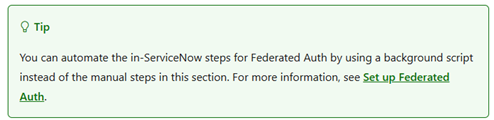

3. Follow the [federated authentication script prerequisites](https://learn.microsoft.com/en-us/microsoft-365/copilot/connectors/servicenow-knowledge-setup-scripts#set-up-federated-authentication), including elevating your ServiceNow role to `security_admin`. Have your **Tenant ID** and the **service principal object ID** from item 1 ready.
   
4. Open [federated_auth_setup.js](https://github.com/microsoft/copilot-servicenow-connector-setup-scripts/blob/main/federated_auth_setup.js), review the script, and select **Copy raw file**.
   
   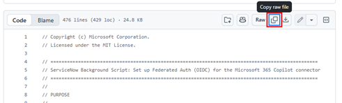
   
5. In ServiceNow, open **All > System Definition > Scripts - Background**.
   
   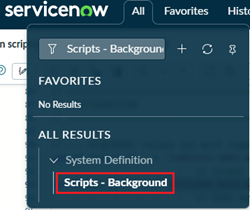

6. Paste the script, scroll to the **CONFIGURATION** section, and set `TENANT_ID` to your tenant ID and `SP_OBJECT_ID` to the service principal object ID. Review the remaining configuration, then select **Run Script**. Confirm that the output summary reports successful completion before continuing.

   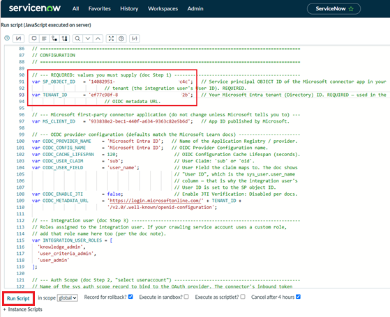
   
7. Open **All > User Administration > Users**.
   
   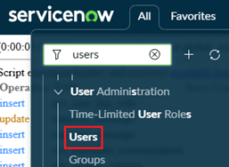

8. Find the integration user whose **User ID** matches the service principal object ID supplied to the script. Confirm that the user is active.
   
   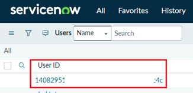

9. If you need to index HR knowledge bases, ensure that **Human Resources Scoped App: Core** is installed. For an isolated developer instance, follow the [HR plugin installation runbook](ServiceNow-HR-Plugin-Installation-Runbook.md#1-install-hr-plugin).
    
10. For HR-scoped content, assign the `sn_hr_core.content_reader` role to the integration user before indexing. Without access to HR-scoped user criteria, the connector can misinterpret restricted articles as unrestricted. See [HR Service Delivery permissions](https://learn.microsoft.com/en-us/microsoft-365/copilot/connectors/servicenow-knowledge-admin-setup#additional-roles-for-hr-service-delivery-hrsd-content).

11. Verify that the integration user can read the required tables and fields; federated authentication alone does not grant all ingestion permissions. Follow [Create service account and grant row-level access](https://learn.microsoft.com/en-us/microsoft-365/copilot/connectors/servicenow-knowledge-setup-scripts#step-1-create-service-account-and-grant-row-level-access) as needed. When using `row_level_acl_setup.js`, set `USER_ID` to the same service principal object ID so that permissions apply to the existing integration user. Add field-level ACLs only where required, following the documented dry-run and impact checks.

Before continuing, confirm that the OIDC integration is **Active**, the client ID and tenant metadata URL are correct, the auth scope is `useraccount`, and the user claim (`sub` or `oid`) maps to the integration user's **User ID**. Confirm that the user's roles match the official setup guidance. In [section 3](#3-configure-the-connection-settings), select **Federated Auth** for this configuration.

---

## 2. Add a New Connection in M365 Admin Center

> Use a separate **scoped integration identity** for ingestion, with privileges required by the selected supported authentication method. Setup admin credentials are not the runtime connector identity. Follow the official prerequisite/authentication sections before creating the connection.

1. Sign in to the [Microsoft 365 admin center](https://admin.microsoft.com).
2. Navigate to **Copilot** → **Connectors**, open the **Connectors** tab, and select **Gallery**.
3. Browse the connector gallery.

   

4. Select **ServiceNow Knowledge**.
5. Open its connection setup.

   


## 3. Configure the Connection Settings

1. Click **Custom setup** in the upper right of the screen.

   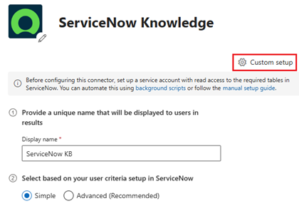

2. Fill in the following fields in the **Setup** tab and then click **Authorize**:

   | Field | Value |
   |---|---|
   | Display name | `ServiceNow` *(or a unique name, e.g., `ServiceNowKB5`)* |
   | User criteria | **Simple** or **Advanced**, depending on your ServiceNow user criteria configuration |
   | ServiceNow URL | `https://[XXXXXX].service-now.com` *(your instance URL)* |
   | Authentication type | **Federated Auth** (shown as **Federated Credential (Recommended)** in the screenshot), using the configuration from [section 1](#1-configure-federated-credentials-for-servicenow-copilot-connector) |
   | API namespace (Advanced only) | The namespace of the configured **Microsoft Copilot** scripted REST API |
   | Notice | Review and acknowledge the actual notice after verifying permissions |

   > Use **Simple** only when the knowledge-base and article user criteria do not use advanced scripts. Otherwise, configure **Advanced** and complete the required [REST API setup](https://learn.microsoft.com/en-us/microsoft-365/copilot/connectors/servicenow-knowledge-setup-scripts#step-4-set-up-rest-api-for-advanced-flow) before authorizing the connection. Follow the subsequent incremental identity sync setup for that flow. See the [user criteria options](https://learn.microsoft.com/en-us/microsoft-365/copilot/connectors/servicenow-knowledge-deployment#choose-flow-based-on-user-criteria).
   >
   > Setup may display a warning when advanced script-based user criteria are detected. Do not rely on the absence of a warning; verify the criteria in ServiceNow.
   >
   > 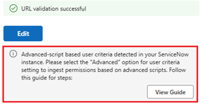
   
   &nbsp;

   > If organizational policy requires a different authentication method, follow its distinct prerequisites in [connector deployment](https://learn.microsoft.com/en-us/microsoft-365/copilot/connectors/servicenow-knowledge-deployment#choose-authentication-type).

   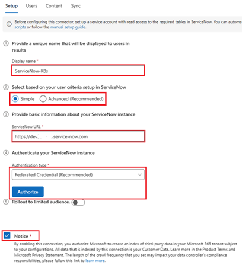


## 4. Configure User Access Permissions

1. Click the **Users** tab at the top of the setup panel.

2. Under **Access Permissions**, select **Only people with access to this data source**. Preserve source permissions, not Everyone.

   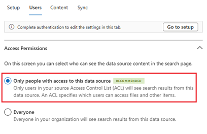

3. Verify identity mapping. By default, ServiceNow email IDs map to Microsoft Entra UPN or mail values. If those values differ in your environment, configure a [custom identity mapping](https://learn.microsoft.com/en-us/microsoft-365/copilot/connectors/map-non-entra-id) and validate it with representative users.

## 5. Configure the Content Filter and Search Schema

In the **Content** tab, you can apply additional content filters and change the search schema under **Manage properties** if needed.

1. To limit indexing to a specific knowledge base, use ServiceNow's encoded query builder on the knowledge article table to generate and validate a filter. Preserve the active and published conditions unless a different scope is explicitly approved. For example:

   ```text
   active=true^workflow_state=published^kb_knowledge_base=<knowledge-base-sys-id>
   ```

   Replace `<knowledge-base-sys-id>` with the knowledge base's actual `sys_id`, not its display name or an article number. Preview the results and confirm that only the intended articles are included.

   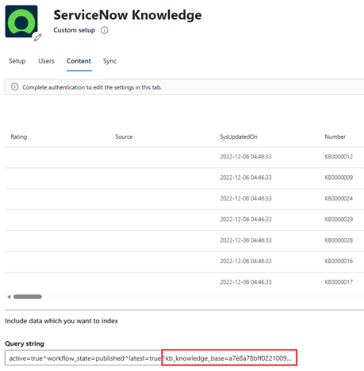


## 6. Create the Connection

1. If the **Create** button is disabled, verify that the connector is authorized in the **Setup** tab. Sometimes the button remains disabled even when everything is configured correctly. If that happens, click **Save and close**, then follow the next two steps. If **Create** is already enabled, click it and continue to item 4.

   

2. Click **Your connections**, select the connection, and click **Edit**.

   

3. Review and select **Notice**. You should now be able to click **Create** to create the connection. If the button is still disabled, resolve any authorization or required-field errors before continuing.

   

4. The button will display **Creating connection** while the process runs. Wait for confirmation that the connection was created.


## 7. Add a Connector Description

1. Once the connection is created, a success screen will appear:
   **"Created connection — ServiceNow (ServiceNowKB[X])"**

   

2. Click **Auto suggestion** to generate a description automatically, then review it for accuracy.

   

   > 💡 **If "Auto suggestion" does not work**, you can add the description later:
   > - Wait until the connection status shows **"Ready"**
   > - Click the connection in the list → Click **"Edit description"**

   &nbsp;

3. Click **Save**, then **Done**.

   > Wait until the connection is **Ready** and both content and identity processing have completed. Inspect actual status and errors; a fixed wait does not establish readiness.

   

---

## 8. Verify Indexed Content via Microsoft Search

1. Open the connector to see the indexing progress. Refresh to see items being crawled and indexed. Completion time depends on content volume and configuration; wait for the connection to be **Ready** and inspect crawl errors before checking search results.

   

2. Sign in as a representative user and open [Microsoft 365 Copilot Search](https://copilot.cloud.microsoft/search).
   
3. Search for a known indexed article title or number, press **Enter**, and select **ServiceNow** (or your configured display name) from the source filters. The screenshot uses **KB000013*** as an example; use an article that exists in your instance.

   

4. Confirm that the expected ServiceNow articles are listed and that their source links open correctly. Test a restricted article with both an authorized user and a user without access: only the authorized user should receive it in search results or Copilot responses. Do not roll out broadly until permission checks pass.


## 9. Verify via M365 Copilot Prompts

1. Select **New chat** and click **+** to change data sources.

   

2. Click **Disable all** and select only **ServiceNow** (or your configured display name), if the source picker is available in your Copilot experience.

   

3. Test with prompts that match your indexed content and the test user's permissions. The following examples require corresponding HR articles; demo data varies, so adapt the topics to articles you verified in section 8. Confirm that answers cite the expected ServiceNow sources rather than treating a plausible answer as proof of retrieval.

   | Scenario | Prompt |
   |---|---|
   | Test basic retrieval | `Find the approved employee handbook and wellness articles. List their titles, source links and applicable populations.` |
   | Test thematic analysis | `What do the approved HR articles say about onboarding? Cite each supported step and mark missing details.` |
   | Test follow-up conversation | After discussing a specific wellness benefit: `What supporting documents are required for that wellness benefit? Cite the applicable source.` |

   &nbsp;

   


## Summary Checklist

| Step | Task | Status |
|---|---|---|
| 1 | Federated Auth OIDC provider and integration user configured | ☐ |
| 2 | New connection added in M365 Admin Center | ☐ |
| 3 | Scoped connection identity, authentication and corpus configured | ☐ |
| 4 | Source permissions, identity mapping and advanced criteria validated | ☐ |
| 5 | Content filter and search schema validated | ☐ |
| 6 | Connection created successfully | ☐ |
| 7 | Connector description reviewed and saved | ☐ |
| 8 | Indexed content and access restrictions verified via Microsoft Search | ☐ |
| 9 | Copilot retrieval, citations, and access restrictions verified | ☐ |


For additional troubleshooting, refer to:
[Troubleshooting the ServiceNow Knowledge Microsoft Copilot connector — Microsoft Learn](https://learn.microsoft.com/en-us/microsoftsearch/troubleshoot-servicenow-knowledge-connector)

---

## Related Resources

- [Create a ServiceNow Developer Tenant](ServiceNow-Developer-Tenant-Setup-Runbook.md)
- [Install the ServiceNow HR Plugin](ServiceNow-HR-Plugin-Installation-Runbook.md)
- [ServiceNow Integration pattern](ServiceNow-Integration.md)
- [Step-by-step runbook](../../01-scenarios/HR-Onboarding-Agent-Microsoft-Copilot-Harness/3.Runbook.md)
- [Create the agent in Copilot Studio](../../01-scenarios/HR-Onboarding-Agent-Microsoft-Copilot-Harness/3.Runbook.md#phase-2-agent-creation-in-copilot-studio)
- [Release readiness](../../01-scenarios/HR-Onboarding-Agent-Microsoft-Copilot-Harness/0.Resources/Release-readiness.md)
- [Microsoft 365 Admin Center](https://admin.microsoft.com)
- [ServiceNow Knowledge connector deployment](https://learn.microsoft.com/en-us/microsoft-365/copilot/connectors/servicenow-knowledge-deployment)
