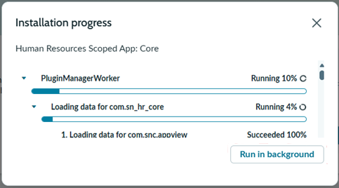

# Runbook - Install the ServiceNow HR Plugin

## Overview

Install **Human Resources Scoped App: Core** with demo data in an isolated ServiceNow
developer instance, then verify that the HR knowledge bases are available.

This runbook prepares the sample content. Authentication and ingestion are covered in
[Configure the ServiceNow Knowledge Copilot Connector](ServiceNow-Copilot-Connector-Configuration-Runbook.md).

---

## Prerequisites

| Requirement | Details |
|---|---|
| ServiceNow developer instance | An approved isolated instance; create one with the [developer tenant setup runbook](ServiceNow-Developer-Tenant-Setup-Runbook.md) if needed |
| ServiceNow administrator access | Authorized access to install the HR plugin and verify knowledge bases |

> Load demo data only in the isolated developer instance. Production needs HR-approved
> content and a supported governed environment.

---

## 1. Install HR Plugin

1. Select the **All** tab in the top navigation.
2. Search for **plugin** and select **Plugins**.

   

3. Search for **Human resources**.

   

4. Select **Human Resources Scoped App: Core** and click **Install**.

   

5. Scroll all the way down in the installation dialog, select **Load demo data**, and then click **Install**.

   

   > **Load demo data** only in this isolated developer instance, not a production environment.

6. Installation can take approximately **15–30 minutes**

   

## 2. Verify Knowledge Bases are Available

After Human Resources Scoped App: Core is installed verify that HR knowledge bases are available

1. Click the **"All"** tab in the top navigation
   
2. Type **"knowledge bases"** in the search field
   
3. Select **"Knowledge Bases"** under **Knowledge > Administration**

   

4. Confirm that the **four default knowledge bases**, including **IT**, and **three HR knowledge bases** are listed.

   

   > These are example default bases. Restrict connector ingestion to the approved HR test corpus rather than indexing all demo content. Confirm the actual base inventory, article/base user criteria and required REST/table ACLs.

---

## Summary Checklist

| Step | Task | Status |
|---|---|---|
| 1 | Human Resources Scoped App: Core installed with demo data in the developer instance | ☐ |
| 2 | HR plugin installation complete; four default knowledge bases, including IT, and three HR knowledge bases confirmed | ☐ |

---

## Related Resources

- [Create a ServiceNow Developer Tenant](ServiceNow-Developer-Tenant-Setup-Runbook.md)
- [Next: Configure the ServiceNow Knowledge Copilot Connector](ServiceNow-Copilot-Connector-Configuration-Runbook.md)
- [ServiceNow Integration pattern](ServiceNow-Integration.md)
