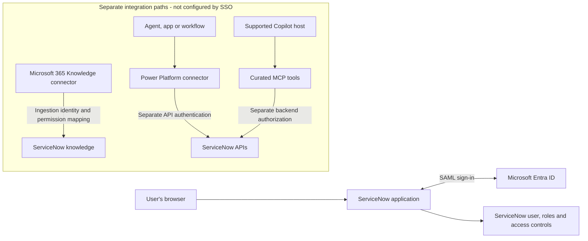

# ServiceNow Integration

Configure ServiceNow integrations with Microsoft 365, starting with **ServiceNow tenant
and Knowledge Copilot connector setup**, **ServiceNow browser SSO with Microsoft Entra ID**, and
**Power Platform connector OIDC authentication**. This pattern separates application sign-in, knowledge
ingestion, live connector operations, and custom tools so that one successful sign-in
is not mistaken for a working integration.

The delivery includes a combined SSO/OIDC configuration runbook, with OIDC authentication
as its own numbered step, and three separate runbooks for developer tenant creation,
HR plugin installation, and Knowledge Copilot connector configuration. Business operations and custom tools below remain
decision guidance, not delivered actions, flows, or tool implementations.

---

## Why This Pattern

| Integration option | Use when you need... | Implementation guidance |
| --- | --- | --- |
| **Entra ID SSO** | Users to open the ServiceNow application with their Entra accounts | [ServiceNow SSO and OIDC configuration runbook](ServiceNow-Entra-ID-SSO-OIDC-Runbook.md) - included |
| Knowledge ingestion | ServiceNow knowledge articles to appear in permission-trimmed Microsoft 365 Copilot search and answers | [Knowledge Copilot connector configuration runbook](ServiceNow-Copilot-Connector-Configuration-Runbook.md) - separate [developer tenant setup](ServiceNow-Developer-Tenant-Setup-Runbook.md) and [HR plugin installation](ServiceNow-HR-Plugin-Installation-Runbook.md) runbooks included; see also [Copilot Connector Knowledge Onboarding](../Copilot-Connector-Knowledge-Onboarding/Copilot-Connector-Knowledge-Onboarding.md) |
| Live connector operations | A Copilot Studio agent, app, or workflow to read or change approved ServiceNow records | [Configure Entra ID OIDC authentication support with ServiceNow](ServiceNow-Entra-ID-SSO-OIDC-Runbook.md#7-configure-entra-id-oidc-authentication-support-with-servicenow) - connection setup included as a separate step; operation configuration and approval remain separate |
| Custom MCP tools | Narrow live operations not adequately covered by the connector | [MCP Server Integration](../MCP-Server-Integration/MCP-Server-Integration.md) - separate service, host authentication, and backend policy required |

**Authentication is not authorization.** Entra app assignment does not create a
ServiceNow user, grant roles, or override ServiceNow access controls. Browser SAML SSO
does not establish an OAuth connection, authorize API operations, or populate a search
index. User provisioning is a separate lifecycle decision.

---

## Architecture

The diagram shows logical integration boundaries, not complete token exchanges.
Browser SSO, knowledge ingestion, and Power Platform OIDC authentication have setup guides in this folder.

Entra authenticates the browser user. ServiceNow maps the assertion to an existing,
active user and applies source permissions. Each other path has its own identity,
permissions, policy, entitlement, and acceptance requirements.

---

## 1. ServiceNow Tenant & Copilot Connector Setup

Use these three runbooks to prepare a developer instance and onboard ServiceNow knowledge
into Microsoft 365:

| Runbook | Scope |
| --- | --- |
| [Create a ServiceNow Developer Tenant](ServiceNow-Developer-Tenant-Setup-Runbook.md) | Create a ServiceNow Developer account and request a Personal Developer Instance |
| [Install the ServiceNow HR Plugin](ServiceNow-HR-Plugin-Installation-Runbook.md) | Install the HR plugin with demo data in an isolated developer instance and verify the available knowledge bases |
| [Configure the ServiceNow Knowledge Copilot Connector](ServiceNow-Copilot-Connector-Configuration-Runbook.md) | Configure Federated Auth and a scoped ingestion identity; create the Microsoft 365 connection with approved corpus and source permissions; verify indexing, retrieval, citations, and access |

If a new instance is needed, complete developer tenant setup before the
SSO/OIDC configuration below. Knowledge connector authentication is separate from the
Power Platform connection configured in step 3.

**Outcome:** approved knowledge articles are indexed and available to permitted users in
Microsoft 365 Copilot. Validate permitted, denied, and revoked access separately; this
does not provide live record access or business-record actions.

---

## 2. ServiceNow Browser SSO with Entra ID

Start with an approved non-production instance and a small pilot. Use an existing
instance or, where available and suitable, a Personal Developer Instance (PDI).
Developer-site access is not the same as an instance entitlement or administrator access;
verify plugin availability and the current developer-program conditions.

The SSO steps in the [combined implementation runbook](ServiceNow-Entra-ID-SSO-OIDC-Runbook.md) cover:

- Instance readiness, retained local administrator recovery, and a configuration baseline.
- The ServiceNow gallery enterprise application and instance-specific SAML values.
- NameID mapping to the intended ServiceNow user field.
- Multi-Provider SSO, identity-provider metadata, and the signing certificate.
- Pilot assignment, positive and negative sign-in tests, rollback, and renewal ownership.

**Outcome:** an assigned user signs in to the correct ServiceNow instance as the intended
ServiceNow account and receives only that account's permitted access. Do not make a new
provider the instance default before pilot acceptance and a separate rollout decision.

---

## 3. Configure Entra ID OIDC authentication support with ServiceNow

Use [step 7 in the combined SSO/OIDC runbook](ServiceNow-Entra-ID-SSO-OIDC-Runbook.md#7-configure-entra-id-oidc-authentication-support-with-servicenow)
to authenticate ServiceNow Power Platform connector API requests independently of browser
SAML SSO. It covers:

- Running `Configure-ServiceNowOIDC.ps1` script with the application display name, instance URL, and authorized ServiceNow administrator credentials.
- Capturing the returned **AppId** for the connection's **Resource URI**.
- Creating a ServiceNow Power Platform connection with **Microsoft Entra ID User Login**.
- Checking existing OIDC provider dependencies and validating an approved read, the
  effective user, and denied access through the consuming host.

**Outcome:** the selected Power Platform host calls ServiceNow as the approved user.
This step does not configure certificate-based application authentication, deliver
business-record actions, or establish that a maker-owned connection executes as each end user.

---

## Integration Boundaries

| Path | Design constraint before implementation |
| --- | --- |
| Knowledge connector | Configure the ingestion identity and source-to-Entra permission mapping separately. Evaluate knowledge-base and article user criteria, including script-based criteria; use the documented Advanced flow where scripts are present. Indexed content is not a live incident feed |
| Power Platform connector | The [OIDC configuration step](ServiceNow-Entra-ID-SSO-OIDC-Runbook.md#7-configure-entra-id-oidc-authentication-support-with-servicenow) uses **Microsoft Entra ID User Login**. The connector's separate **Microsoft Entra ID OAuth using Certificate** option is app-token based, not delegated user access, and is not configured by this runbook. Neither is configured by the SAML enterprise application alone. Check existing Knowledge connector OIDC mappings before changing a provider |
| Record creation | The connector reference documents that `CreateRecord` can ignore the full description. If complete initial content is required, validate a supported create-only alternative or record a blocker; do not silently add an `UpdateRecord` operation |
| Custom tools | Fix the instance, tables, fields, query bounds, and permitted actions in backend policy. Do not expose a generic administrator API or accept model-selected identities |
| Agent delegation | This initial pattern does not claim ServiceNow A2A support or copy Workday's agent registration procedure. Qualify any vendor-agent integration independently |

The Power Platform connector is listed as Premium for Copilot Studio, Power Apps, and
Power Automate; Logic Apps has its own classification. Check current product licensing,
cloud/region support, DLP policy, instance-domain restrictions, and ServiceNow entitlement
for the selected path. An SSO-enabled subscription does not establish those entitlements.

No product action skills, connector packages, flows, MCP server, or deployment automation
are included. Any later action extension needs its own capability and approval boundaries;
all business-record writes are outside this initial delivery.

---

## Shared Prerequisites and Delivery Order

| Area | Confirm before configuration |
| --- | --- |
| Environment | Exact ServiceNow instance URL/release, Entra tenant, intended users, and non-production boundary |
| Administration | Authorized Entra application administrator and ServiceNow administrator; elevation only where the specific change requires it |
| Identity | Active source users, unique claim-to-user mapping, approved provisioning policy, and least-privilege roles |
| Safety | Baseline configuration, approved change window, tested local recovery, and named rollback owner |
| Operations | SAML certificate expiry/renewal, sign-in diagnostics, instance refresh checks, and sanitized acceptance evidence |

1. Record the desired integration path and actual host before adding knowledge or tools.
2. If an instance is needed, complete [developer tenant setup](ServiceNow-Developer-Tenant-Setup-Runbook.md).
   For HR knowledge ingestion, follow [HR plugin installation and knowledge-base verification](ServiceNow-HR-Plugin-Installation-Runbook.md),
   then [Knowledge Copilot connector configuration](ServiceNow-Copilot-Connector-Configuration-Runbook.md).
   The HR runbook includes demo-data setup for an isolated developer instance; adapt the
   corpus and permissions to the approved scope.
3. Complete the instance-readiness and SSO steps in the [combined SSO/OIDC runbook](ServiceNow-Entra-ID-SSO-OIDC-Runbook.md).
4. For Power Platform connections, complete [Configure Entra ID OIDC authentication support with ServiceNow](ServiceNow-Entra-ID-SSO-OIDC-Runbook.md#7-configure-entra-id-oidc-authentication-support-with-servicenow)
   in the same runbook and check existing OIDC provider dependencies before configuring the connection.
5. Configure and validate each path independently; use the actual end-user identity for
   delegated operations and explicitly govern any application identity.

SSO is not a universal technical prerequisite for every
ServiceNow API or ingestion authentication method. If a later integration fails, preserve
the working SSO configuration and diagnose the failing path rather than broadening access.

## Acceptance and Documentation Status

| Boundary | Minimum evidence |
| --- | --- |
| Browser SSO | Fresh SP-initiated login, correct instance and mapped user, assignment denial, expected source access limits, and working administrator recovery |
| Knowledge connector | Separate ingestion and permission tests, including a restricted article and source permission changes |
| Power Platform OIDC | Approved read through the actual consuming host, confirmed effective user/application identity, denied access to restricted data, and no regression of existing integrations |
| Later action path | Approved operation with observed effective identity, a denied out-of-scope operation, and source-backed outcome verification |

This folder contains manual configuration documentation. It does not configure a tenant,
provision accounts, grant permissions, or provide a live acceptance record. Official
references were reviewed on **11 November 2026**; verify release-specific UI and behavior
in the target environment.

## Official References

- [Microsoft: Configure ServiceNow SSO with Entra ID](https://learn.microsoft.com/en-us/entra/identity/saas-apps/servicenow-tutorial) - primary SAML configuration source.
- [ServiceNow Developer Program](https://developer.servicenow.com/) - optional PDI availability and current program guidance.
- [Microsoft: ServiceNow user provisioning](https://learn.microsoft.com/en-us/entra/identity/saas-apps/servicenow-provisioning-tutorial) - separate lifecycle configuration.
- [Microsoft: ServiceNow Power Platform connector](https://learn.microsoft.com/en-us/connectors/service-now/) - authentication types, operations, licensing classification, and limitations.
- [Microsoft: ServiceNow OIDC user mapping and coexistence](https://learn.microsoft.com/en-us/copilot/employee-self-service/servicenow-hrsd-itsm#servicenow-configuration) - supplemental Power Platform configuration guidance and existing-provider constraints.
- [Microsoft: Deploy the ServiceNow Knowledge connector](https://learn.microsoft.com/en-us/microsoft-365/copilot/connectors/servicenow-knowledge-deployment) - separate ingestion authentication and permissions.
- [Microsoft: Assign users and groups](https://learn.microsoft.com/en-us/entra/identity/enterprise-apps/assign-user-or-group-access-portal) - assignment and group licensing requirements.
- [Microsoft: Manage federation certificates](https://learn.microsoft.com/en-us/entra/identity/enterprise-apps/tutorial-manage-certificates-for-federated-single-sign-on) - certificate lifecycle.
