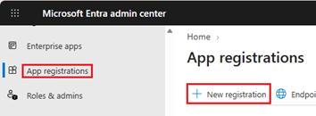
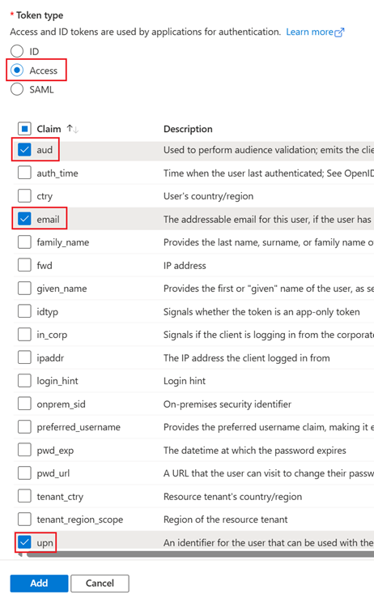
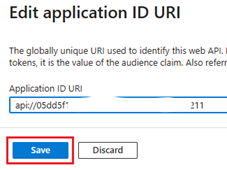
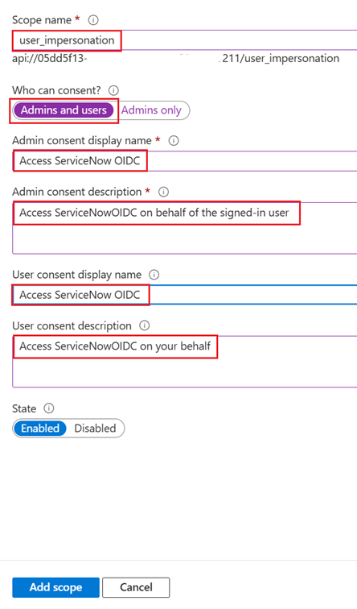
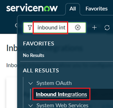
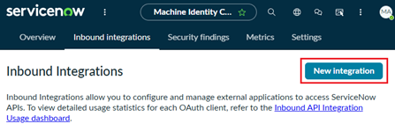
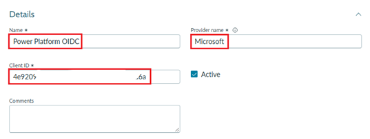
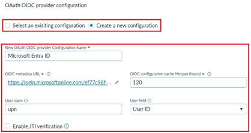
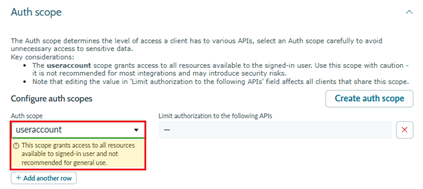

# Configure Entra OIDC authentication support for ServiceNow Power Platform connections

This runbook configures Microsoft Entra ID user-login authentication for ServiceNow Power Platform connections. 

ServiceNow browser SSO and SAML configuration are separate and outside scope. SAML configuration is covered in this [official Microsoft tutorial](https://learn.microsoft.com/en-us/entra/identity/saas-apps/servicenow-tutorial). 

## 1. Prerequisites

| Prerequisite | Required evidence |
| --- | --- |
| ServiceNow | Approved instance URL/release, SSO-enabled entitlement, administrator access, and availability of **Integration - Multiple Provider Single Sign-On Installer** |
| Entra ID SSO | For interactive user sign-in; [configure ServiceNow single sign-on with Microsoft Entra ID](https://learn.microsoft.com/en-us/entra/identity/saas-apps/servicenow-tutorial) if required. It does not replace the connector's federated authentication setup |
| Entra ID | Correct tenant and rights to manage the enterprise application, such as Cloud Application Administrator or the applicable application-owner permissions |

Do not use a production administrator as the ordinary pilot account. Do not copy passwords, assertions, private keys, session cookies, or tokens into this repository or test evidence.

## 2. Create Entra ID application registration

1. Open https://entra.microsoft.com, select **App registrations** and click **+ New registration**

   

2. Provide name and click Register
   
   
   
3. Select **Token configuration**, click **+ Add optional claim** and select **Access**. Then choose **aud**, **email** and **upn** and click **Add**

   

4. If you are prompted to turn on Microsoft Graph email and profile permissions then select it and click **Add**  
   
   

5. Select **Expose an API** and click **Add**

   

6. Accept default value `api://<application-id>` and click **Save**

   

7. Click **+ Add scope**, define following values and click **Add scope**
   - Scope name: **user_impersonation**
   - Who can consent?: **Admins and users**
   - Admin consent display name: **Access ServiceNow OIDC**
   - Admin consent description: **Access ServiceNow OIDC on behalf of the signed-in user**
   - User consent display name: **Access ServiceNow OIDC**
   - User consent description: **Access ServiceNow OIDC on behalf of the signed-in user**

    
      

8. Click **+ Add client application** and copy-paste this GUID to Client ID `c26b24aa-7874-4e06-ad55-7d06b1f79b63` (ServiceNow Power Platform connector). Then select the scope and click **Add application**

   

## 3. Register the same ID as an OIDC provider in ServiceNow

1. In ServiceNow open **All** menu then search and select **Inbound Integrations**
   
   

2. Click **New integration**

   

3. Select **Third party ID token issued by OIDC supporting identity provider**

   

4. Configure provider providing a Name and following settings:
   
   - Provider name: **Microsoft**
   - Client ID: *Client ID of the Entra application registration done in previous step*

      

   Create new OAuth OIDC provider configuration or use existing if you already have provider registered for same OIDC metadata URL. **There can't be more than one provider registered with same metadata URL**

   - Name: **Microsoft Entra ID**
   - OIDC metadata URL: `https://login.microsoftonline.com/<tenantID>/.well-known/openid-configuration`, replace `<tenantID>` with your Directory (tenant) ID
   - OIDC configuration cache lifespan: **120**
   - User claim: **upn**
      > If ServiceNow User ID = Entra ID UserPrincipalName. If not then see more guidance in [troubleshooting section](#4-troubleshoot-without-broadening-access)
   - User field: **User ID**
   - Enable JTI verification: **unselected**

      

   > **Important**: Select Auth scope either use the available useraccount which grants access to all resources available for user. Consider creating custom scope and define access only to required resources needed for the solution(s) using provider 
   
   

1. **Save** the provider
   
2. Create ServiceNow Power Platform connection for example in agent and configure connection like below
   
   - Authentication Type: Microsoft Entra ID User Login
   - Resource URI: *Application ID (Client ID) of your Entra application you created earlier*
   - Instance Name: *Your ServiceNow instance name*

      
    
3. Select **Sign in**, complete Microsoft Entra ID authentication with the intended user
   account, and confirm that the ServiceNow Power Platform connection is created
   successfully and shows **Connected**. If creation fails, use the troubleshooting
   section below and retry after correcting the configuration.

**Deliverable:** a successfully created ServiceNow Power Platform connection using
**Microsoft Entra ID User Login**. Connection creation is the only acceptance test
required at this stage; it does not verify ServiceNow API permissions, record access,
or end-to-end agent behavior. This step does not configure certificate-based application
authentication, business-record actions, or Knowledge connector ingestion.

## 4. Troubleshoot Without Broadening Access

| Symptom | Check | Safe response |
| --- | --- | --- |
| App assignment denial | Tenant, application, **Assignment required?**, and pilot membership | Correct only the approved assignment; do not allow every user |
| User not found or wrong account (OIDC user-claim mapping) | Confirm whether ServiceNow **User ID** stores an email address, UPN, employee ID, or another identifier. Check the OIDC provider's **User Claim**, its emitted token value, the selected **User Field**, and whether the matching ServiceNow account is active and unique. | Set **User Claim** to `upn`, `email`, or an emitted custom claim whose value exactly matches the identifier stored in **User Field**. Do not assume email and UPN are interchangeable. If an employee ID or another identifier is not already in the token, configure Entra to emit the populated attribute as a claim and use its actual claim name. Follow [Microsoft's non-email user-matching guidance](https://learn.microsoft.com/en-us/copilot/employee-self-service/servicenow-hrsd-itsm#match-users-when-the-servicenow-user-id-isnt-an-email-or-upn). Do not enable blanket user import. |
| Audience/recipient mismatch | SP Entity ID, ACS, host, trailing slash, and provider selection | Align exact values with source configuration |
| Invalid signature or expired certificate | Actual signing certificate and provider association | Restore trusted configuration or perform an approved certificate rollover |
| Redirect loop or wrong provider | Default provider, source user/provider association where applicable, and login URL sys_id | Use the explicit pilot provider URL; preserve local recovery |
| Test Connection fails | Authentication result, mappings, certificate, instance time, and sanitized logs | Fix the cause; do not disable mandatory test validation |
| SSO works but API/connector fails | API connection authentication and effective source permissions | Diagnose that separate integration; SAML success is not an API access token |

Do not grant `admin` or broad source roles to a pilot user as a troubleshooting shortcut.
Do not switch to a maker/service account to disguise a user-access failure.

## 5. Rollback, Rollout, and Handover

1. On a failed pilot, use the retained local administrator session. Restore changed
   properties, provider/default settings, and user mappings from the baseline. Deactivate
   only the newly introduced provider if appropriate; do not disable existing providers.
2. Remove or disable the new Entra pilot application/assignments only after confirming
   which other users or integrations depend on it. Restore existing application values
   instead if the pilot reused an app.
3. Recheck the previously working sign-in and local recovery routes. Account for existing
   sessions separately: assignment removal or provider deactivation does not prove that
   every active session has ended.
4. Broader rollout, default-provider or automatic-redirection changes, and broader user
   assignment are outside this runbook. Plan their approvals and validation separately.
5. Assign owners for certificate expiry notifications and rollover, source user lifecycle,
   sign-in failures, and refresh/clone recovery. Test renewal before expiry; revalidate
   instance-specific endpoints and trust after an instance refresh or replacement.
6. Store the environment/app/provider identifiers, mapping rule, certificate thumbprint
   and expiry, the connection-creation result, rollback baseline, and support route in the approved
   operational location. Exclude credentials and raw authentication payloads.

**Exit condition:** the ServiceNow Power Platform connection is created successfully
using **Microsoft Entra ID User Login** and shows **Connected**. No browser SSO,
business-record access, or agent capability is validated by this exit condition.

## Official References

- [Configure ServiceNow SSO with Microsoft Entra ID](https://learn.microsoft.com/en-us/entra/identity/saas-apps/servicenow-tutorial)
- [ServiceNow Developer Program](https://developer.servicenow.com/)
- [Manage application user and group assignments](https://learn.microsoft.com/en-us/entra/identity/enterprise-apps/assign-user-or-group-access-portal)
- [ServiceNow automatic user provisioning](https://learn.microsoft.com/en-us/entra/identity/saas-apps/servicenow-provisioning-tutorial)
- [Manage certificates for federated SSO](https://learn.microsoft.com/en-us/entra/identity/enterprise-apps/tutorial-manage-certificates-for-federated-single-sign-on)

Documentation reviewed on **4 November 2026**. These are manual setup instructions, not
evidence that a tenant has been configured or tested.
