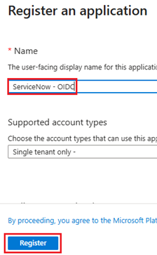
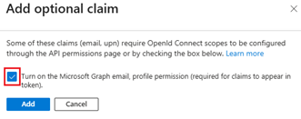
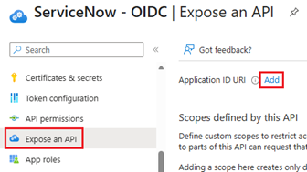
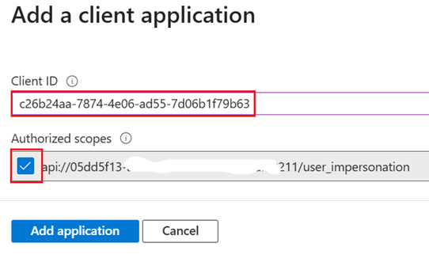
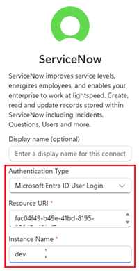

# Configure Entra OIDC authentication support for ServiceNow Power Platform connections

> **Draft:** The ServiceNow OIDC provider-registration procedure in section 3 is incomplete.
> Do not use this draft as an end-to-end configuration guide.

This runbook provides guidance how to configure Entra ID OIDC authentication support for ServiceNow

 includes integration-user creation and pilot user provisioning. It does not configure SSO to the ServiceNow Developer site, knowledge ingestion, MCP, or agent delegation. The SAML setup uses Multi-Provider SSO, as described in the [official Microsoft tutorial](https://learn.microsoft.com/en-us/entra/identity/saas-apps/servicenow-tutorial). Navigation labels vary by ServiceNow release. The legacy ServiceNow Express procedure is not covered here.

## 1. Confirm Access and Capture a Baseline

| Prerequisite | Required evidence |
| --- | --- |
| ServiceNow | Approved instance URL/release, SSO-enabled entitlement, administrator access, and availability of **Integration - Multiple Provider Single Sign-On Installer** |
| Entra ID SSO | For interactive user sign-in; [configure ServiceNow single sign-on with Microsoft Entra ID](https://learn.microsoft.com/en-us/entra/identity/saas-apps/servicenow-tutorial) if required. It does not replace the connector's federated authentication setup |
| Entra ID | Correct tenant and rights to manage the enterprise application, such as Cloud Application Administrator or the applicable application-owner permissions |

Do not use a production administrator as the ordinary pilot account. Do not copy passwords, assertions, private keys, session cookies, or tokens into this repository or test evidence.

## 2. Create Entra ID application registration

1. Open https://entra.microsoft.com, select **App registrations** and click **+ New registration**

   

2. Provide name and click Register
   
   
   
3. Select **Token configuration**, click **+ Add optional claim** and select **Access**. Then choose **aud**, **email** and **upn** and click **Add**

   

4. If you are prompted to turn on Microsoft Graph email and profile permissions then select it and click **Add**  
   
   

5. Select **Expose an API** and click **Add**

   

6. Accept default value api://<application-id> and click **Save**

   

7. Click **+ Add scope**, define following values and click **Add scope**
   - Scope name: **user_impersonation**
   - Who can consent?: **Admins and users**
   - Admin consent display name: **Access ServiceNow OIDC**
   - Admin consent description: **Access ServiceNow OIDC on behalf of the signed-un user**
   - User consent display name: **Access ServiceNow OIDC**
   - User consent description: **Access ServiceNow OIDC on behalf of the signed-un user**

    
      

8. Click **+ Add client application** and copy-paste this GUID to Client ID `c26b24aa-7874-4e06-ad55-7d06b1f79b63`(ServiceNow Power Platform connector). Then select the scope and click **Add application**

   

## 3. Register the same ID as an OIDC provider in ServiceNow

1. In ServiceNow ????

9.  Create ServiceNow Power Platform connection for example in agent and configure connection like below
   
   - Authentication Type: Microsoft Entra ID User Login
   - Resource URI: *AppId copied in previous step*
   - Instance Name: *Your ServiceNow instance name*

      

10. Validate an approved read through the actual consuming agent, app, or workflow.
   Confirm the effective ServiceNow user and verify that restricted data remains denied.
   A maker-owned connection must not be assumed to run as each end user.

**Deliverable:** a separately validated OIDC connection using **Microsoft Entra ID User
Login**. This step does not configure certificate-based application authentication,
business-record actions, or Knowledge connector ingestion.

## 8. Validate End-to-End Sign-In and Access Boundaries

Use fresh private browser sessions so that an existing local or federated session cannot
mask a configuration failure. Capture sanitized timestamps and correlation/error IDs,
not full SAML assertions.

| Test | Procedure | Pass condition |
| --- | --- | --- |
| SP-initiated sign-in | Open the provider-specific ServiceNow URL as an assigned user and complete Entra authentication | Correct instance opens as the intended source user, not the retained administrator |
| My Apps entry | Open the ServiceNow tile using the configured Sign on URL | Lands in the same intended instance/account |
| Assignment denial | Attempt the same provider path with an ordinary unassigned test user | Entra denies access to this application; no fallback through another identity is counted as a pass |
| Missing source mapping | Use an approved test identity with no matching source account and no JIT import | No unintended account is created or substituted; failure is explicit |
| Source authorization | With the pilot identity, attempt an owner-selected restricted record/action | Source permissions still deny it; no roles are added to make the test pass |
| Session and logout | Sign out and repeat the entry path; inspect ServiceNow and Entra session behavior | Observed behavior is recorded, including any remaining Entra session; local logout is not claimed to revoke all tokens |
| Recovery | Verify the separate local administrator route after activation | Administrator can still access configuration without depending on the new provider |
| Conditional Access | Exercise the pilot under applicable tenant policies | Required challenges and denials are honored; no exclusions added to bypass failure |

If a test fails, stop rollout and diagnose the relevant boundary. A successful provider
test or visible My Apps tile is not sufficient end-to-end evidence.

**Deliverable:** recorded pass/fail results, unresolved limitations, and owner acceptance.

## 9. Troubleshoot Without Broadening Access

| Symptom | Check | Safe response |
| --- | --- | --- |
| App assignment denial | Tenant, application, **Assignment required?**, and pilot membership | Correct only the approved assignment; do not allow every user |
| User not found or wrong account | Emitted NameID, configured User Field, active source record, duplicates | Correct the agreed mapping; do not enable blanket user import |
| Audience/recipient mismatch | SP Entity ID, ACS, host, trailing slash, and provider selection | Align exact values with source configuration |
| Invalid signature or expired certificate | Actual signing certificate and provider association | Restore trusted configuration or perform an approved certificate rollover |
| Redirect loop or wrong provider | Default provider, source user/provider association where applicable, and login URL sys_id | Use the explicit pilot provider URL; preserve local recovery |
| Test Connection fails | Authentication result, mappings, certificate, instance time, and sanitized logs | Fix the cause; do not disable mandatory test validation |
| SSO works but API/connector fails | API connection authentication and effective source permissions | Diagnose that separate integration; SAML success is not an API access token |

Do not grant `admin` or broad source roles to a pilot user as a troubleshooting shortcut.
Do not switch to a maker/service account to disguise a user-access failure.

## 10. Rollback, Rollout, and Handover

1. On a failed pilot, use the retained local administrator session. Restore changed
   properties, provider/default settings, and user mappings from the baseline. Deactivate
   only the newly introduced provider if appropriate; do not disable existing providers.
2. Remove or disable the new Entra pilot application/assignments only after confirming
   which other users or integrations depend on it. Restore existing application values
   instead if the pilot reused an app.
3. Recheck the previously working sign-in and local recovery routes. Account for existing
   sessions separately: assignment removal or provider deactivation does not prove that
   every active session has ended.
4. After successful pilot acceptance, obtain approval for any default-provider or
   automatic-redirection change and broader assignment. Repeat boundary tests after that
   change; local login and other providers are separate access paths to govern.
5. Assign owners for certificate expiry notifications and rollover, source user lifecycle,
   sign-in failures, and refresh/clone recovery. Test renewal before expiry; revalidate
   instance-specific endpoints and trust after an instance refresh or replacement.
6. Store the environment/app/provider identifiers, mapping rule, certificate thumbprint
   and expiry, acceptance results, rollback baseline, and support route in the approved
   operational location. Exclude credentials and raw authentication payloads.

**Exit condition:** accepted browser SSO and a separately validated Power Platform OIDC
connection, with recoverable administration and named operations owners. Browser
sign-in tests do not establish connector acceptance. No business-record mutation or
agent capability is implied by this exit condition.

## Official References

- [Configure ServiceNow SSO with Microsoft Entra ID](https://learn.microsoft.com/en-us/entra/identity/saas-apps/servicenow-tutorial)
- [ServiceNow Developer Program](https://developer.servicenow.com/)
- [Manage application user and group assignments](https://learn.microsoft.com/en-us/entra/identity/enterprise-apps/assign-user-or-group-access-portal)
- [ServiceNow automatic user provisioning](https://learn.microsoft.com/en-us/entra/identity/saas-apps/servicenow-provisioning-tutorial)
- [Manage certificates for federated SSO](https://learn.microsoft.com/en-us/entra/identity/enterprise-apps/tutorial-manage-certificates-for-federated-single-sign-on)

Documentation reviewed on **4 November 2026**. These are manual setup instructions, not
evidence that a tenant has been configured or tested.
