# Power Platform Integration

This runbook covers configuration of Workday integration with Power Platform to be able to connect and use Workday Power Platform connector in agents, apps, workflows

## Prerequisites

- Workday tenant and single sign-on configured between Entra ID and Workday > [Runbook - Workday Integration with Microsoft Entra ID](Workday-Developer-Tenant-and-Entra-ID-SSO-Runbook.md)

## Create Workday API client

1. Login to **Workday** as admin and search and select **Register API Client** task

    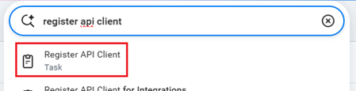

2. Provide name for the client and configure it like below:
   - Client Grant Type: **SAML Bearer Grant**
   - Assertion Verification: **Use Configured IdPs**
   - Access Token Type: **Bearer**
   - Allow Access to All System Users: ✅
   - Scope (Functional Areas): All required Workday functional areas which need to be accessible for Power Platform solution using API client like **Contact Information, Organizations and Roles, Staffing, Time Off and Leave**
   - Include Workday Owned Scope: ✅
   
     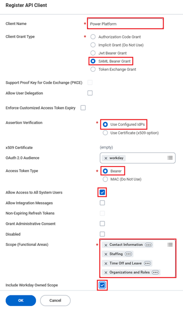

3. Copy **Client ID**, **Workday REST API Endpoint** without /v1/tenant_name and **Token Endpoint**

    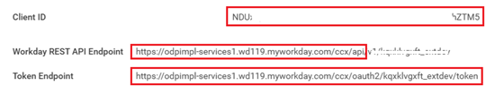

## Configure Workday Domain Security

In Workday to be able to access and update employee information from external clients like Copilot Studio agent using integration. **Workday administrators** need to configure permissions depending which information need to be accessed using integration. Follow these Microsoft Employee Self-Service agent template instructions explaining how to define Workday domain level permissions

https://learn.microsoft.com/en-us/copilot/employee-self-service/declarative-agent-workday-reference#workday-task-5-configure-domain-security-for-your-rollout

## Configure Entra ID

1. In Entra ID open **Workday** app registration
   
   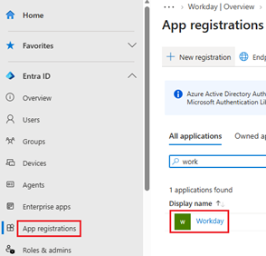
   
2. Select **Expose API** and verify that following values and settings are defined
   
   - Application ID URI: `http://www.workday.com/{TENANT-NAME}`
   - Authorized client applications: `4e4707ca-5f53-46a6-a819-f7765446e6ff` with scope selected. This is Workday Power Platform connector
   
    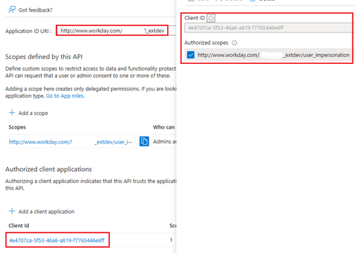

3. Select **API permissions** and verify that following permissions are admin granted for the application. If not then add permissions and grant admin consent
   
   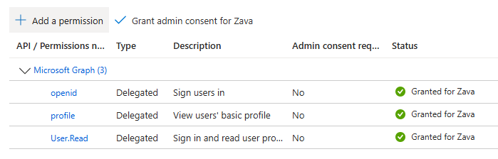

## Test Workday connection in Power Automate portal

1. Open https://make.powerautomate.com/connections, select the environment you want to use for testing and click **+ New connection**
   
   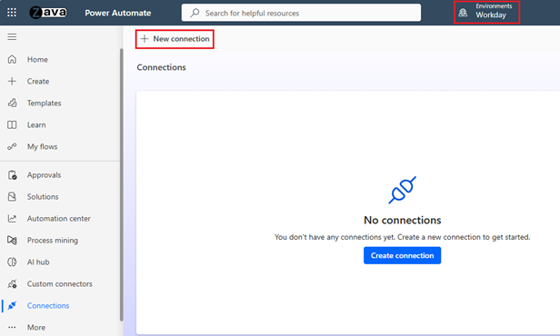

3. Search and select **Workday** to create the connection
   
   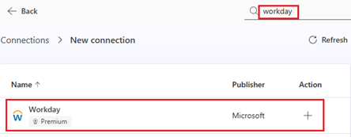

4. Configure connection
   
   - Authentication type: **Microsoft Entra ID Integrated**
   - Application ID URI: **`http://www.workday.com/{TENANT-NAME}`**
   - Workday OAuth token URL: Copied in the end of [Workday API Client](#create-workday-api-client) in form of `https://{WORKDAY-HOST-URL}/ccx/oauth2/{TENANT-NAME}/token`
   - Workday OAuth client ID: Copied in the end of [Workday API Client](#create-workday-api-client) 
   - SOAP base URL: `https://{WORKDAY-HOST-URL}}/ccx/service`
   - REST base URL: Copied in the end of [Workday API Client](#create-workday-api-client)
   - Tenant name: `{TENANT-NAME}`
  
     &nbsp;

     **Example:**
        
     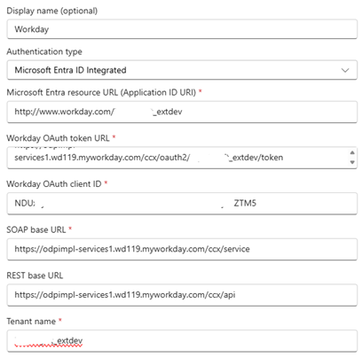
   

5. You should be prompted to login with your Entra ID account
   
   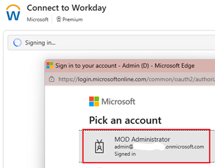

6. After successful login connection is created and status **Connected**. You can now test connection for example in agent or workflow
   
   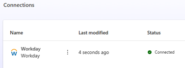