# Runbook - Workday Integration with Microsoft Entra ID

This runbook covers configuration of Microsoft Entra ID SAML SSO authentication with Workday tenant. Read the [pattern overview](Workday-Integration.md). It applies for both Workday Developer and Test/Production tenants.

Runbook covers configuration of Workday enterprise application in Entra ID and collecting the configuration details needed to connect the two systems. In Workday side we setup SAML identity provider, authentication policies and security group for Workday users who should use SAML SSO authentication. 

## Setup Workday Developer Tenant

Skip this step if you already have Workday Developer tenant or configuration need to be done against non-developer tenant like Workday test or production

See detailed information about Workday developer tenants and how to create them from Workday documentation > https://developer.workday.com/documentation/GUID-4f875963-a845-43b5-868a-0f77e6261eb7-enHYPHENus/CreateandManagePersonalAccountDevelopmentTenants 

1. Open this site to re https://developer.workday.com/about
   
2. Select **Create Account**
   
   
   
3. Create your Workday ID
   
   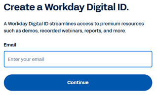

4. Request access to beta program
   
   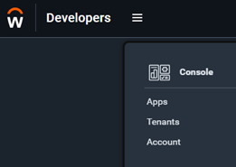

5. Fill-in required information and select request access
   
   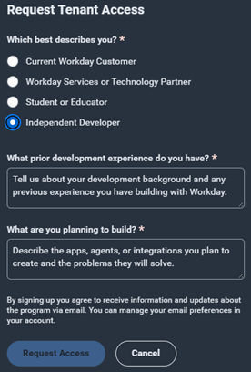

6. You should get email confirmation about welcoming to Open Access Beta Program
   
   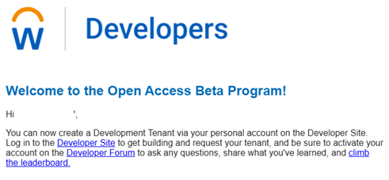

7. You can now create developer tenant in Workday developer portal
   
   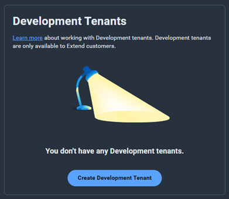

8. After little while your tenant is provisioned. **IMPORTANT!** These tenants will expire in 7-days if do not login to tenant. So please remember to visit the tenant at least once per week
   
   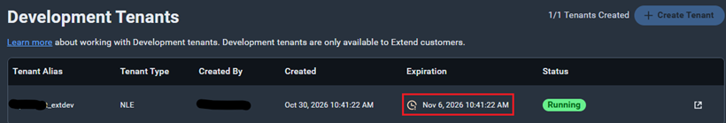

9. You should get email with tenant link and password. Remember to login within 72-hours as this is temporary password and will expire. You can reset the password in developer portal if needed
    
    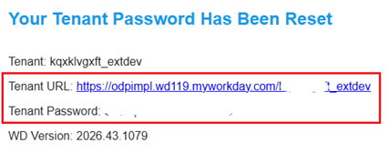

10. Click the link to login to tenant. Username should be **`lmcneil`** check this still from documentation > [Create and Manage Personal Account Development Tenants](https://developer.workday.com/documentation/GUID-4f875963-a845-43b5-868a-0f77e6261eb7-enHYPHENus/CreateandManagePersonalAccountDevelopmentTenants)
    
    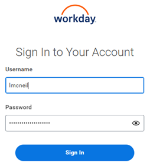
    
11. Change the password

&nbsp;

## Configure Entra ID for Workday SSO

Official configuration documentation can be found from https://learn.microsoft.com/en-us/entra/identity/saas-apps/workday-tutorial#configure-microsoft-entra-sso

1. Open Entra ID https://entra.microsoft.com 
   
2. Select **Enterprise apps**
   
   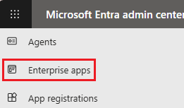

3. If you do not have Workday application already installed in your tenant then click **+ New application**. If Workday is already installed then jump to step 6
   
   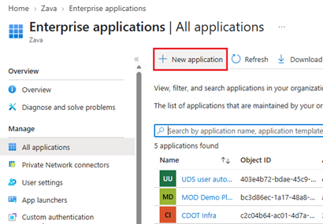

4. Search and select Workday application
   
   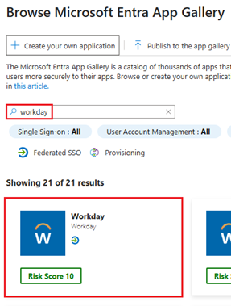

5. Select **Single sign-on** > **SAML**
   
   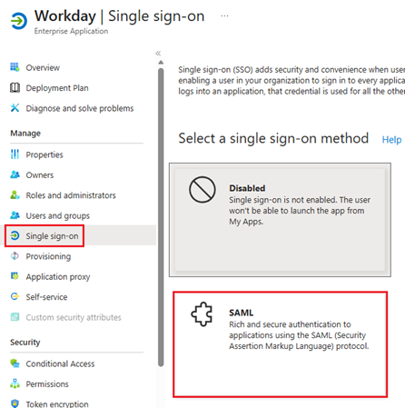

6. Select **Edit** to configure SAML
   
   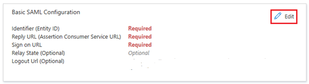

7. Define following values by replacing `<TENANT-NAME>` with your actual Workday tenant name. 

   **Developer tenants:**

   Verify your tenant's URL and update it if not the same as below `odpimpl.wd119`

   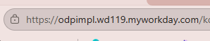
   
   - Identifier (Entity ID): `http://www.workday.com/<TENANT-NAME>`
   - Reply URL (Assertion Consumer Service URL): `https://odpimpl.wd119.myworkday.com/<TENANT-NAME>/login-saml.htmld`
   - Sign on URL: `https://odpimpl.wd119.myworkday.com/<TENANT-NAME>/login-saml2.flex`
   - Logout Url: `https://odpimpl.wd119.myworkday.com/<TENANT-NAME>/login-saml.htmld`

   **Non-developer tenants:**

   - Identifier (Entity ID): `http://www.workday.com/<TENANT-NAME>`
   - Reply URL (Assertion Consumer Service URL): `https://impl.workday.com/<TENANT-NAME>/login-saml.htmld`
   - Sign on URL: `https://impl.workday.com/<TENANT-NAME>/login-saml2.flex`
   - Logout Url: `https://impl.workday.com/<TENANT-NAME>/login-saml.htmld`

8. Do not test the sign-on yet
   
   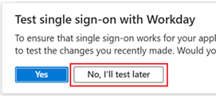

9. Download **Federation Metadata XML** file

    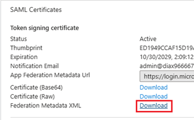   

10. Copy **Logout URL** we need that in configuration in Workday side
    
    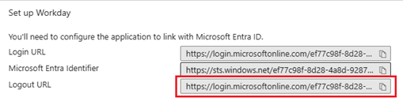

11. Select **Users and groups** and add all users/groups who should be able to use Workday app and login to Workday
    
    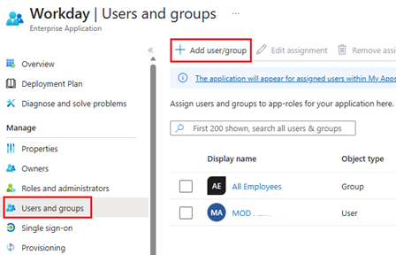

## Configure Workday

### Select and update existing Workday user to test SSO

**NOTE** This is done **only** when setting up SSO with Workday **DEVELOPER** tenant!

Workday developer tenants has several user accounts already created and we will use one of them for initial testing of SSO authentication. For this we need to update username of the selected user to match the Entra ID user principal name (UPN)

1. Search and select **Edit Workday Account** task

    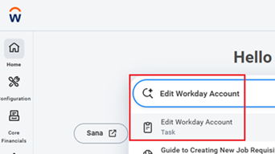

2. Select one of the accounts for example the first one **Aidan Mitzner**
   
    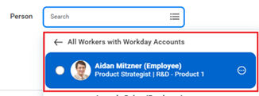

3. Update **User Name** to match your Entra ID account's user principal name and select **Exempt Account** MFA setting. Then click **Submit**
   
    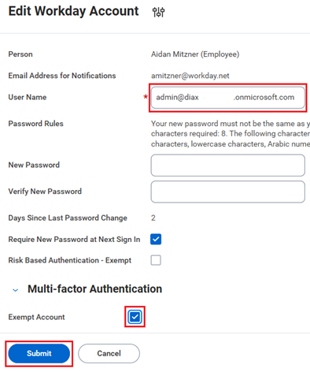

&nbsp;

### Create Security Group for SSO users

We will create Security Group in Workday to control which user accounts should use the Entra ID SSO authentication

1. Search and select **Create Security Group** task
   
   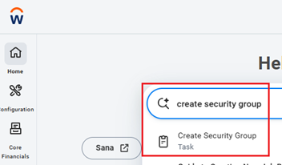

2. Select **User-Based Security Group** and provide name for the group
   
   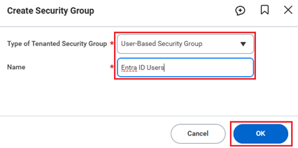

3. Click **OK** 

   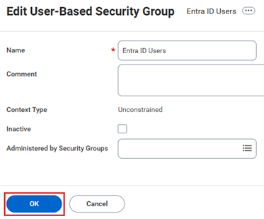

4. Search and select **Assign Users to User-Based Security Group** task

   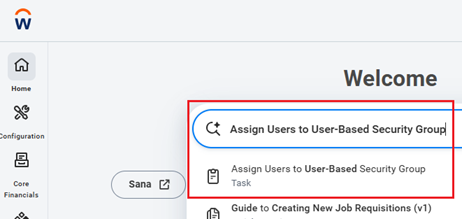

5. Search and select the group you just created then click **OK**
   
   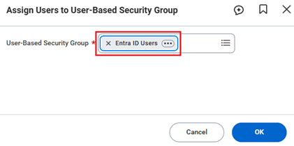

6. Search and select the user(s) you want to add to group who should be able to login using Entra ID SSO
   
   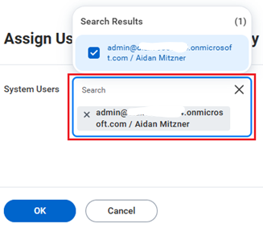

&nbsp;

### Configure SAML SSO

1. Open your Workday instance using your Workday tenant admin account and search and select **Edit Tenant Setup - Security**
    
    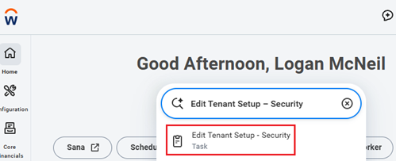

2.  Scroll down select **Import Identity Provider**
    
    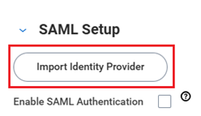

3.  Provide name, for environment select **WPC Development** and upload the Federation Metadata XML file you downloaded from Entra ID and click **OK** twice and then click **Done**
    
    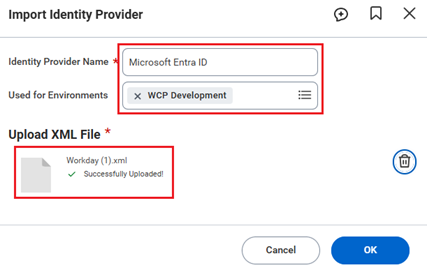

4.  Configure provider
    - **Enable IdP Initiated Logout**: ✅
    - **Logout Response URL**: `http://www.workday.com`
    - **Enable Workday Initiated Logout**: ✅ 
    - **Logout Request URL**: Entra ID logout URL you copied from Workday Entra enterprise app > `https://login.microsoftonline.com/TENANT_ID/saml2` where **TENANT_ID** is your tenant ID (GUID)
    - **SP Initiated**: ✅
    - **Service Provider ID** is the same as Identifier value in Entra ID SAML configuration `http://www.workday.com/TENANT_NAME`. Replace **TENANT_NAME** with your Workday tenant name.
    - **Do Not Deflate SP-initiated Authentication Request**: ✅
    
    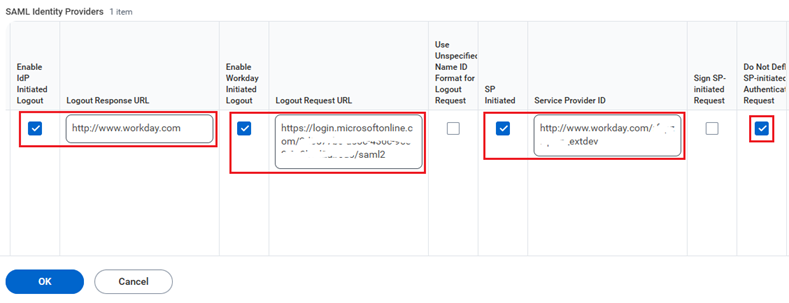

5.  Click **OK** and **Done**

6.  Open **Edit Tenant Setup - Security** again
    
    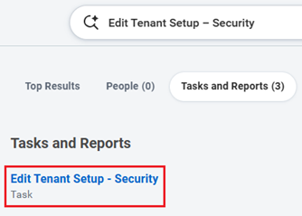

7.  Verify that **OAuth 2.0 Clients** setting is enabled, enable **SAML authentication**

    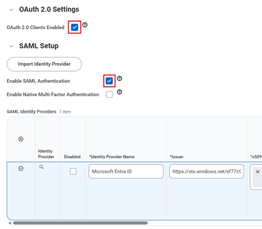

8.  Select x509 Private Key Pair field and choose **Create x509 Private Key Pair**
   
    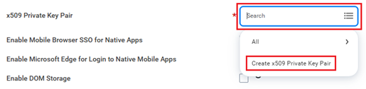

9.  Provide name and click OK
    
    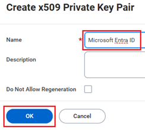

10. Click **OK** and **Done** to save SAML configuration
    
    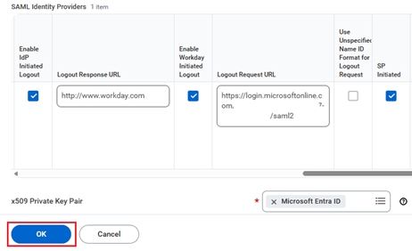

11. Search and select **Manage Authentication Policies** report

   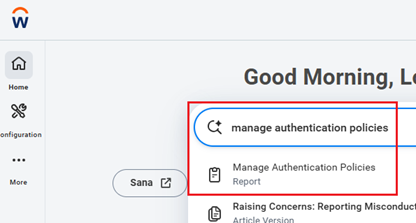

12. Click **Edit**

   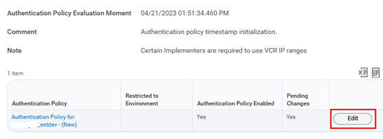
    
13. Verify that correct type of environment(s) are include. In case working with Workday developer tenant add **WPC Development** environment
    
    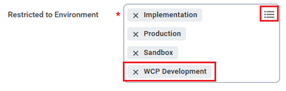

14. Click **(+)** icon to add new Authentication Ruleset
    
    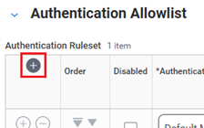

15. Provide name for the authentication rule and configure rest of the settings like below
    - **Security Group**: Group you created in the step [Create Security Group for SSO users](#Create-Security-Group-for-SSO-users)
    - **Authentication Condition Name**: SAML
    - **Authentication Conditions**: Any
    - **Allowed Authentication Types**: Specific > select your SAML configuration
    
    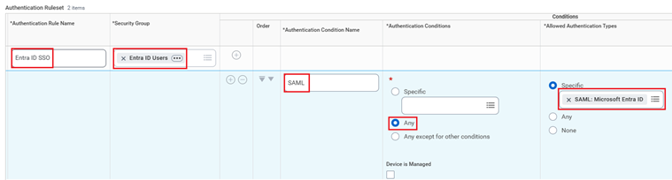

   &nbsp;

16. Click **OK** and **Done**
    
    &nbsp;

17. Select **Activate All Authentication Policies**

    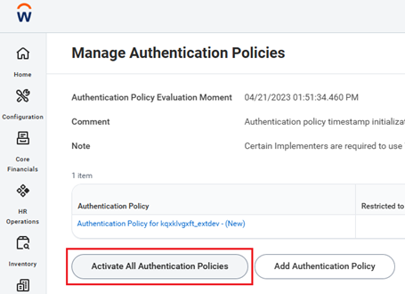

18. Provide **Comment** and click **OK**
    
    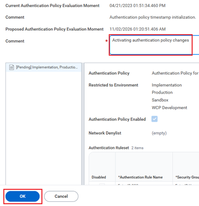

19. Select **Confirm** and click **OK** and **Done**
    
    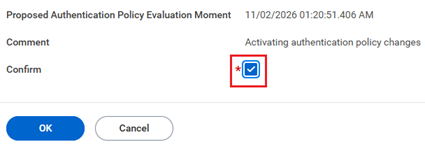

20. Authentication policies should be enabled now
    
    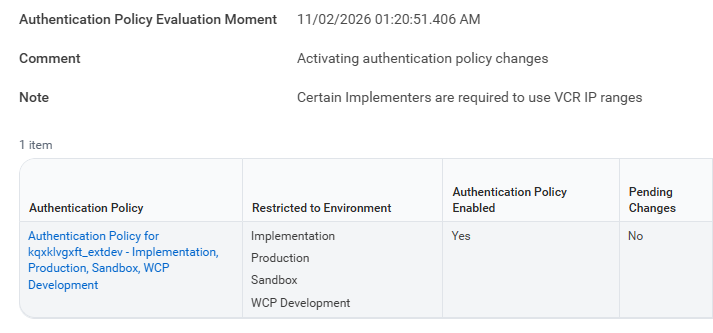

&nbsp;

### Test authentication using SSO

Add Workday app to your app launcher in your tenant

1. Open **App Launcher** and select **More apps**
   
   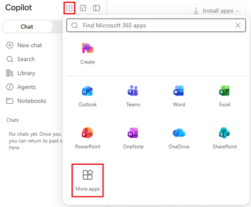

2. Scroll down to see Other apps and pin Workday to App Launcher
   
   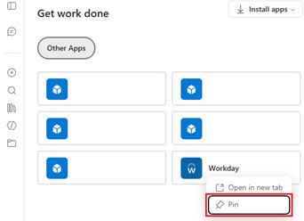

3. Open App Launcher again and you should see Workday app pinned. If it is not visible then refresh the page
   
   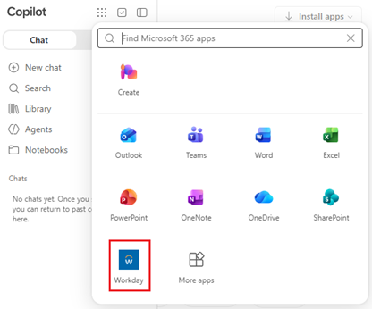
   
4. Open Workday app and you should be redirected to Microsoft 365 login page for authentication
   
   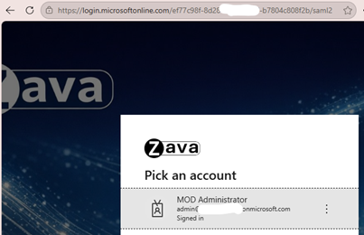

5. After successful login Workday portal should open with Workday user account you configured to get SOO login i.e. account user name matches the Entra ID user account's UPN
   
   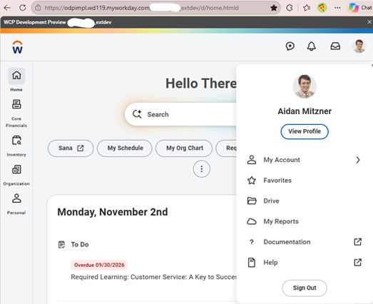

## References

- [Microsoft Workday SSO tutorial](https://learn.microsoft.com/en-us/entra/identity/saas-apps/workday-tutorial)
- [Entra user and group assignment](https://learn.microsoft.com/en-us/entra/identity/enterprise-apps/assign-user-or-group-access-portal)
