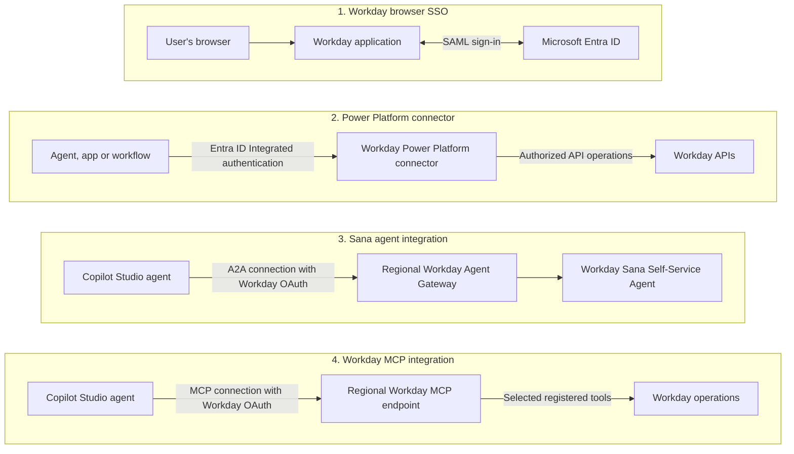

# Workday Integration

Configure Workday integrations with Microsoft 365 through four related setup paths:
**SSO with Entra ID**, **Entra ID Integrated authentication for the Workday Power Platform
connector**, **Workday Sana Self-Service Agent A2A integration**, and **Workday MCP tool
integration for Copilot Studio agents**.

Start with SSO, then follow the connector, A2A, and/or MCP runbook for the integrations you
need. These are separate integration options, not a mandatory chain. MCP reuses the
Workday setup sections linked from the A2A runbook, but does not require an A2A connection.
Neither A2A nor MCP requires the Workday Power Platform connector.

---

## Why This Pattern

Opening Workday in a browser, calling connector operations from Power Platform, delegating
a task to Workday's agent, and calling Workday tools through MCP are different integration
needs. This pattern brings their setup guides together without treating one successful
connection as proof that the others work.

| Order | Integration option | Use when you need... | Implementation runbook |
| --- | --- | --- | --- |
| 1 | SSO with Entra ID | Users to sign in to the Workday application with their Entra accounts | [Workday tenant setup and Entra ID SSO](Workday-Developer-Tenant-and-Entra-ID-SSO-Runbook.md) |
| 2 | Workday Power Platform connector | Agents, apps, or workflows to call connector operations using Entra ID Integrated authentication | [Power Platform integration](Power-Platform-Integration-Runbook.md) |
| 3 | Workday Sana Self-Service Agent A2A | A Copilot Studio agent to delegate employment-related requests to Workday's Self-Service Agent | [Sana Self-Service Agent A2A configuration](Workday-Self-Service-Agent-Configuration-Runbook.md) |
| 4 | Workday MCP | A Copilot Studio agent to call selected Workday tools for employee self-service | [Workday MCP configuration](Workday-MCP-Configuration-Runbook.md) |

**Authentication is not authorization.** Entra app assignment does not create Workday
accounts or grant HR permissions. Workday account status, security groups, API scopes,
and agent availability continue to govern access. Browser SSO alone configures none of
the Power Platform, A2A, or MCP connections.

---

## Architecture

The diagram shows the four logical integration paths, not the complete token exchange
for each protocol.

The connector path invokes configured operations. The A2A path delegates a task to another
agent. The MCP path exposes selected tools for the Copilot Studio agent to call and
orchestrate. None should be presented as a knowledge crawl or as unrestricted access to
Workday data.

---

## 1. SSO with Entra ID

Use this option to configure SAML-based browser sign-in to the **Workday application**.
The runbook also covers obtaining a developer tenant where the applicable Workday program
permits it, or using an existing tenant.

The setup covers the Workday enterprise application in Entra ID, tenant-specific SAML
endpoints, federation metadata, Workday account mapping, a user-based security group,
and Workday authentication policies.

Before changing tenant security, retain administrator access and verify the permitted
local recovery route: the Workday application base URL plus `/login.flex?redirect=n`.
Match the Entra NameID to the actual Workday account user ID. Reusing and renaming a sample
account is a developer-tenant exercise, not a production account-management procedure.

Entra pilot assignment limits who can authenticate through the enterprise application.
It does not make tenant-level Workday changes pilot-only. Confirm the affected environments
and preserve recovery access before activating authentication policies.

**Outcome:** an assigned user can open the intended Workday tenant through Entra ID and
reach only the data allowed by their Workday permissions.

**Runbook:** [Workday tenant setup and Entra ID SSO](Workday-Developer-Tenant-and-Entra-ID-SSO-Runbook.md).

This is not SSO for the [Workday Developer Site](https://developer.workday.com/doc/GUID-acba65a2-6238-43c8-ada0-756335a317bc.md)
at `developer.workday.com`, and it does not provision users or establish API access.

---

## 2. Workday Power Platform Connector with Entra ID Integrated Authentication

Use this option when an agent, app, or workflow needs to invoke Workday connector
operations rather than delegate a conversation to Workday's agent.

After the SSO foundation is configured, follow the runbook to register a Workday API client
using **SAML Bearer Grant** and the configured identity providers. Select only the functional
areas needed by the integration. Then configure the Entra application ID URI, authorized
connector client, and required consent.

Create a connection in the target Power Platform environment using **Microsoft Entra ID
Integrated** authentication, the application ID URI, Workday OAuth client ID and token URL,
SOAP/REST base URLs, and tenant name.

**Outcome:** the connection is established and an approved connector operation succeeds
with the intended user identity and Workday permissions. A **Connected** status alone is
not proof that every operation is authorized.

**Runbook:** [Power Platform integration](Power-Platform-Integration-Runbook.md).

Confirm that the target environment exposes the connector and authentication option shown
in the runbook, and check its licensing and policy requirements. Do not substitute the
similarly named [Workday HCM connector](https://learn.microsoft.com/en-us/connectors/workdayhcm/):
its published connection contract uses a Workday username and password, not the Entra ID
Integrated setup described here.

---

## 3. Workday Sana Self-Service Agent A2A Integration for Copilot Studio

Use this option when a Copilot Studio agent should delegate an employment-related request
to Workday's Sana Self-Service Agent through the **Agent2Agent (A2A)** protocol.

The setup covers Workday Agent System of Record (ASOR) prerequisites, an API client for
external-agent registration, and registration through the regional Workday Agent Gateway.
Then configure the registered agent in Agent Management Hub, enable the Self-Service Agent
skill for the approved users, and activate it.

In Copilot Studio, add the A2A connection using the regional agent endpoint and the
registered external agent's OAuth client credentials and authorization/token endpoints.
Register the exact redirect URI generated for that connection in Workday before testing.
The API client used to register an external agent and the registered agent's runtime OAuth
credentials are distinct; do not interchange them.

**Outcome:** Copilot Studio can delegate an approved request to the Workday Self-Service
Agent and receive a response under the intended user's access. Agent activation or a
successful OAuth sign-in alone does not prove end-to-end delegation.

**Runbook:** [Sana Self-Service Agent A2A configuration](Workday-Self-Service-Agent-Configuration-Runbook.md).

**Supporting asset:** [external-agent registration HTTP template](Resources/WD-RegisterExternalAgent.http).
Keep populated secrets, authorization codes, and tokens outside source control.

Confirm Workday agent entitlement, region, ASOR permissions, and A2A/OAuth support in the
selected Copilot Studio harness and environment. The linked Microsoft A2A guide describes
the standard harness; validate the configuration against the host actually being used
rather than assuming every harness or screenshot exposes the same options.

---

## 4. Workday MCP Tool Integration for Copilot Studio

Use this option when a Copilot Studio agent should call selected Workday tools through
the **Model Context Protocol (MCP)**, rather than delegate a task to the Sana Self-Service
Agent through A2A.

The runbook reuses the tenant, SSO, region, ASOR, and registration API-client setup linked
from the A2A runbook. It then uses a separate MCP registration template to register the
external agent's selected skills and tools. Configure skill security in Workday, including
**Employee as Self** where available, review the required permissions, and activate the
registered agent.

In Copilot Studio, add the Workday MCP server under **Tools**, configure manual OAuth 2.0
with the registered external agent's runtime credentials and regional endpoints, and
register the exact generated redirect URI in Workday. Use the MCP endpoint documented in
the runbook, not the Sana A2A endpoint.

The included example manifest defines seven skills: reading home phone numbers, employee
profiles, hire/service dates, home addresses, and absence balances, plus updating an
existing home phone number and requesting time off. These use **Delegate** execution mode.
Require explicit confirmation before creating or submitting changes, and distinguish
submitted or pending changes from approved or completed changes.

**Outcome:** the intended employee can use the registered MCP tools within their Workday
permissions. Tool discovery or a successful OAuth connection alone does not establish
permission to access another employee's records or prove a write completed.

**Runbook:** [Workday MCP configuration](Workday-MCP-Configuration-Runbook.md).

**Supporting asset:** [MCP external-agent registration HTTP template](Resources/WD-RegisterExternalAgentForMCP.http).
Keep populated credentials and tokens outside source control. The registration API client
and the registered agent's runtime OAuth credentials serve different purposes.

Workday documents MCP availability for Extend Professionals. Confirm entitlement, any
subscription-specific enablement and consumption charges, and MCP/OAuth support in the
selected Copilot Studio harness and environment. The linked Microsoft MCP guide describes
the standard harness; check the host actually being used. Agent instructions and tool
descriptions do not replace Workday's backend authorization or approval policies.

---

## Shared Prerequisites and Delivery Order

| Area | Confirm before configuration |
| --- | --- |
| Workday access | An authorized tenant, active mapped users, named administrator, and entitlements for the selected integrations |
| Microsoft access | Entra application administration, plus Power Platform/Copilot Studio maker and connection permissions where needed |
| Environment boundary | Exact Workday host/tenant, Entra tenant, Power Platform environment, and regional agent endpoint |
| Least privilege | Approved app assignments, Workday groups and API functional areas, connector operations, agent audience, and MCP skill/tool permissions |
| Change safety | An approved change window, retained baseline, verified recovery route, and rollback owner |
| Operations | SAML certificate renewal, OAuth secret lifecycle, tenant refresh checks, and sanitized acceptance evidence |

Use a non-production tenant and approved test data for the first pass. Production changes
require environment-specific review; developer sample accounts and broad example scopes
are not production defaults. Confirm tenant availability and permissions rather than
assuming that Developer Site registration grants application-administrator access.

1. Complete and validate **SSO** first, or confirm that the existing SSO setup meets the
   prerequisites in the selected integration runbook.
2. Configure and validate the **Power Platform connector** if direct connector operations
   are needed.
3. Configure and validate **Sana A2A** if agent delegation is needed. Skip option 2 if
   connector operations are not part of the solution.
4. Configure and validate **Workday MCP** if direct tool calls are needed. Reuse the
   prerequisite sections linked by its runbook; the A2A connection itself is not required.

If a later integration fails, preserve the successful earlier configuration and diagnose
that integration's own endpoints, credentials, permissions, and connection state. Do not
broaden access or switch identities simply to bypass the failure.

## Acceptance and Documentation Status

| Path | Minimum acceptance evidence |
| --- | --- |
| SSO | Fresh browser sign-in to the correct account and tenant, an unassigned-user denial, expected Workday permission boundaries, and working administrator recovery |
| Power Platform connector | Entra ID Integrated connection plus an approved operation with the intended identity, and a denied operation outside its approved access |
| Sana A2A | Correct region and redirect URI, approved agent audience, successful delegated test request, and denial for a user outside that audience |
| Workday MCP | Correct region and redirect URI, expected registered tools, an authorized employee read and denied access outside that scope, plus confirmation and actual status for any tested write |

This folder contains manual configuration walkthroughs, screenshots, and a registration
request template for each of A2A and MCP. It does not deploy connections, grant permissions,
or provide a live acceptance record. The MCP runbook is a working copy with an example
skill/tool manifest; review its selections against the intended implementation.

---

## Related Patterns

- [Copilot Connector Knowledge Onboarding](../Copilot-Connector-Knowledge-Onboarding/Copilot-Connector-Knowledge-Onboarding.md) - separate indexed content and permission-mapping work.
- [MCP Server Integration](../MCP-Server-Integration/MCP-Server-Integration.md) - general MCP connectivity, tool/API identity, and backend authorization.

## Official References

- [Microsoft: Configure Workday SSO with Entra ID](https://learn.microsoft.com/en-us/entra/identity/saas-apps/workday-tutorial) - primary configuration source.
- [Microsoft: Connect to an agent over A2A](https://learn.microsoft.com/en-us/microsoft-copilot-studio/add-agent-agent-to-agent) - Copilot Studio connection and authentication guidance.
- [Microsoft: Extend your agent with MCP](https://learn.microsoft.com/en-us/microsoft-copilot-studio/agent-extend-action-mcp) - Copilot Studio MCP concepts and onboarding guidance.
- [Workday: Connect an External Agent with Workday MCP](https://developer.workday.com/documentation/GUID-03605c39-71d3-4314-bf71-97f274df457c-enHYPHENus) - MCP entitlement, registration, security, and connection prerequisites.
- [Workday: Agent Gateway](https://doc.workday.com/admin-guide/en-us/workday-ai/agents/workday-agent-gateway-for-partner-agents.html) - regional gateway and authentication model.
- [Workday: Set up Agent System of Record](https://doc.workday.com/admin-guide/en-us/workday-ai/agents/set-up-agent-system-of-record.html) - Workday-side prerequisites for external-agent registration.
- [Microsoft: Manage users and groups assignment](https://learn.microsoft.com/en-us/entra/identity/enterprise-apps/assign-user-or-group-access-portal) - assignment and group-licensing requirements.
- [Microsoft: Manage federation certificates](https://learn.microsoft.com/en-us/entra/identity/enterprise-apps/tutorial-manage-certificates-for-federated-single-sign-on) - renewal and notification ownership.
- [Workday customer support](https://www.workday.com/en-us/customer-experience/support.html) - tenant-specific endpoints and access assistance.

The Entra ID Integrated connector setup is documented in the included walkthrough and must
be verified in the target environment. Documentation review is not live integration validation.
