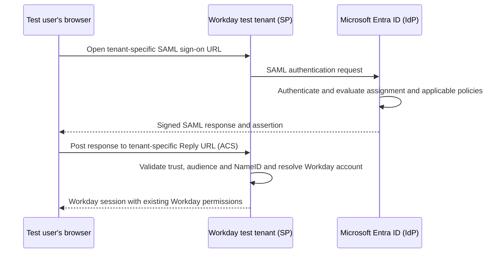

# Workday Integration

Configure Microsoft Entra ID as the SAML identity provider for an existing Workday tenant. This pattern covers browser sign-in to the **Workday application**,
not sign-in to the Workday Developer Site at `developer.workday.com`.

The deliverable is an overview and a manual implementation runbook. No tenant, enterprise
application, account, connector, or integration is provisioned by these documents, and
the configuration has not been validated against a live tenant.

---

## Why This Pattern

Workday-backed agent demonstrations often need a repeatable, controlled way for test users
to open the source application. SAML SSO provides that interactive sign-in path while
Workday continues to enforce its own account status, security groups, and data permissions.

| Requirement | What this pattern provides |
| --- | --- |
| An isolated development environment | Tenant-access qualification and an explicit non-production boundary |
| Entra-based browser sign-in | Workday gallery enterprise application and SP-initiated SAML configuration |
| Correct user mapping | A NameID contract matched to an existing Workday account |
| Safe configuration changes | Pre-change recovery test, retained administrator access, and rollback procedure |
| Repeatable handover | Positive/negative tests, certificate ownership, and tenant-refresh checks |

**SSO is not provisioning or API authorization.** Assigning an Entra user to the app does
not create their Workday account, grant HR data access, configure an Integration System
User, or authenticate a Copilot connector or MCP server. Those are separate work packages.

---

## Scope and Tenant Access

Obtain or request an authorized Workday developer, implementation, or sandbox tenant through
your organization's Workday administrator or your applicable Workday program/support route.
Have the owner confirm entitlement to SAML SSO and permission to change tenant security.
This pattern does not assume that developer registration supplies a free HCM tenant or
administrative access to **Edit Tenant Setup - Security**.

| Use when... | Do not use when... |
| --- | --- |
| The target is an approved non-production Workday application tenant | The target is the Developer Site Account dashboard |
| The Workday owner can administer SAML and verify local recovery access | Only a developer account or API credential is available |
| Test users have corresponding Workday accounts | The real requirement is worker/account provisioning |
| Browser SSO is a prerequisite for a demo or lab | The requirement is OAuth/API access or unattended agent execution |

The [Developer Site SAML procedure](https://developer.workday.com/doc/GUID-acba65a2-6238-43c8-ada0-756335a317bc.md)
is a different integration with its own entitlement, endpoints, activation, and support
recovery requirements. Do not copy its values into this pattern.

---

## Architecture

Entra authenticates the user; Workday authorizes their application access. A successful
Entra sign-in log entry alone does not prove that Workday accepted the assertion or opened
the intended account.

---

## Configuration Contract

Use the tenant owner's confirmed values, not another environment's URLs.

| Setting | Contract |
| --- | --- |
| Workday host and tenant name | Exact non-production host, tenant path, and environment confirmed by the Workday owner |
| Identifier / Service Provider ID | `http://www.workday.com/<TENANT-ID>`; |
| Sign-on URL | Tenant-specific SP-initiated sign-in endpoint: `https://impl.workday.com/<tenant>/login-saml2.flex` Workday developer tenants: `https://odpimpl.<hosting-instance>.myworkday.com/<tenant>/login-saml2.flex` |
| Reply URL | Tenant-specific assertion recipient: `https://impl.workday.com/<tenant>/login-saml.htmld` Workday developer tenants: `https://odpimpl.<hosting-instance>.myworkday.com/<tenant>/login-saml.htmld` |
| Logout URL | Tenant-specific assertion recipient: `https://impl.workday.com/<tenant>/login-saml.htmld` Workday developer tenants: `https://odpimpl.<hosting-instance>.myworkday.com/<tenant>/login-saml.htmld` |
| NameID | Entra claim value must match the actual Workday account user ID; email/UPN is not universally correct |
| Signing | Entra **Sign SAML response and assertion**, with the active signing certificate trusted by Workday |
| Entra issuer and endpoints | Copy from this enterprise application's SAML setup and federation metadata |
| Workday environment scope | Explicit approved test environment(s), not production |
| Recovery URL | Tenant application base URL plus `/login.flex?redirect=n`; verify with a permitted local administrator before changing SAML |

The `http://www.workday.com` value is an entity identifier, not an instruction to send
credentials over HTTP. Actual browser authentication endpoints must use HTTPS.

Microsoft documents a fixed identifier and only one Workday gallery instance per Entra
tenant. Check for an existing application before adding one. If it already serves another
environment, stop and agree an isolated lab design with the identity owner; do not overwrite
it or invent a new identifier to bypass the constraint.

---

## How to Apply

1. Qualify tenant access, SSO entitlement, owners, and non-production scope.
2. Record current settings and prove recovery sign-in before making changes.
3. Configure the Entra enterprise app, pilot assignment, NameID, and signing.
4. Import Entra federation metadata into the approved Workday environment.
5. Test a new SP-initiated session, the account identity, application permissions, and denied access.
6. Hand over certificate renewal, refresh/rebuild checks, rollback, and ownership.

Follow the [implementation runbook](Workday-Developer-Tenant-Entra-ID-SSO.md)
for the field-by-field sequence and acceptance evidence.

Entra pilot assignment limits who can authenticate through that enterprise application.
It does **not** make a tenant-level Workday SAML change pilot-only or remove other Workday
sign-in methods. The Workday owner must assess the wider effect before saving.

---

## Related Patterns and Scenarios

- [Employee Self-Service Agent](../../01-scenarios/Employee-Self-Service-Agent/1.Overview.md) - optional Workday browser-access prerequisite, not a delivered HRIS connection.
- [Copilot Connector Knowledge Onboarding](../Copilot-Connector-Knowledge-Onboarding/Copilot-Connector-Knowledge-Onboarding.md) - separate indexed content and permission-mapping work.
- [MCP Server Integration](../MCP-Server-Integration/MCP-Server-Integration.md) - separate tool/API identity and backend authorization.

## Official References

- [Microsoft: Configure Workday SSO with Entra ID](https://learn.microsoft.com/en-us/entra/identity/saas-apps/workday-tutorial) - primary configuration source.
- [Microsoft: Manage users and groups assignment](https://learn.microsoft.com/en-us/entra/identity/enterprise-apps/assign-user-or-group-access-portal) - assignment and group-licensing requirements.
- [Microsoft: Manage federation certificates](https://learn.microsoft.com/en-us/entra/identity/enterprise-apps/tutorial-manage-certificates-for-federated-single-sign-on) - renewal and notification ownership.
- [Workday customer support](https://www.workday.com/en-us/customer-experience/support.html) - tenant-specific endpoints and access assistance.

References checked on 2026-10-30. Confirm current labels and environment-specific values
at delivery time; documentation review is not live tenant validation.
