# Workday MCP Configuration

This runbook is a working copy for configuring Workday MCP with Copilot Studio.

## Prerequisites

- **Workday licensing:** Extend Professional entitlement is required according to [Workday's MCP documentation](https://developer.workday.com/documentation/GUID-03605c39-71d3-4314-bf71-97f274df457c-enHYPHENus). Confirm production licensing and any consumption charges with Customer and/or Workday.

## Before you start

Complete the following sections in the [Workday Self-Service Agent Configuration Runbook](Workday-Self-Service-Agent-Configuration-Runbook.md), in this order:

1. [Prerequisites](Workday-Self-Service-Agent-Configuration-Runbook.md#prerequisites)
2. [Workday tenant regions](Workday-Self-Service-Agent-Configuration-Runbook.md#workday-tenant-regions)
3. [Set Up Agent System of Record (ASOR) in Workday](Workday-Self-Service-Agent-Configuration-Runbook.md#set-up-agent-system-of-record-asor-in-workday)
4. [Create Workday API client](Workday-Self-Service-Agent-Configuration-Runbook.md#create-workday-api-client)
5. [Generate auth code and token to call the APIs](Workday-Self-Service-Agent-Configuration-Runbook.md#generate-auth-code-and-token-to-call-the-apis)

Reuse the region, tenant alias, API client credentials, and authorization code from that setup in the steps below.


## Configured Workday Skills and Tools

The external agent configured in next step enables Workday skills and tools  listed in the table below which are used for this runbook.

You probably need some other skills in your implementation, so use the [Workday MCP explorer](https://developer.workday.com/mcp-explorer) to learn about available skills and tools. Recommendation is to download all the skills as CSV and the leverage GitHub Copilot or some other AI tool to create required list of skills for external agent JSON manifest.

| Skill name and ID | Purpose | Access | Included MCP tools |
|---|---|---|---|
| **Read home phone numbers**<br>`read_home_phone` | Read current home phone numbers. | Read-only | `list_worker_phone_numbers` |
| **Update an existing home phone number**<br>`update_home_phone` | Update an existing home phone after confirmation. | Read/write | `list_worker_phone_numbers`<br>`create_worker_home_contact_change`<br>`list_phone_numbers_for_home_contact_change`<br>`update_phone_number_for_home_contact_change`<br>`submit_home_contact_change`<br>`find_home_contact_change_event`<br>`list_active_phone_device_types`<br>`list_preferred_country_phone_codes` |
| **Read employee profile**<br>`read_employee_profile` | Read employee ID, name, business title, work email, and location. | Read-only | `find_staffing_workers` |
| **Read hire and service dates**<br>`read_hire_and_service_dates` | Read hire, original hire, and other service dates. | Read-only | `find_staffing_workers`<br>`find_service_dates_for_worker` |
| **Read home addresses**<br>`read_home_address` | Read current home addresses. | Read-only | `list_worker_addresses` |
| **Read vacation and absence balances**<br>`read_absence_balances` | Read vacation and absence balances, units, and effective dates. | Read-only | `find_staffing_workers`<br>`find_absence_balances` |
| **Request time off**<br>`request_time_off` | Validate and submit time-off requests after confirmation. | Read/write | `find_staffing_workers`<br>`find_worker_eligible_absence_types`<br>`find_worker_valid_time_off_dates`<br>`find_absence_balances`<br>`find_worker_time_off_details`<br>`create_worker_time_off_request` |

All skills use **Delegate** execution mode and operate within the signed-in employee's Workday permissions. Submitted changes may remain pending approval or processing; submission does not guarantee completion or approval.


## Register External Agent in Workday

Visual Studio Code with REST Client extension is used here but you can use any REST client to

1. Open Visual Studio Code and make sure that REST Client extension is installed

    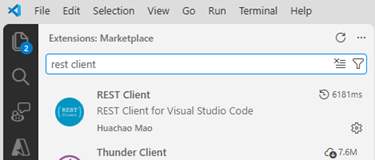

&nbsp;

2. Open [WD-RegisterExternalAgentForMCP.http](./Resources/WD-RegisterExternalAgentForMCP.http) file to Visual Studio Code

3. Set these values and then save the file. Remember that if you are using Workday Developer tenant then {REGION} = `odp` and for other tenants see [Workday tenant regions](Workday-Self-Service-Agent-Configuration-Runbook.md#workday-tenant-regions)

   - gateway: **`{REGION}`.agent.workday.com**
   - tenant: Your workday **Tenant name**
   - clientId: **Client ID** of the API you registered in the [Create Workday API Client](Workday-Self-Service-Agent-Configuration-Runbook.md#create-workday-api-client) step
   - clientSecret: **Client Secret** of the API you registered in the [Create Workday API Client](Workday-Self-Service-Agent-Configuration-Runbook.md#create-workday-api-client) step
   - code: **Authorization code** generated in the previous step

      &nbsp;

      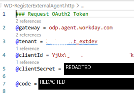

4. Click **Send Request** and if all values are correct for the API call then you should get HTTP 200 OK for successful call. Copy the **access token** value as that is needed in the next step.

    **NOTE!** If you need to run this request again then first re-authorize to get new authorization code

   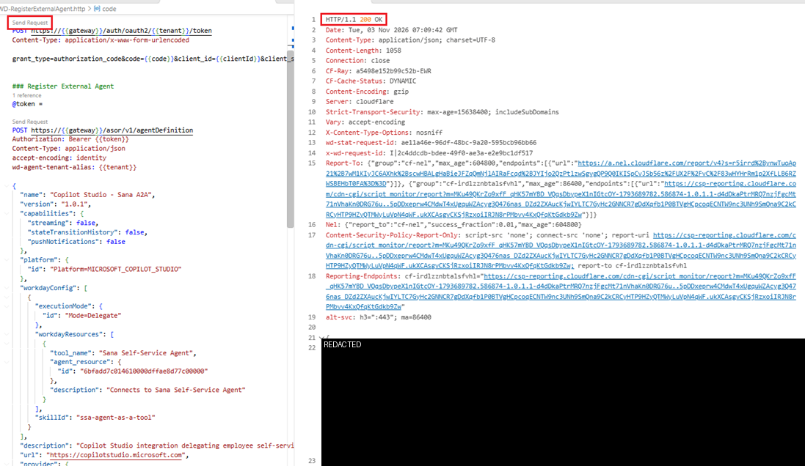

5. Paste the **access token** to @token variable value and click **Send Request**. You should get HTTP 201 Created response for successful call with body of registered agent

   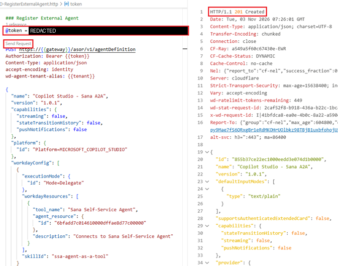


## Configure agent in Workday

In Workday, open **Agent Management Hub** to finalize external agent's configuration which was just created

1. Select the registered agent **Copilot Studio**

   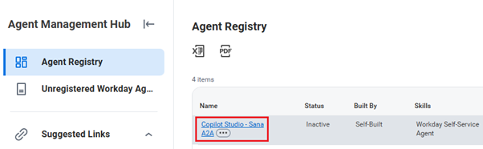

2. Select **Credentials** and click **Edit**

   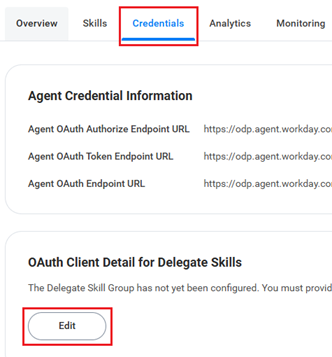

3. Set **Redirect URI** to `https://localhost` and click **OK**. **NOTE!** This is temporary URI which will be replaced later with actual Redirect URI

   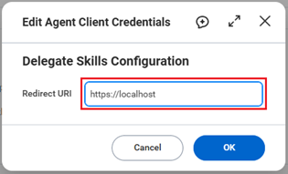

4. Click **Generate New Client Secret** and in the opened dialog select **Confirm** and click **OK**

    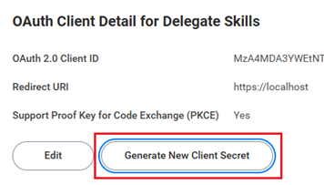

5. Copy **Client Secret** somewhere like notepad as we need that in the Power Platform side of the configuration and click **Done**

    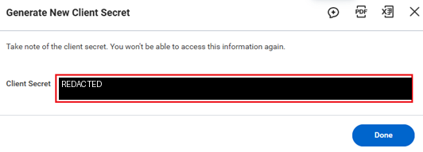

6. Click **Configure Agent**

    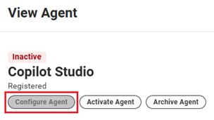

7. Enable **all** skills and define which users should be able to use it using **Available To** should be **Employee as Self** where available. Then click **Save**

    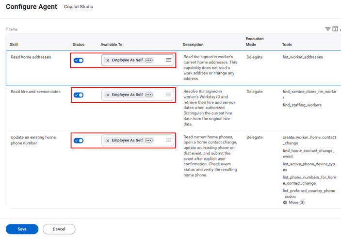

8. In Available Skills view you can select **View Security** to check and verify that all necessary skill level permissions are defined

   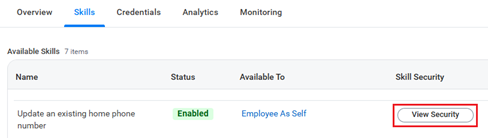

9.  Activate the agent

    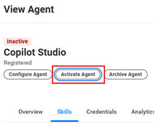

    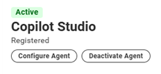

&nbsp;

## Values to collect

Collect following values which are needed in A2A configuration in Copilot Studio. That configuration will create Power Platform custom connector which we need to change in later steps

| Item | Where it comes from |
| --- | --- |
| Environment URL | The Power Platform environment that owns the connector |
| Tenant alias | Workday tenant name |
| Client ID | Workday registered external agent (MCP) OAuth client ID |
| Client Secret | Workday registered external agent (MCP) OAuth client Secret |
| Region | Host prefix from [Workday Tenant Regions](Workday-Self-Service-Agent-Configuration-Runbook.md#workday-tenant-regions)  |
| Connector redirect URL | Generated by Power Platform when connector is created |

&nbsp;

#### Build the URLs like below using your region and tenant alias

```text
MCP endpoint URL: https://{region}.agent.workday.com/{tenant-alias}/mcp
Authorize:  https://{region}.agent.workday.com/auth/authorize/{tenant-alias}
Token:      https://{region}.agent.workday.com/auth/oauth2/{tenant-alias}/token
Refresh:    https://{region}.agent.workday.com/auth/oauth2/{tenant-alias}/token
```

The connector redirect is not a URL you choose. After the connector is created it looks like this:

```text
https://global.consent.azure-apim.net/redirect/{connector-redirect-id}
```

Register that exact value on the Workday OAuth client. Each Power Platform custom connector gets its own Redirect URI. Do not reuse the Redirect URIs from another connector.


## Configure MCP in Copilot Studio

1. Open existing Copilot Studio agent or create new agent using **Microsoft Copilot Harness**

2. Select **Tools**.

   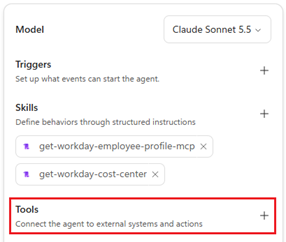

3. Select **Add** > **Model Context Protocol (MCP)**

   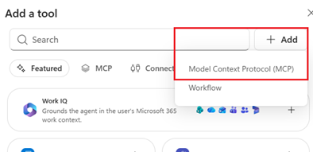

4. Paste agent endpoint URL defined [here](#build-the-urls-like-below-using-your-region-and-tenant-alias) and provide name and description

   - Name: `Workday MCP`
   - Description: `Use Workday tools for the signed-in employee’s self-service requests. Retrieve available employee information, including worker ID, name, business title, work email, work location, hire/service dates, home addresses, home phone numbers, and vacation/time-off balances. Support updating an existing home phone number and requesting eligible time off. Obtain explicit user confirmation before creating or submitting changes. Use Workday-provided identifiers, eligibility rules, dates, quantities, and units. Clearly distinguish submitted or pending requests from approved/completed changes. Use only for the employee’s own information. Not intended for general HR policy questions, other employees’ information, or unsupported changes to employment, compensation, or addresses.`
   - Server URL: `https://{region}.agent.workday.com/{WorkdayTenantName}/mcp`

    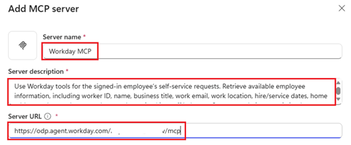

5. Select **OAuth 2.0** > **Manual** authentication and define following values. Values needed here are your Workday registered external agent **Client ID/Secret**, **Authorization** and **Token URLs**

    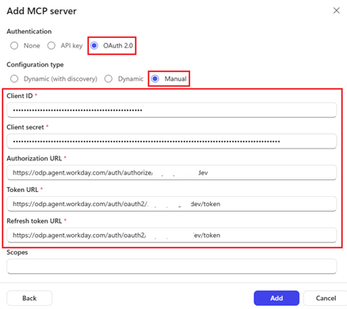

    &nbsp;

    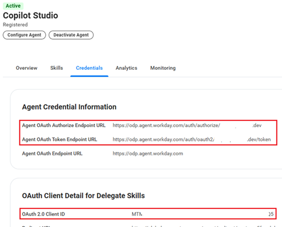

6. Click **Next** to add the MCP server

7. Copy generated **Redirect URI**

    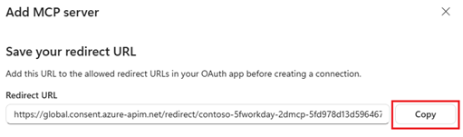

8. Go to **Workday** external agent configuration and update the **Redirect URI**

    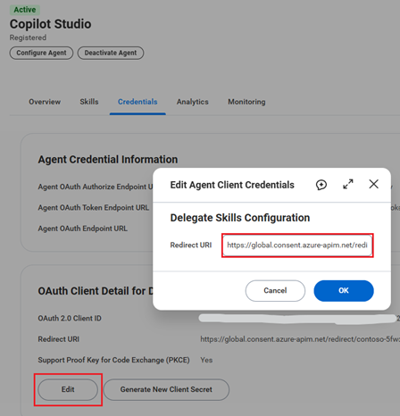

9.  Then back to Copilot Studio to create connection for the Workday MCP server

    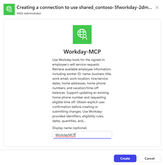

10. Test MCP in your agent for example by asking about `get my employee information`. In this example there is skill which calls several Workday MCP tools to get all needed information

    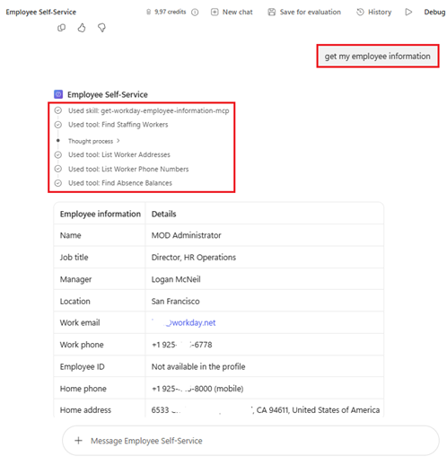