# Connect Workday agent with Copilot Studio agent using A2A

Use this when you want to integrate Copilot Studio agent with Workday Self-Service agent using A2A protocol. 

## Prerequisites

- Workday tenant and single sign-on configured between Entra ID and Workday > [Runbook - Workday Integration with Microsoft Entra ID](Workday-Developer-Tenant-and-Entra-ID-SSO-Runbook.md)
- REST API client like Visual Studio Code with REST Client extension installed

## Workday tenant regions

`{REGION}` is referenced is several steps and it is the lowercase host prefix for the data center that hosts the tenant. You can see the list of available regions from [Concept: Workday Agent Gateway](https://doc.workday.com/admin-guide/en-us/workday-ai/agents/workday-agent-gateway-for-partner-agents.html?toc=0.4). A tenant on the wrong regional host is rejected.

Build the **Workday** URLs from the region and tenant alias. **NOTE!** Workday developer tenants are always using `odp` prefix

| Region | Prefix |
| --- | --- |
| **Dev Tenants** | `odp`|
| US | `us` |
| EU | `eu` |
| UK | `uk` |
| CAN | `ca` |
| AU | `au` |
| SIN | `sg` |
| IND | `in` |
| JPN | `jp` |


## Set Up Agent System of Record (ASOR) in Workday

Configure the ASOR security domains in Workday > [Set Up Agent System of Record](https://doc.workday.com/admin-guide/en-us/workday-ai/agents/set-up-agent-system-of-record.html)

## Create Workday API client

1. Login to Workday and search and select **Register API Client** task

    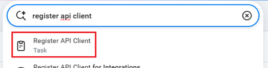

2. Provide name for the client and configure it like below:
   - Client Grant Type: **Authorization Code Grant**
   - Access Token Type: **Bearer**
   - Redirection URI: `https://localhost`
   - Scope (Functional Areas): **Agent System of Record** 
   - Include Workday Owned Scope: 
   
    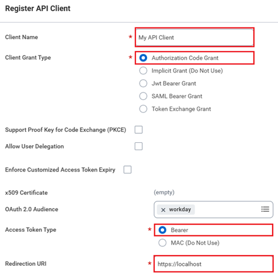

    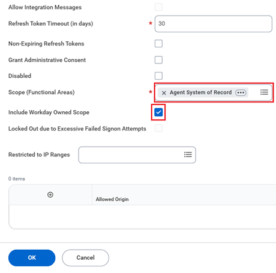

3. Copy **Client ID** and **Client Secret** as you will need them in the API calls. Client Secret can't been seen anymore after you have clicked **Done** can be 

    


## Generate auth code and token to call the APIs

Build first URL to request authorization code. Replace {REGION}, {WD-TENANT-ALIAS} and {CLIENT-ID} with you own values. Remember that if you are using Workday Developer tenant then {REGION} = `odp` and for other tenants see [Workday tenant regions](#workday-tenant-regions)

```
https://{REGION}.agent.workday.com/auth/authorize/{WD-TENANT-ALIAS}?response_type=code&client_id={CLIENT-ID}&redirect_uri=https://localhost
```
Open URL in browser, login with your Workday account and select **Allow**

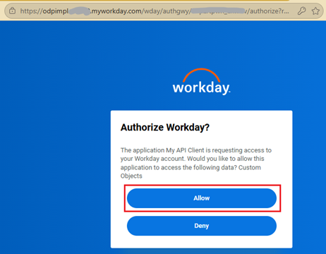 

Copy the authorization code from the redirect URL

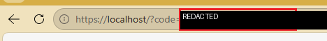

## Register External Agent in Workday

Visual Studio Code with REST Client extension is used here but you can use any REST client to 

1. Open Visual Studio Code and make sure that REST Client extension is installed
   
    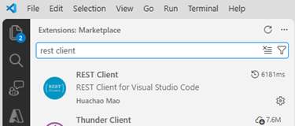

&nbsp;
2. Open [WD-RegisterExternalAgent.http](./Resources/WD-RegisterExternalAgent.http) file to Visual Studio Code
   
3. Set these values and then save the file. Remember that if you are using Workday Developer tenant then {REGION} = `odp` and for other tenants see [Workday tenant regions](#workday-tenant-regions)
   
   - gateway: **`{REGION}`.agent.workday.com**
   - tenant: Your workday **Tenant name**
   - clientId: **Client ID** of the API you registered in the [Create Workday API Client](#create-workday-api-client) step
   - clientSecret: **Client Secret** of the API you registered in the [Create Workday API Client](#create-workday-api-client) step
   - code: **Authorization code** generated in the previous step

      &nbsp;

      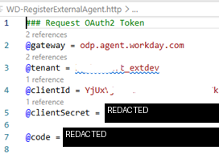

4. Click **Send Request** and if all values are correct for the API call then you should get HTTP 200 OK for successful call. Copy the **access token** value as that is needed in the next step. 
  
    **NOTE!** If you need to run this request again then first re-authorize to get new authorization code
   
   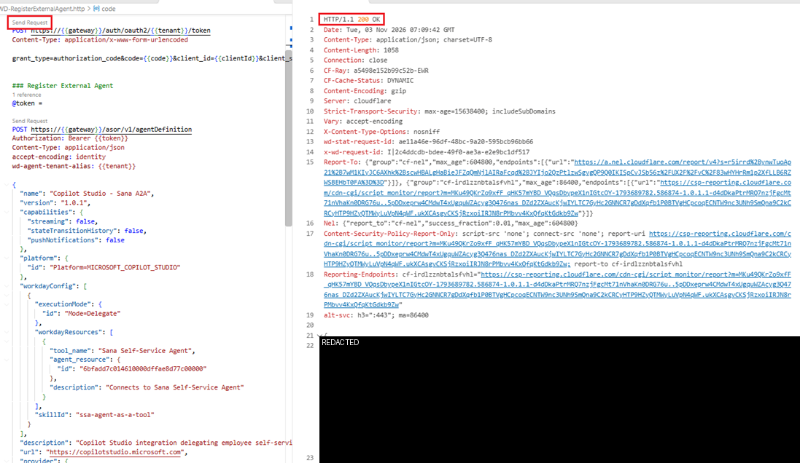

5. Paste the **access token** to @token variable value and click **Send Request**. You should get HTTP 201 Created response for successful call with body of registered agent 
   
   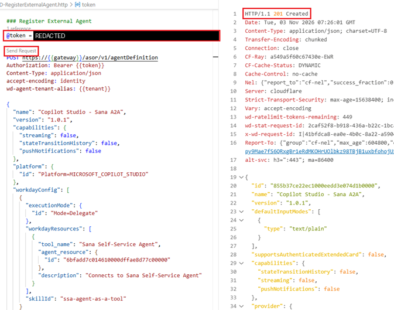


## Configure agent in Workday

In Workday, open **Agent Management Hub** to finalize external agent's configuration which was just created

1. Select the registered agent **Copilot Studio - Sana A2A**
   
   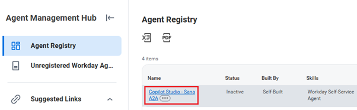

2. Select **Credentials** and click **Edit**
   
   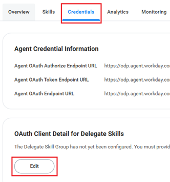

3. Set **Redirect URI** to `https://localhost` and click **OK**. **NOTE!** This is temporary URI which will be replaced later with actual Redirect URI
   
   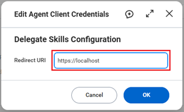

4. Click **Generate New Client Secret** and in the opened dialog select **Confirm** and click **OK**
   
    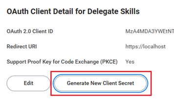

5. Copy **Client Secret** somewhere like notepad as we need that in the Power Platform side of the configuration and click **Done**

    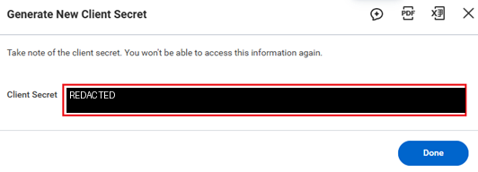

6. Click **Configure Agent**

    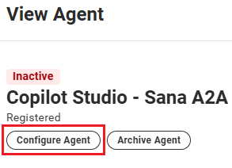

7. Enable Workday Self-Service Agent skill and define which users should be able to use it using **Available To**. Then click **Save**

    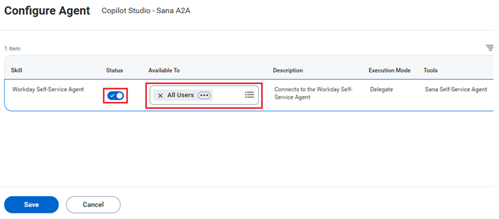


8. Activate the agent

    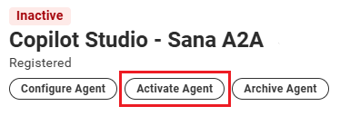

    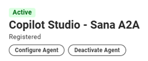

&nbsp;

## Values to collect

Collect following values which are needed in A2A configuration in Copilot Studio. That configuration will create Power Platform custom connector which we need to change in later steps

| Item | Where it comes from |
| --- | --- |
| Environment URL | The Power Platform environment that owns the connector |
| Tenant alias | Workday tenant name |
| Client ID | Workday registered external agent OAuth client ID |
| Client Secret | Workday registered external agent OAuth client Secret |
| Region | Host prefix from [Workday Tenant Regions](#workday-tenant-regions)  |
| Connector redirect URL | Generated by Power Platform when connector is created |

&nbsp;

#### Build the URLs like below using your region and tenant alias 

```text
Agent endpoint URL: https://{region}.agent.workday.com/v1/a2a/{tenant-alias}/self-service-agent
Authorize:  https://{region}.agent.workday.com/auth/authorize/{tenant-alias}
Token:      https://{region}.agent.workday.com/auth/oauth2/{tenant-alias}/token
Refresh:    https://{region}.agent.workday.com/auth/oauth2/{tenant-alias}/token
```

The connector redirect is not a URL you choose. After the connector is created it looks like this:

```text
https://global.consent.azure-apim.net/redirect/{connector-redirect-id}
```

Register that exact value on the Workday OAuth client. Each Power Platform custom connector gets its own Redirect URI. Do not reuse the Redirect URIs from another connector.


## Configure A2A in Copilot Studio

1. Open existing Copilot Studio agent or create new agent using **Microsoft Copilot Harness**
   
2. Select **Connected agents**. 
   
   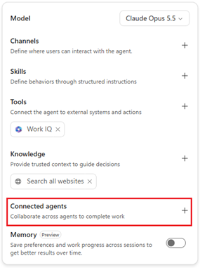

3. Select Add > **Add A2A Agent**
   
   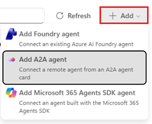

4. Paste agent endpoint URL defined [here](#build-the-urls-like-below-using-your-region-and-tenant-alias) and provide name and description
   
   - Name: `Workday-Self-Service-Agent`
   - Description: `Assist with employment-related tasks, including viewing and updating employee information, checking vacation balances, and submitting time-off requests.`

    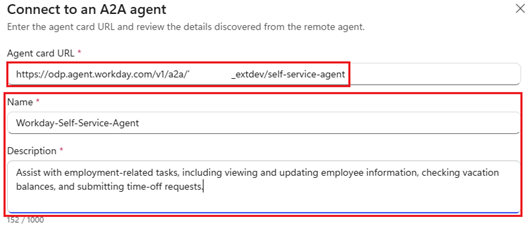
      
5. Select **OAuth 2.0** authentication and define following values. Values needed here are your Workday registered external agent Client ID/Secret, Authorization and Token URLs

    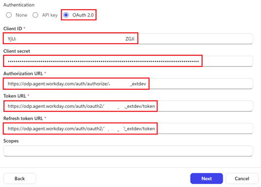

    &nbsp;

    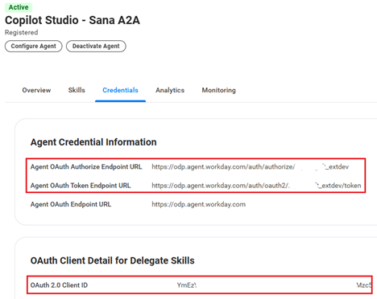

6. Click **Next** to create the A2A connector
   
7. Copy generated **Redirect URI**
   
    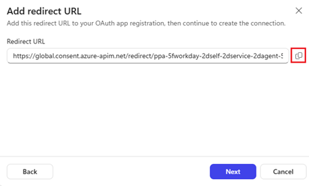

8. Go to **Workday** external agent configuration and update the **Redirect URI**

    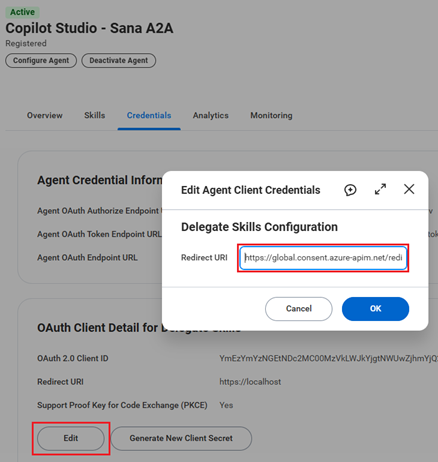

9.  Then back to Copilot Studio to create connection for the Workday A2A agent
    
    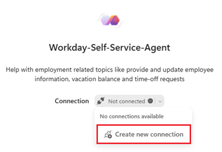

10. Test A2A in your agent for example by asking about `tell me about my employee information including home address and provide results as table`

    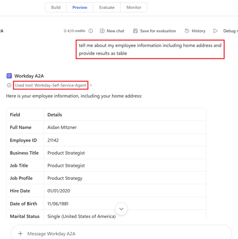

